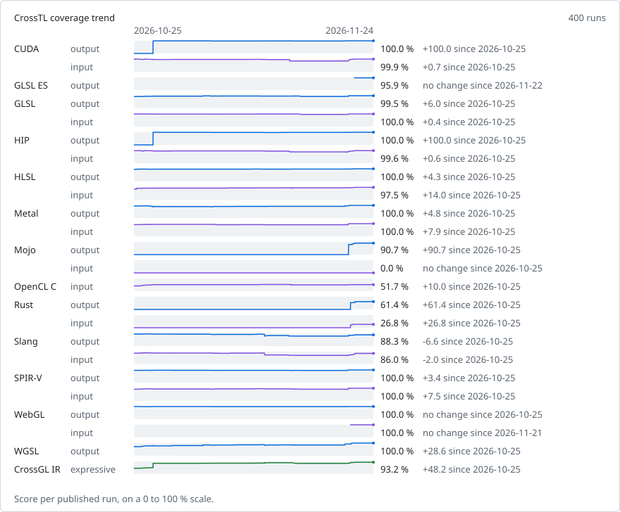

# CrossTL coverage

Measured on commit [`35ed8c7`](https://github.com/CrossGL/crosstl/commit/35ed8c7dc43264b625206cb6bf60d0858d205616) at 2026-11-24T12:11:45Z (CrossTL 3.8.0) by the [Coverage workflow](https://github.com/CrossGL/crosstl/actions/workflows/coverage.yml), which publishes this file on every push to `main` and nightly. Run `python -m tools.coverage run` to measure locally.

Every feature in a pinned upstream feature list gets a generated probe. For output, CrossTL translates a CrossGL probe to the language; for input, it imports a native probe and translates it back. The native SPIR-V probe is the module glslang compiles the GLSL probe to, and its round trip must keep the feature's instruction. The language's reference tool then validates the result:

- **supported**: the reference tool accepts the translation, which keeps the built-ins and decorations the feature needs once compiled and, where it runs, computes what the native probe computes;
- **refused**: CrossTL rejects the feature with a diagnostic;
- **wrong**: CrossTL produces output the reference tool rejects, that loses a built-in or decoration the feature needs or that computes other results, writes a placeholder comment in place of the feature, or fails without a diagnostic;
- **untested**: no probe can be built for the feature yet, or the reference tool rejects the probe itself.

Score = supported / (supported + refused + wrong). Untested features are shown separately and do not count. The CrossGL IR row covers the union of every language's output features, merged into semantic features through the SPIR-V each native probe lowers to; a semantic feature is expressible when its CrossGL probe translates correctly to at least one language that has it, or to valid SPIR-V that lowers to the same semantic feature.

The Executed column counts the compute probes that also ran on a runtime of Core's conformance harness, on the GPU or on Mesa's software drivers. A supported compute probe whose translation reads the native probe's input buffers runs next to the native probe on the same inputs, and a translation that binds other resources or writes other results is wrong. HLSL, Slang, WGSL and Rust probes run as the SPIR-V their reference compiler writes for them, and so do GLSL probes that llvmpipe's OpenGL rejects. HLSL probes also run as HLSL on Direct3D 12 WARP, and a row that ran on more than one runtime counts its probes per runtime; a probe that diverges on either is wrong. The harness has no runtime for the language of a compile-only row, so the reference tool alone decides its score; 0 means that no supported probe of the row could run.

| Language | Direction | Score | Supported | Refused | Wrong | Untested | Executed |
|---|---|---:|---:|---:|---:|---:|---|
| CUDA | output | 100.0 % | 718 | 0 | 0 | 0 | compile-only |
| CUDA | input | 99.9 % | 717 | 1 | 0 | 0 | compile-only |
| GLSL ES | output | 95.9 % | 513 | 4 | 18 | 9 | compile-only |
| GLSL ES | input | not offered | | | | | |
| GLSL | output | 99.5 % | 601 | 0 | 3 | 0 | 323 on opengl-llvmpipe, 76 on vulkan-lavapipe |
| GLSL | input | 100.0 % | 604 | 0 | 0 | 0 | 320 on opengl-llvmpipe, 79 on vulkan-lavapipe |
| HIP | output | 100.0 % | 567 | 0 | 0 | 0 | compile-only |
| HIP | input | 99.6 % | 565 | 2 | 0 | 0 | compile-only |
| HLSL | output | 100.0 % | 831 | 0 | 0 | 0 | 364 on d3d12-warp, 353 on vulkan-lavapipe |
| HLSL | input | 97.5 % | 810 | 21 | 0 | 0 | 364 on d3d12-warp, 353 on vulkan-lavapipe |
| Metal | output | 100.0 % | 545 | 0 | 0 | 0 | 452 on metal-apple |
| Metal | input | 100.0 % | 545 | 0 | 0 | 0 | 471 on metal-apple |
| Mojo | output | 90.7 % | 292 | 30 | 0 | 0 | compile-only |
| Mojo | input | 0.0 % | 0 | 322 | 0 | 0 | compile-only |
| OpenCL C | output | not offered | | | | | |
| OpenCL C | input | 51.7 % | 381 | 355 | 1 | 0 | compile-only |
| Rust | output | 61.4 % | 557 | 350 | 0 | 11 | 425 on vulkan-lavapipe |
| Rust | input | 26.8 % | 243 | 664 | 0 | 11 | 219 on vulkan-lavapipe |
| Slang | output | 88.3 % | 616 | 82 | 0 | 9 | 401 on vulkan-lavapipe |
| Slang | input | 86.0 % | 600 | 98 | 0 | 9 | 387 on vulkan-lavapipe |
| SPIR-V | output | 100.0 % | 565 | 0 | 0 | 3 | 403 on vulkan-lavapipe |
| SPIR-V | input | 100.0 % | 567 | 0 | 0 | 1 | 403 on vulkan-lavapipe |
| WebGL | output | 100.0 % | 298 | 0 | 0 | 0 | compile-only |
| WebGL | input | 100.0 % | 298 | 0 | 0 | 0 | compile-only |
| WGSL | output | 100.0 % | 403 | 0 | 0 | 1 | 321 on vulkan-lavapipe |
| WGSL | input | not offered | | | | | |
| CrossGL IR | expressiveness | 93.2 % | 1551 | 114 | 0 | 18 |  |

GLSL ES input is not offered: GLSL ES sources are read as GLSL, which the GLSL and WebGL input rows measure.
OpenCL C output is not offered: CrossTL has no OpenCL C generator.
WGSL input is not offered: CrossTL has no WGSL source frontend.

Each language also has [a page of its own](languages/index.md) with its scores by category, the translation matrix cells it is the source or target of, and its gaps.

## Translation matrix

CrossTL translates a file of one language straight to another: the source language's frontend imports it to CrossGL and the target language's code generator writes it out. A cell measures this for the features of the source's input row that the target has too, matched by the semantic feature the CrossGL IR row groups features by. CrossTL translates the source's native probe to the target in one call, and the target's reference tool checks the result as it checks the target's output row. A feature that the source's input row leaves untested is untested in the source's cells. Where both languages lower to SPIR-V (GLSL, HLSL, Rust, Slang, SPIR-V and WGSL), the native probe and its translation also run on the same runtime and must compute the same results; the other cells are compile-only.

Rows are source languages and columns are target languages. Each score links to the cell's gaps. A score in italics is the source's input row, which translates back into the source language (OpenCL C into HLSL), `none` marks two languages that share no feature, and an empty cell was not measured. The Coverage workflow measures the matrix nightly; this one was measured on commit [`35ed8c7`](https://github.com/CrossGL/crosstl/commit/35ed8c7dc43264b625206cb6bf60d0858d205616) at 2026-11-24T12:11:45Z.

| Source \ Target | CUDA | GLSL ES | GLSL | HIP | HLSL | Metal | Mojo | Rust | Slang | SPIR-V | WebGL | WGSL |
|---|---:|---:|---:|---:|---:|---:|---:|---:|---:|---:|---:|---:|
| CUDA | *99.9 %* | [90.8 %](pairs/cuda-to-gles.md) | [88.0 %](pairs/cuda-to-glsl.md) | [99.4 %](pairs/cuda-to-hip.md) | [94.7 %](pairs/cuda-to-hlsl.md) | [89.2 %](pairs/cuda-to-metal.md) | [85.5 %](pairs/cuda-to-mojo.md) | [66.8 %](pairs/cuda-to-rust.md) | [83.0 %](pairs/cuda-to-slang.md) | [85.8 %](pairs/cuda-to-spirv.md) | none | [89.1 %](pairs/cuda-to-wgsl.md) |
| GLSL | [95.9 %](pairs/glsl-to-cuda.md) | [96.7 %](pairs/glsl-to-gles.md) | *100.0 %* | [95.9 %](pairs/glsl-to-hip.md) | [94.9 %](pairs/glsl-to-hlsl.md) | [97.3 %](pairs/glsl-to-metal.md) | [94.7 %](pairs/glsl-to-mojo.md) | [4.8 %](pairs/glsl-to-rust.md) | [92.7 %](pairs/glsl-to-slang.md) | [99.2 %](pairs/glsl-to-spirv.md) | [68.2 %](pairs/glsl-to-webgl.md) | [96.7 %](pairs/glsl-to-wgsl.md) |
| HIP | [99.4 %](pairs/hip-to-cuda.md) | [92.1 %](pairs/hip-to-gles.md) | [89.5 %](pairs/hip-to-glsl.md) | *99.6 %* | [94.4 %](pairs/hip-to-hlsl.md) | [90.0 %](pairs/hip-to-metal.md) | [84.9 %](pairs/hip-to-mojo.md) | [66.5 %](pairs/hip-to-rust.md) | [83.7 %](pairs/hip-to-slang.md) | [86.9 %](pairs/hip-to-spirv.md) | none | [90.6 %](pairs/hip-to-wgsl.md) |
| HLSL | [95.4 %](pairs/hlsl-to-cuda.md) | [88.2 %](pairs/hlsl-to-gles.md) | [94.8 %](pairs/hlsl-to-glsl.md) | [95.4 %](pairs/hlsl-to-hip.md) | *97.5 %* | [96.3 %](pairs/hlsl-to-metal.md) | [0.0 %](pairs/hlsl-to-mojo.md) | [46.2 %](pairs/hlsl-to-rust.md) | [96.0 %](pairs/hlsl-to-slang.md) | [93.8 %](pairs/hlsl-to-spirv.md) | [73.3 %](pairs/hlsl-to-webgl.md) | [87.2 %](pairs/hlsl-to-wgsl.md) |
| Metal | [86.6 %](pairs/metal-to-cuda.md) | [85.0 %](pairs/metal-to-gles.md) | [93.9 %](pairs/metal-to-glsl.md) | [86.6 %](pairs/metal-to-hip.md) | [92.0 %](pairs/metal-to-hlsl.md) | *100.0 %* | [0.0 %](pairs/metal-to-mojo.md) | [69.0 %](pairs/metal-to-rust.md) | [86.0 %](pairs/metal-to-slang.md) | [91.3 %](pairs/metal-to-spirv.md) | [72.2 %](pairs/metal-to-webgl.md) | [87.7 %](pairs/metal-to-wgsl.md) |
| Mojo | [0.0 %](pairs/mojo-to-cuda.md) | [0.0 %](pairs/mojo-to-gles.md) | [0.0 %](pairs/mojo-to-glsl.md) | [0.0 %](pairs/mojo-to-hip.md) | [0.0 %](pairs/mojo-to-hlsl.md) | [0.0 %](pairs/mojo-to-metal.md) | *0.0 %* | [0.0 %](pairs/mojo-to-rust.md) | [0.0 %](pairs/mojo-to-slang.md) | [0.0 %](pairs/mojo-to-spirv.md) | none | [0.0 %](pairs/mojo-to-wgsl.md) |
| OpenCL C | [87.7 %](pairs/opencl-to-cuda.md) | [86.0 %](pairs/opencl-to-gles.md) | [91.7 %](pairs/opencl-to-glsl.md) | [87.3 %](pairs/opencl-to-hip.md) | *51.7 %* | [91.5 %](pairs/opencl-to-metal.md) | [0.0 %](pairs/opencl-to-mojo.md) | [73.0 %](pairs/opencl-to-rust.md) | [86.3 %](pairs/opencl-to-slang.md) | [91.9 %](pairs/opencl-to-spirv.md) | none | [83.7 %](pairs/opencl-to-wgsl.md) |
| Rust | [81.0 %](pairs/rust-to-cuda.md) | [35.6 %](pairs/rust-to-gles.md) | [52.8 %](pairs/rust-to-glsl.md) | [80.0 %](pairs/rust-to-hip.md) | [48.0 %](pairs/rust-to-hlsl.md) | [59.2 %](pairs/rust-to-metal.md) | [0.0 %](pairs/rust-to-mojo.md) | *26.8 %* | [56.4 %](pairs/rust-to-slang.md) | [55.2 %](pairs/rust-to-spirv.md) | [55.6 %](pairs/rust-to-webgl.md) | [52.0 %](pairs/rust-to-wgsl.md) |
| Slang | [93.7 %](pairs/slang-to-cuda.md) | [86.0 %](pairs/slang-to-gles.md) | [90.3 %](pairs/slang-to-glsl.md) | [93.4 %](pairs/slang-to-hip.md) | [90.8 %](pairs/slang-to-hlsl.md) | [93.8 %](pairs/slang-to-metal.md) | [0.0 %](pairs/slang-to-mojo.md) | [59.2 %](pairs/slang-to-rust.md) | *86.0 %* | [84.4 %](pairs/slang-to-spirv.md) | [64.7 %](pairs/slang-to-webgl.md) | [81.7 %](pairs/slang-to-wgsl.md) |
| SPIR-V | [5.2 %](pairs/spirv-to-cuda.md) | [56.6 %](pairs/spirv-to-gles.md) | [98.6 %](pairs/spirv-to-glsl.md) | [94.0 %](pairs/spirv-to-hip.md) | [93.3 %](pairs/spirv-to-hlsl.md) | [97.6 %](pairs/spirv-to-metal.md) | [0.0 %](pairs/spirv-to-mojo.md) | [3.2 %](pairs/spirv-to-rust.md) | [19.7 %](pairs/spirv-to-slang.md) | *100.0 %* | [75.0 %](pairs/spirv-to-webgl.md) | [4.4 %](pairs/spirv-to-wgsl.md) |
| WebGL | [0.0 %](pairs/webgl-to-cuda.md) | [100.0 %](pairs/webgl-to-gles.md) | [100.0 %](pairs/webgl-to-glsl.md) | [0.0 %](pairs/webgl-to-hip.md) | [99.6 %](pairs/webgl-to-hlsl.md) | [99.6 %](pairs/webgl-to-metal.md) | [97.1 %](pairs/webgl-to-mojo.md) | [4.7 %](pairs/webgl-to-rust.md) | [97.4 %](pairs/webgl-to-slang.md) | [99.7 %](pairs/webgl-to-spirv.md) | *100.0 %* | [98.4 %](pairs/webgl-to-wgsl.md) |

## Trend

## By category

Each cell counts the supported features of a category over its supported, refused and wrong ones. Untested features are left out, and a blank cell means none of the category's features could be measured.

| Language | Direction | compute | control-flow | function | graphics | method | operator | resource | stage | type |
|---|---|---:|---:|---:|---:|---:|---:|---:|---:|---:|
| CUDA | output | 18/18 | 60/60 | 512/512 | | | 34/34 | 45/45 | 1/1 | 48/48 |
| CUDA | input | 18/18 | 60/60 | 512/512 | | | 34/34 | 44/45 | 1/1 | 48/48 |
| GLSL ES | output | 28/28 | 59/59 | 219/225 | 30/41 | | 50/51 | 60/63 | 6/6 | 61/62 |
| GLSL | output | 28/28 | 59/59 | 248/251 | 69/69 | | 51/51 | 67/67 | 14/14 | 65/65 |
| GLSL | input | 28/28 | 59/59 | 251/251 | 69/69 | | 51/51 | 67/67 | 14/14 | 65/65 |
| HIP | output | 18/18 | 60/60 | 361/361 | | | 34/34 | 45/45 | 1/1 | 48/48 |
| HIP | input | 18/18 | 60/60 | 361/361 | | | 34/34 | 44/45 | 1/1 | 47/48 |
| HLSL | output | 13/13 | 62/62 | 205/205 | 63/63 | 291/291 | 50/50 | 67/67 | 14/14 | 66/66 |
| HLSL | input | 13/13 | 62/62 | 204/205 | 63/63 | 271/291 | 50/50 | 67/67 | 14/14 | 66/66 |
| Metal | output | 25/25 | 62/62 | 224/224 | 45/45 | | 51/51 | 64/64 | 7/7 | 67/67 |
| Metal | input | 25/25 | 62/62 | 224/224 | 45/45 | | 51/51 | 64/64 | 7/7 | 67/67 |
| Mojo | output | 16/16 | 47/47 | 105/135 | | | 42/42 | 29/29 | 1/1 | 52/52 |
| Mojo | input | 0/16 | 0/47 | 0/135 | | | 0/42 | 0/29 | 0/1 | 0/52 |
| OpenCL C | input | 13/18 | 48/57 | 179/515 | | | 43/44 | 42/45 | 1/1 | 55/57 |
| Rust | output | 17/17 | 54/54 | 340/584 | 25/64 | | 47/47 | 12/62 | 3/14 | 59/65 |
| Rust | input | 5/17 | 47/54 | 85/584 | 13/64 | | 34/47 | 9/62 | 2/14 | 48/65 |
| Slang | output | 24/24 | 62/62 | 267/343 | 65/67 | | 51/51 | 65/67 | 14/14 | 68/70 |
| Slang | input | 23/24 | 60/62 | 255/343 | 65/67 | | 51/51 | 66/67 | 14/14 | 66/70 |
| SPIR-V | output | 28/28 | 62/62 | 199/199 | 73/73 | | 52/52 | 67/67 | 14/14 | 70/70 |
| SPIR-V | input | 28/28 | 62/62 | 201/201 | 73/73 | | 52/52 | 67/67 | 14/14 | 70/70 |
| WebGL | output | | 58/58 | 89/89 | 12/12 | | 50/50 | 32/32 | 2/2 | 55/55 |
| WebGL | input | | 58/58 | 89/89 | 12/12 | | 50/50 | 32/32 | 2/2 | 55/55 |
| WGSL | output | 22/22 | 56/56 | 145/145 | 16/16 | | 48/48 | 57/57 | 3/3 | 56/56 |
| CrossGL IR | expressiveness | 28/28 | 62/62 | 1070/1184 | 73/73 | 113/113 | 52/52 | 67/67 | 14/14 | 72/72 |

## Feature lists

| Language | Feature list | Pinned at |
|---|---|---|
| CUDA | [LLVM 23.1.3 device-side CUDA Math API wrappers](https://github.com/llvm/llvm-project/blob/0d261d1ca552c95a8f007e061c787ac7132fbcbc/clang/lib/Headers/__clang_cuda_math.h) | `0d261d1ca552` |
| CUDA | [LLVM 23.1.3 CUDA intrinsic and atomic wrappers](https://github.com/llvm/llvm-project/blob/0d261d1ca552c95a8f007e061c787ac7132fbcbc/clang/lib/Headers/__clang_cuda_device_functions.h) | `0d261d1ca552` |
| CUDA | [LLVM 23.1.3 CUDA warp, cache-hinted load and store, and funnel shift intrinsics](https://github.com/llvm/llvm-project/blob/0d261d1ca552c95a8f007e061c787ac7132fbcbc/clang/lib/Headers/__clang_cuda_intrinsics.h) | `0d261d1ca552` |
| GLSL | [GLSL 4.60 specification, chapter 8 (built-in functions)](https://github.com/KhronosGroup/GLSL/blob/0099bf83b0288469917fc2e2972cb0a2b74d6711/chapters/builtinfunctions.adoc) | `0099bf83b028` |
| GLSL | [GL_EXT_shader_quad_control (quad votes)](https://github.com/KhronosGroup/GLSL/blob/0099bf83b0288469917fc2e2972cb0a2b74d6711/extensions/ext/GLSL_EXT_shader_quad_control.txt) | `0099bf83b028` |
| GLSL | [GL_KHR_shader_subgroup (section 8.18, shader invocation group functions)](https://github.com/KhronosGroup/GLSL/blob/0099bf83b0288469917fc2e2972cb0a2b74d6711/extensions/khr/GL_KHR_shader_subgroup.txt) | `0099bf83b028` |
| GLSL | [GL_NV_shader_subgroup_partitioned (partitioned subgroup operations)](https://github.com/KhronosGroup/GLSL/blob/0099bf83b0288469917fc2e2972cb0a2b74d6711/extensions/nv/GL_NV_shader_subgroup_partitioned.txt) | `0099bf83b028` |
| GLSL | [GL_KHR_shader_subgroup_rotate (subgroup rotations)](https://github.com/KhronosGroup/GLSL/blob/0099bf83b0288469917fc2e2972cb0a2b74d6711/extensions/khr/GL_KHR_shader_subgroup_rotate.txt) | `0099bf83b028` |
| HIP | [LLVM 17.0.6 device-side HIP math functions and intrinsics](https://github.com/llvm/llvm-project/blob/6009708b4367171ccdbf4b5905cb6a803753fe18/clang/lib/Headers/__clang_hip_math.h) | `6009708b4367` |
| HIP | [ROCm 5.7.1 HIP atomic functions](https://github.com/ROCm/clr/blob/1949b1621a802ffb1492616adbae6154bfbe64ef/hipamd/include/hip/amd_detail/amd_hip_atomic.h) | `1949b1621a80` |
| HIP | [ROCm 5.7.1 HIP device functions (integer intrinsics, conversions, barriers)](https://github.com/ROCm/clr/blob/1949b1621a802ffb1492616adbae6154bfbe64ef/hipamd/include/hip/amd_detail/amd_device_functions.h) | `1949b1621a80` |
| HIP | [ROCm 5.7.1 HIP warp shuffles and lane permutes](https://github.com/ROCm/clr/blob/1949b1621a802ffb1492616adbae6154bfbe64ef/hipamd/include/hip/amd_detail/amd_warp_functions.h) | `1949b1621a80` |
| HLSL | [DXC v1.9.2602.24 intrinsic table](https://github.com/microsoft/DirectXShaderCompiler/blob/d355aa8364d34df3f0822ba0de8d1dfc75ae6f48/utils/hct/gen_intrin_main.txt) | `d355aa8364d3` |
| HLSL | [DXC v1.10.2605.37 (Shader Model 6.10 preview) intrinsic table](https://github.com/microsoft/DirectXShaderCompiler/blob/c4d8f4f99aa221da58cd540bf2099a2889632ab6/utils/hct/gen_intrin_main.txt) | `c4d8f4f99aa2` |
| Metal | [Metal Shading Language 4.1 standard library, from Apple metal version 32023.918 (metalfe-32023.918.1)](https://github.com/CrossGL/crosstl/blob/35ed8c7dc43264b625206cb6bf60d0858d205616/tools/coverage/features/metal.txt) | this repository |
| Mojo | [Mojo 1.2.0 std.atomic functions and Atomic methods](https://github.com/modular/modular/blob/527d069ee11a41ac5320af1f9402db0a66b2b868/Mojo/stdlib/std/atomic/atomic.mojo) | `527d069ee11a` |
| Mojo | [Mojo 1.2.0 std.atomic public API](https://github.com/modular/modular/blob/527d069ee11a41ac5320af1f9402db0a66b2b868/Mojo/stdlib/std/atomic/__init__.mojo) | `527d069ee11a` |
| Mojo | [Mojo 1.2.0 std.bit functions](https://github.com/modular/modular/blob/527d069ee11a41ac5320af1f9402db0a66b2b868/Mojo/stdlib/std/bit/bit.mojo) | `527d069ee11a` |
| Mojo | [Mojo 1.2.0 std.bit public API](https://github.com/modular/modular/blob/527d069ee11a41ac5320af1f9402db0a66b2b868/Mojo/stdlib/std/bit/__init__.mojo) | `527d069ee11a` |
| Mojo | [MAX 26.7.0 max.gpu.primitives.block functions](https://github.com/modular/modular/blob/527d069ee11a41ac5320af1f9402db0a66b2b868/max/mojo/max/gpu/primitives/block.mojo) | `527d069ee11a` |
| Mojo | [MAX 26.7.0 max.gpu.primitives.id functions](https://github.com/modular/modular/blob/527d069ee11a41ac5320af1f9402db0a66b2b868/max/mojo/max/gpu/primitives/id.mojo) | `527d069ee11a` |
| Mojo | [Mojo 1.2.0 GPU index functions max.gpu re-exports](https://github.com/modular/modular/blob/527d069ee11a41ac5320af1f9402db0a66b2b868/Mojo/stdlib/std/_gpu/primitives/id.mojo) | `527d069ee11a` |
| Mojo | [MAX 26.7.0 max.gpu synchronization functions](https://github.com/modular/modular/blob/527d069ee11a41ac5320af1f9402db0a66b2b868/max/mojo/max/gpu/sync/sync.mojo) | `527d069ee11a` |
| Mojo | [MAX 26.7.0 max.gpu.sync public API](https://github.com/modular/modular/blob/527d069ee11a41ac5320af1f9402db0a66b2b868/max/mojo/max/gpu/sync/__init__.mojo) | `527d069ee11a` |
| Mojo | [MAX 26.7.0 max.gpu.primitives.warp functions](https://github.com/modular/modular/blob/527d069ee11a41ac5320af1f9402db0a66b2b868/max/mojo/max/gpu/primitives/warp.mojo) | `527d069ee11a` |
| Mojo | [Mojo 1.2.0 std.math functions](https://github.com/modular/modular/blob/527d069ee11a41ac5320af1f9402db0a66b2b868/Mojo/stdlib/std/math/math.mojo) | `527d069ee11a` |
| Mojo | [Mojo 1.2.0 std.math public API](https://github.com/modular/modular/blob/527d069ee11a41ac5320af1f9402db0a66b2b868/Mojo/stdlib/std/math/__init__.mojo) | `527d069ee11a` |
| Mojo | [Mojo 1.2.0 floating-point predicates std.math re-exports](https://github.com/modular/modular/blob/527d069ee11a41ac5320af1f9402db0a66b2b868/Mojo/stdlib/std/utils/numerics.mojo) | `527d069ee11a` |
| OpenCL C | [LLVM 18.1.3 OpenCL C built-in function declarations](https://github.com/llvm/llvm-project/blob/c13b7485b87909fcf739f62cfa382b55407433c0/clang/lib/Headers/opencl-c.h) | `c13b7485b879` |
| OpenCL C | [LLVM 18.1.3 OpenCL C as_type operators and printf](https://github.com/llvm/llvm-project/blob/c13b7485b87909fcf739f62cfa382b55407433c0/clang/lib/Headers/opencl-c-base.h) | `c13b7485b879` |
| OpenCL C | [LLVM 18.1.3 OpenCL C pipe, enqueue and address-space built-ins](https://github.com/llvm/llvm-project/blob/c13b7485b87909fcf739f62cfa382b55407433c0/clang/include/clang/Basic/Builtins.def) | `c13b7485b879` |
| OpenCL C | [LLVM 18.1.3 OpenCL C keyword operators](https://github.com/llvm/llvm-project/blob/c13b7485b87909fcf739f62cfa382b55407433c0/clang/include/clang/Basic/TokenKinds.def) | `c13b7485b879` |
| Rust | [rust-gpu 0.11.0 spirv_std::arch](https://github.com/Rust-GPU/rust-gpu/blob/62401280ab4b512c734ad1aceee7553385e17418/crates/spirv-std/src/arch.rs) | `62401280ab4b` |
| Rust | [rust-gpu 0.11.0 spirv_std::arch, module atomics](https://github.com/Rust-GPU/rust-gpu/blob/62401280ab4b512c734ad1aceee7553385e17418/crates/spirv-std/src/arch/atomics.rs) | `62401280ab4b` |
| Rust | [rust-gpu 0.11.0 spirv_std::arch, module barrier](https://github.com/Rust-GPU/rust-gpu/blob/62401280ab4b512c734ad1aceee7553385e17418/crates/spirv-std/src/arch/barrier.rs) | `62401280ab4b` |
| Rust | [glam 0.34.1 BVec2](https://github.com/bitshifter/glam-rs/blob/f5c5a6b635c5be1b7e904808175470ed0f29f4ff/src/bool/bvec2.rs) | `f5c5a6b635c5` |
| Rust | [glam 0.34.1 BVec3](https://github.com/bitshifter/glam-rs/blob/f5c5a6b635c5be1b7e904808175470ed0f29f4ff/src/bool/bvec3.rs) | `f5c5a6b635c5` |
| Rust | [glam 0.34.1 BVec4](https://github.com/bitshifter/glam-rs/blob/f5c5a6b635c5be1b7e904808175470ed0f29f4ff/src/bool/bvec4.rs) | `f5c5a6b635c5` |
| Rust | [rust-gpu 0.11.0 spirv_std::ByteAddressableBuffer methods](https://github.com/Rust-GPU/rust-gpu/blob/62401280ab4b512c734ad1aceee7553385e17418/crates/spirv-std/src/byte_addressable_buffer.rs) | `62401280ab4b` |
| Rust | [rust-gpu 0.11.0 spirv_std::arch, module demote_to_helper_invocation_ext](https://github.com/Rust-GPU/rust-gpu/blob/62401280ab4b512c734ad1aceee7553385e17418/crates/spirv-std/src/arch/demote_to_helper_invocation_ext.rs) | `62401280ab4b` |
| Rust | [rust-gpu 0.11.0 spirv_std::arch, module derivative](https://github.com/Rust-GPU/rust-gpu/blob/62401280ab4b512c734ad1aceee7553385e17418/crates/spirv-std/src/arch/derivative.rs) | `62401280ab4b` |
| Rust | [glam 0.34.1 DMat2](https://github.com/bitshifter/glam-rs/blob/f5c5a6b635c5be1b7e904808175470ed0f29f4ff/src/f64/dmat2.rs) | `f5c5a6b635c5` |
| Rust | [glam 0.34.1 DMat3](https://github.com/bitshifter/glam-rs/blob/f5c5a6b635c5be1b7e904808175470ed0f29f4ff/src/f64/dmat3.rs) | `f5c5a6b635c5` |
| Rust | [glam 0.34.1 DMat4](https://github.com/bitshifter/glam-rs/blob/f5c5a6b635c5be1b7e904808175470ed0f29f4ff/src/f64/dmat4.rs) | `f5c5a6b635c5` |
| Rust | [glam 0.34.1 DQuat](https://github.com/bitshifter/glam-rs/blob/f5c5a6b635c5be1b7e904808175470ed0f29f4ff/src/f64/dquat.rs) | `f5c5a6b635c5` |
| Rust | [glam 0.34.1 DVec2](https://github.com/bitshifter/glam-rs/blob/f5c5a6b635c5be1b7e904808175470ed0f29f4ff/src/f64/dvec2.rs) | `f5c5a6b635c5` |
| Rust | [glam 0.34.1 DVec3](https://github.com/bitshifter/glam-rs/blob/f5c5a6b635c5be1b7e904808175470ed0f29f4ff/src/f64/dvec3.rs) | `f5c5a6b635c5` |
| Rust | [glam 0.34.1 DVec4](https://github.com/bitshifter/glam-rs/blob/f5c5a6b635c5be1b7e904808175470ed0f29f4ff/src/f64/dvec4.rs) | `f5c5a6b635c5` |
| Rust | [num-traits 0.2.19 Float trait](https://github.com/rust-num/num-traits/blob/7ec3d41d39b28190ec1d42db38021107b3951f3a/src/float.rs) | `7ec3d41d39b2` |
| Rust | [rust-gpu 0.11.0 spirv_std::image Image and SampledImage methods](https://github.com/Rust-GPU/rust-gpu/blob/62401280ab4b512c734ad1aceee7553385e17418/crates/spirv-std/src/image.rs) | `62401280ab4b` |
| Rust | [glam 0.34.1 IVec2](https://github.com/bitshifter/glam-rs/blob/f5c5a6b635c5be1b7e904808175470ed0f29f4ff/src/i32/ivec2.rs) | `f5c5a6b635c5` |
| Rust | [glam 0.34.1 IVec3](https://github.com/bitshifter/glam-rs/blob/f5c5a6b635c5be1b7e904808175470ed0f29f4ff/src/i32/ivec3.rs) | `f5c5a6b635c5` |
| Rust | [glam 0.34.1 IVec4](https://github.com/bitshifter/glam-rs/blob/f5c5a6b635c5be1b7e904808175470ed0f29f4ff/src/i32/ivec4.rs) | `f5c5a6b635c5` |
| Rust | [rust-gpu 0.11.0 spirv_std debug_printf macros](https://github.com/Rust-GPU/rust-gpu/blob/62401280ab4b512c734ad1aceee7553385e17418/crates/spirv-std/macros/src/lib.rs) | `62401280ab4b` |
| Rust | [glam 0.34.1 Mat2](https://github.com/bitshifter/glam-rs/blob/f5c5a6b635c5be1b7e904808175470ed0f29f4ff/src/f32/scalar/mat2.rs) | `f5c5a6b635c5` |
| Rust | [glam 0.34.1 Mat3](https://github.com/bitshifter/glam-rs/blob/f5c5a6b635c5be1b7e904808175470ed0f29f4ff/src/f32/mat3.rs) | `f5c5a6b635c5` |
| Rust | [glam 0.34.1 Mat3A](https://github.com/bitshifter/glam-rs/blob/f5c5a6b635c5be1b7e904808175470ed0f29f4ff/src/f32/scalar/mat3a.rs) | `f5c5a6b635c5` |
| Rust | [glam 0.34.1 Mat4](https://github.com/bitshifter/glam-rs/blob/f5c5a6b635c5be1b7e904808175470ed0f29f4ff/src/f32/scalar/mat4.rs) | `f5c5a6b635c5` |
| Rust | [rust-gpu 0.11.0 spirv_std::arch, module mesh_shading](https://github.com/Rust-GPU/rust-gpu/blob/62401280ab4b512c734ad1aceee7553385e17418/crates/spirv-std/src/arch/mesh_shading.rs) | `62401280ab4b` |
| Rust | [rust-gpu 0.11.0 spirv_std::float packing functions](https://github.com/Rust-GPU/rust-gpu/blob/62401280ab4b512c734ad1aceee7553385e17418/crates/spirv-std/src/float.rs) | `62401280ab4b` |
| Rust | [rust-gpu 0.11.0 spirv_std::arch, module primitive](https://github.com/Rust-GPU/rust-gpu/blob/62401280ab4b512c734ad1aceee7553385e17418/crates/spirv-std/src/arch/primitive.rs) | `62401280ab4b` |
| Rust | [glam 0.34.1 Quat](https://github.com/bitshifter/glam-rs/blob/f5c5a6b635c5be1b7e904808175470ed0f29f4ff/src/f32/scalar/quat.rs) | `f5c5a6b635c5` |
| Rust | [rust-gpu 0.11.0 spirv_std::ray_tracing RayQuery and AccelerationStructure methods](https://github.com/Rust-GPU/rust-gpu/blob/62401280ab4b512c734ad1aceee7553385e17418/crates/spirv-std/src/ray_tracing.rs) | `62401280ab4b` |
| Rust | [rust-gpu 0.11.0 spirv_std::arch, module ray_tracing](https://github.com/Rust-GPU/rust-gpu/blob/62401280ab4b512c734ad1aceee7553385e17418/crates/spirv-std/src/arch/ray_tracing.rs) | `62401280ab4b` |
| Rust | [rust-gpu 0.11.0 spirv_std::RuntimeArray methods](https://github.com/Rust-GPU/rust-gpu/blob/62401280ab4b512c734ad1aceee7553385e17418/crates/spirv-std/src/runtime_array.rs) | `62401280ab4b` |
| Rust | [rust-gpu 0.11.0 spirv_std::arch, module subgroup](https://github.com/Rust-GPU/rust-gpu/blob/62401280ab4b512c734ad1aceee7553385e17418/crates/spirv-std/src/arch/subgroup.rs) | `62401280ab4b` |
| Rust | [glam 0.34.1 UVec2](https://github.com/bitshifter/glam-rs/blob/f5c5a6b635c5be1b7e904808175470ed0f29f4ff/src/u32/uvec2.rs) | `f5c5a6b635c5` |
| Rust | [glam 0.34.1 UVec3](https://github.com/bitshifter/glam-rs/blob/f5c5a6b635c5be1b7e904808175470ed0f29f4ff/src/u32/uvec3.rs) | `f5c5a6b635c5` |
| Rust | [glam 0.34.1 UVec4](https://github.com/bitshifter/glam-rs/blob/f5c5a6b635c5be1b7e904808175470ed0f29f4ff/src/u32/uvec4.rs) | `f5c5a6b635c5` |
| Rust | [glam 0.34.1 Vec2](https://github.com/bitshifter/glam-rs/blob/f5c5a6b635c5be1b7e904808175470ed0f29f4ff/src/f32/vec2.rs) | `f5c5a6b635c5` |
| Rust | [glam 0.34.1 Vec3](https://github.com/bitshifter/glam-rs/blob/f5c5a6b635c5be1b7e904808175470ed0f29f4ff/src/f32/vec3.rs) | `f5c5a6b635c5` |
| Rust | [glam 0.34.1 Vec3A](https://github.com/bitshifter/glam-rs/blob/f5c5a6b635c5be1b7e904808175470ed0f29f4ff/src/f32/scalar/vec3a.rs) | `f5c5a6b635c5` |
| Rust | [glam 0.34.1 Vec4](https://github.com/bitshifter/glam-rs/blob/f5c5a6b635c5be1b7e904808175470ed0f29f4ff/src/f32/scalar/vec4.rs) | `f5c5a6b635c5` |
| Slang | [Slang v2026.20 core module: HLSL-compatible built-in functions](https://github.com/shader-slang/slang/blob/d9ede2dd5836afc0e9586da18d9236b171d0faa8/source/slang/hlsl.meta.slang) | `d9ede2dd5836` |
| Slang | [Slang v2026.20 core module: core built-in functions](https://github.com/shader-slang/slang/blob/d9ede2dd5836afc0e9586da18d9236b171d0faa8/source/slang/core.meta.slang) | `d9ede2dd5836` |
| SPIR-V | [SPIR-V GLSL.std.450 extended instruction grammar](https://github.com/KhronosGroup/SPIRV-Headers/blob/496543121ce6419f23d6fa5d7194ba66c36212d2/include/spirv/unified1/extinst.glsl.std.450.grammar.json) | `496543121ce6` |
| SPIR-V | [SPIR-V core grammar (execution models, capabilities, storage classes, instructions)](https://github.com/KhronosGroup/SPIRV-Headers/blob/496543121ce6419f23d6fa5d7194ba66c36212d2/include/spirv/unified1/spirv.core.grammar.json) | `496543121ce6` |
| WebGL | [ANGLE's GLSL ES built-in function table](https://github.com/google/angle/blob/1ff891807e391d842c33d552ea26ab26b5341ef4/src/compiler/translator/builtin_function_declarations.txt) | `1ff891807e39` |
| WGSL | [Tint's WGSL built-in function definitions](https://github.com/google/dawn/blob/ff7c6960f62d4249f967a78448918eec21705a86/src/tint/lang/wgsl/wgsl.def) | `ff7c6960f62d` |

Reference tools: clang Ubuntu clang version 18.1.3 (1ubuntu1), dxc libdxcompiler.so: 1.9(5191-d355aa83)(1.9.0.5191), dxc-preview libdxcompiler.so: 1.10(5373-c4d8f4f9)(1.10.0.5373), glslangValidator Glslang Version: 11:16.6.0, hipcc HIP version: 5.7.31921-0, metal Apple metal version 32023.921 (metalfe-32023.921.6), mojo Mojo 1.2.0 (2016d0cd), naga 30.0.1, nvcc nvcc: NVIDIA (R) Cuda compiler driver, rust-gpu rust-gpu 0.11.0 (rustc 1.99.0-nightly (d453bdd8f 2026-08-14)), slangc 2026.20, spirv-as SPIRV-Tools v2026.4 ef96ed763b43b59b33b31b362f09a02b729fa1c9, spirv-dis SPIRV-Tools v2026.4 ef96ed763b43b59b33b31b362f09a02b729fa1c9, spirv-val SPIRV-Tools v2026.4 ef96ed763b43b59b33b31b362f09a02b729fa1c9.

## Gaps

Each row's wrong and refused features are grouped by diagnostic. A diagnostic drops its line numbers and writes the probe's own variables as `<probe>`, and one that several features share writes each feature's name as `<feature>`. Untested features are grouped by the reason no probe could measure them.

### CUDA input

1 gaps: 1 refused, 0 wrong

Refused, by diagnostic:

- `project.translate.undeclared-function: UndeclaredFunctionError: function 'surf2Dread' is not declared: it is neither a CrossGL built-in function nor a function, structure method, type or callable value of the program (target cuda) [project.translate.undeclared-function]`: `read-write-image`

### GLSL ES output

22 gaps: 4 refused, 18 wrong

Wrong, by cause ([open bug issues](https://github.com/CrossGL/crosstl/issues?q=is:issue%20is:open%20label:coverage%20label:bug%20label:backend:gles%20label:direction:output)):

- `'<feature>' : undeclared identifier` (8): `barycentric-coordinate`, `helper-invocation`, `layer`, `primitive-id`, `sample-index`, `sample-mask`, `sample-mask-input`, `shading-rate`
- `'rgba32f' : format requires readonly or writeonly memory qualifier` (4): `imageLoad`, `imageSize`, `imageStore`, `storage-image`
- `'variable indexing sampler array' : not supported for this version or the enabled extensions` (2): `array-of-textures-loop-index`, `array-of-textures-nonuniform-index`
- `'+' : wrong operand types: no operation '+' exists that takes a left-hand operand of type ' temp highp float' and a right operand of type ' const int' (or there is no acceptable conversion)`: `implicit-conversion`
- `'early_fragment_tests' : not supported for this version or the enabled extensions`: `early-fragment-tests`
- `'noperspective' : Reserved word.`: `noperspective-interpolation`
- `'sample' : Reserved word.`: `sample-interpolation`

Refused, by diagnostic:

- `project.translate.opengl-lowering-unsupported: OpenGLLoweringRefused: OpenGL cannot lower N constructs: GLSL version requirement: type 'double' does not exist in GLSL ES; the target is #version N es; GLSL version requirement: type 'dvec2' does not exist in GLSL ES; the target is #version N es; GLSL version requirement: type 'dvec3' does not exist in GLSL ES; the t` (3): `subgroupPartitionNV`, `subgroupPartitionedExclusiveAddNV`, `subgroupPartitionedExclusiveMulNV`
- `project.translate.opengl-scalar-conversion-unsupported: OpenGLScalarConversionError: OpenGL cannot preserve source conversion from 'half' to 'half': half unsupported profile`: `half`

9 untested: graphics 6, resource 1, type 2

- `the probe itself is rejected: ERROR: 0:2: '#extension' : extension not supported: GL_EXT_clip_cull_distance` (2): `clip-distance`, `cull-distance`
- `the probe itself is rejected: ERROR: 0:10: '64-bit integer' : not supported with this profile: es`: `int64`
- `the probe itself is rejected: ERROR: 0:10: '64-bit unsigned integer' : not supported with this profile: es`: `uint64`
- `the probe itself is rejected: ERROR: 0:2: '#extension' : extension not supported: GL_OES_viewport_array`: `viewport-index`
- `the probe itself is rejected: ERROR: 0:5: 'fragment shader interlock layout qualifier' : not supported with this profile: es`: `rasterizer-ordered-buffer`
- `the probe itself is rejected: ERROR: 0:6: 'fragment shader interlock layout qualifier' : not supported with this profile: es`: `rasterizer-ordered-image`
- `the probe itself is rejected: ERROR: 0:9: '' : array size required`: `unsized-array-of-textures`
- `the probe itself is rejected: ERROR: 0:9: 'gl_FragStencilRefARB' : undeclared identifier`: `stencil-export`

### GLSL output

3 gaps: 0 refused, 3 wrong

Wrong, by cause ([open bug issues](https://github.com/CrossGL/crosstl/issues?q=is:issue%20is:open%20label:coverage%20label:bug%20label:backend:glsl%20label:direction:output)):

- `on opengl-llvmpipe, the translation is rejected by the runtime` (3): `allInvocations`, `allInvocationsEqual`, `anyInvocation`

89 supported compute probes a runtime did not run

- `on opengl-llvmpipe, its native probe did not run (harness-error)` (65): `array-of-images`, `array-of-textures`, `array-of-textures-loop-index`, `array-of-textures-nonuniform-index`, `atomicCounter`, `atomicCounterAdd`, `atomicCounterAnd`, `atomicCounterCompSwap`, `atomicCounterDecrement`, `atomicCounterExchange`, `atomicCounterIncrement`, `atomicCounterMax`, `atomicCounterMin`, `atomicCounterOr`, `atomicCounterSubtract`, `atomicCounterXor`, `imageAtomicAdd`, `imageAtomicAnd`, `imageAtomicCompSwap`, `imageAtomicExchange`, `imageAtomicMax`, `imageAtomicMin`, `imageAtomicOr`, `imageAtomicXor`, `imageLoad`, `imageSamples`, `imageSize`, `imageStore`, `integer-storage-image`, `read-write-image`, `sampled-texture`, `shared-sampler`, `specialization-workgroup-size`, `storage-image`, `storage-image-1d`, `storage-image-3d`, `storage-image-array`, `storage-texel-buffer`, `texel-buffer`, `texelFetch`, `texelFetchOffset`, `texture-1d`, `texture-1d-array`, `texture-2d-array`, `texture-3d`, `texture-argument`, `texture-cube`, `texture-cube-array`, `texture-in-helper`, `textureGather`, `textureGatherOffset`, `textureGatherOffsets`, `textureGrad`, `textureGradOffset`, `textureLod`, `textureLodOffset`, `textureProjGrad`, `textureProjGradOffset`, `textureProjLod`, `textureProjLodOffset`, `textureQueryLevels`, `textureSamples`, `textureSize`, `unorm-storage-image`, `unsized-array-of-textures`
- `on vulkan-lavapipe, its native probe did not run (driver-rejected)` (22): `subgroupPartitionNV`, `subgroupPartitionedAddNV`, `subgroupPartitionedAndNV`, `subgroupPartitionedExclusiveAddNV`, `subgroupPartitionedExclusiveAndNV`, `subgroupPartitionedExclusiveMaxNV`, `subgroupPartitionedExclusiveMinNV`, `subgroupPartitionedExclusiveMulNV`, `subgroupPartitionedExclusiveOrNV`, `subgroupPartitionedExclusiveXorNV`, `subgroupPartitionedInclusiveAddNV`, `subgroupPartitionedInclusiveAndNV`, `subgroupPartitionedInclusiveMaxNV`, `subgroupPartitionedInclusiveMinNV`, `subgroupPartitionedInclusiveMulNV`, `subgroupPartitionedInclusiveOrNV`, `subgroupPartitionedInclusiveXorNV`, `subgroupPartitionedMaxNV`, `subgroupPartitionedMinNV`, `subgroupPartitionedMulNV`, `subgroupPartitionedOrNV`, `subgroupPartitionedXorNV`
- `on vulkan-lavapipe, its SPIR-V declares a 16-bit float, which lavapipe does not round through`: `half`
- `on vulkan-lavapipe, its native probe did not run (harness-error)`: `descriptor-set`

### GLSL input

89 supported compute probes a runtime did not run

- `on opengl-llvmpipe, its native probe did not run (harness-error)` (65): `array-of-images`, `array-of-textures`, `array-of-textures-loop-index`, `array-of-textures-nonuniform-index`, `atomicCounter`, `atomicCounterAdd`, `atomicCounterAnd`, `atomicCounterCompSwap`, `atomicCounterDecrement`, `atomicCounterExchange`, `atomicCounterIncrement`, `atomicCounterMax`, `atomicCounterMin`, `atomicCounterOr`, `atomicCounterSubtract`, `atomicCounterXor`, `imageAtomicAdd`, `imageAtomicAnd`, `imageAtomicCompSwap`, `imageAtomicExchange`, `imageAtomicMax`, `imageAtomicMin`, `imageAtomicOr`, `imageAtomicXor`, `imageLoad`, `imageSamples`, `imageSize`, `imageStore`, `integer-storage-image`, `read-write-image`, `sampled-texture`, `shared-sampler`, `specialization-workgroup-size`, `storage-image`, `storage-image-1d`, `storage-image-3d`, `storage-image-array`, `storage-texel-buffer`, `texel-buffer`, `texelFetch`, `texelFetchOffset`, `texture-1d`, `texture-1d-array`, `texture-2d-array`, `texture-3d`, `texture-argument`, `texture-cube`, `texture-cube-array`, `texture-in-helper`, `textureGather`, `textureGatherOffset`, `textureGatherOffsets`, `textureGrad`, `textureGradOffset`, `textureLod`, `textureLodOffset`, `textureProjGrad`, `textureProjGradOffset`, `textureProjLod`, `textureProjLodOffset`, `textureQueryLevels`, `textureSamples`, `textureSize`, `unorm-storage-image`, `unsized-array-of-textures`
- `on vulkan-lavapipe, its native probe did not run (driver-rejected)` (22): `subgroupPartitionNV`, `subgroupPartitionedAddNV`, `subgroupPartitionedAndNV`, `subgroupPartitionedExclusiveAddNV`, `subgroupPartitionedExclusiveAndNV`, `subgroupPartitionedExclusiveMaxNV`, `subgroupPartitionedExclusiveMinNV`, `subgroupPartitionedExclusiveMulNV`, `subgroupPartitionedExclusiveOrNV`, `subgroupPartitionedExclusiveXorNV`, `subgroupPartitionedInclusiveAddNV`, `subgroupPartitionedInclusiveAndNV`, `subgroupPartitionedInclusiveMaxNV`, `subgroupPartitionedInclusiveMinNV`, `subgroupPartitionedInclusiveMulNV`, `subgroupPartitionedInclusiveOrNV`, `subgroupPartitionedInclusiveXorNV`, `subgroupPartitionedMaxNV`, `subgroupPartitionedMinNV`, `subgroupPartitionedMulNV`, `subgroupPartitionedOrNV`, `subgroupPartitionedXorNV`
- `on vulkan-lavapipe, its SPIR-V declares a 16-bit float, which lavapipe does not round through`: `half`
- `on vulkan-lavapipe, its native probe did not run (harness-error)`: `descriptor-set`

### HIP input

2 gaps: 2 refused, 0 wrong

Refused, by diagnostic:

- `project.translate.hip-record-semantics-unsupported: HipRecordSemanticError: HIP record method call 'width' is unsupported for record 'Span' in call expression`: `struct-method`
- `project.translate.hip-surface-byte-offset-unproven: HipSurfaceByteOffsetError: surf2Dwrite cannot scale its x byte offset N: the element type is unknown, so the offset cannot be shown to be a multiple of the element size [project.translate.hip-surface-byte-offset-unproven]`: `read-write-image`

### HLSL output

260 supported compute probes a runtime did not run

- `on d3d12-warp, its native probe did not run (harness-error)` (184): `AppendStructuredBuffer.Append`, `AppendStructuredBuffer.GetDimensions`, `Buffer.GetDimensions`, `Buffer.Load`, `ConsumeStructuredBuffer.Consume`, `ConsumeStructuredBuffer.GetDimensions`, `FeedbackTexture2D.WriteSamplerFeedbackGrad`, `FeedbackTexture2D.WriteSamplerFeedbackLevel`, `FeedbackTexture2DArray.WriteSamplerFeedbackGrad`, `FeedbackTexture2DArray.WriteSamplerFeedbackLevel`, `RWBuffer.GetDimensions`, `RWBuffer.Load`, `RWByteAddressBuffer.GetDimensions`, `RWByteAddressBuffer.InterlockedAdd`, `RWByteAddressBuffer.InterlockedAdd64`, `RWByteAddressBuffer.InterlockedAnd`, `RWByteAddressBuffer.InterlockedAnd64`, `RWByteAddressBuffer.InterlockedCompareExchange`, `RWByteAddressBuffer.InterlockedCompareExchange64`, `RWByteAddressBuffer.InterlockedCompareExchangeFloatBitwise`, `RWByteAddressBuffer.InterlockedCompareStore`, `RWByteAddressBuffer.InterlockedCompareStore64`, `RWByteAddressBuffer.InterlockedCompareStoreFloatBitwise`, `RWByteAddressBuffer.InterlockedExchange`, `RWByteAddressBuffer.InterlockedExchange64`, `RWByteAddressBuffer.InterlockedExchangeFloat`, `RWByteAddressBuffer.InterlockedMax`, `RWByteAddressBuffer.InterlockedMax64`, `RWByteAddressBuffer.InterlockedMin`, `RWByteAddressBuffer.InterlockedMin64`, `RWByteAddressBuffer.InterlockedOr`, `RWByteAddressBuffer.InterlockedOr64`, `RWByteAddressBuffer.InterlockedXor`, `RWByteAddressBuffer.InterlockedXor64`, `RWByteAddressBuffer.Load`, `RWByteAddressBuffer.Load2`, `RWByteAddressBuffer.Load3`, `RWByteAddressBuffer.Load4`, `RWByteAddressBuffer.Store`, `RWByteAddressBuffer.Store2`, `RWByteAddressBuffer.Store3`, `RWByteAddressBuffer.Store4`, `RWStructuredBuffer.DecrementCounter`, `RWStructuredBuffer.GetDimensions`, `RWStructuredBuffer.IncrementCounter`, `RWStructuredBuffer.Load`, `RWTexture1D.GetDimensions`, `RWTexture1D.Load`, `RWTexture1DArray.GetDimensions`, `RWTexture1DArray.Load`, `RWTexture2D.GetDimensions`, `RWTexture2D.Load`, `RWTexture2DArray.GetDimensions`, `RWTexture2DArray.Load`, `RWTexture2DMS.GetDimensions`, `RWTexture2DMS.GetSamplePosition`, `RWTexture2DMS.Load`, `RWTexture2DMSArray.GetDimensions`, `RWTexture2DMSArray.GetSamplePosition`, `RWTexture2DMSArray.Load`, `RWTexture3D.GetDimensions`, `RWTexture3D.Load`, `Texture1D.GetDimensions`, `Texture1D.Load`, `Texture1D.SampleCmpGrad`, `Texture1D.SampleCmpLevel`, `Texture1D.SampleCmpLevelZero`, `Texture1D.SampleGrad`, `Texture1D.SampleLevel`, `Texture1DArray.GetDimensions`, `Texture1DArray.Load`, `Texture1DArray.SampleCmpGrad`, `Texture1DArray.SampleCmpLevel`, `Texture1DArray.SampleCmpLevelZero`, `Texture1DArray.SampleGrad`, `Texture1DArray.SampleLevel`, `Texture2D.Gather`, `Texture2D.GatherAlpha`, `Texture2D.GatherBlue`, `Texture2D.GatherCmp`, `Texture2D.GatherCmpAlpha`, `Texture2D.GatherCmpBlue`, `Texture2D.GatherCmpGreen`, `Texture2D.GatherCmpRed`, `Texture2D.GatherGreen`, `Texture2D.GatherRaw`, `Texture2D.GatherRed`, `Texture2D.GetDimensions`, `Texture2D.Load`, `Texture2D.SampleCmpGrad`, `Texture2D.SampleCmpLevel`, `Texture2D.SampleCmpLevelZero`, `Texture2D.SampleGrad`, `Texture2D.SampleLevel`, `Texture2DArray.Gather`, `Texture2DArray.GatherAlpha`, `Texture2DArray.GatherBlue`, `Texture2DArray.GatherCmp`, `Texture2DArray.GatherCmpAlpha`, `Texture2DArray.GatherCmpBlue`, `Texture2DArray.GatherCmpGreen`, `Texture2DArray.GatherCmpRed`, `Texture2DArray.GatherGreen`, `Texture2DArray.GatherRaw`, `Texture2DArray.GatherRed`, `Texture2DArray.GetDimensions`, `Texture2DArray.Load`, `Texture2DArray.SampleCmpGrad`, `Texture2DArray.SampleCmpLevel`, `Texture2DArray.SampleCmpLevelZero`, `Texture2DArray.SampleGrad`, `Texture2DArray.SampleLevel`, `Texture2DArrayMS.GetDimensions`, `Texture2DArrayMS.GetSamplePosition`, `Texture2DArrayMS.Load`, `Texture2DMS.GetDimensions`, `Texture2DMS.GetSamplePosition`, `Texture2DMS.Load`, `Texture3D.GetDimensions`, `Texture3D.Load`, `Texture3D.SampleGrad`, `Texture3D.SampleLevel`, `TextureCUBE.Gather`, `TextureCUBE.GatherAlpha`, `TextureCUBE.GatherBlue`, `TextureCUBE.GatherCmp`, `TextureCUBE.GatherCmpAlpha`, `TextureCUBE.GatherCmpBlue`, `TextureCUBE.GatherCmpGreen`, `TextureCUBE.GatherCmpRed`, `TextureCUBE.GatherGreen`, `TextureCUBE.GatherRed`, `TextureCUBE.GetDimensions`, `TextureCUBE.SampleCmpGrad`, `TextureCUBE.SampleCmpLevel`, `TextureCUBE.SampleCmpLevelZero`, `TextureCUBE.SampleGrad`, `TextureCUBE.SampleLevel`, `TextureCUBEArray.Gather`, `TextureCUBEArray.GatherAlpha`, `TextureCUBEArray.GatherBlue`, `TextureCUBEArray.GatherCmp`, `TextureCUBEArray.GatherCmpAlpha`, `TextureCUBEArray.GatherCmpBlue`, `TextureCUBEArray.GatherCmpGreen`, `TextureCUBEArray.GatherCmpRed`, `TextureCUBEArray.GatherGreen`, `TextureCUBEArray.GatherRed`, `TextureCUBEArray.GetDimensions`, `TextureCUBEArray.SampleCmpGrad`, `TextureCUBEArray.SampleCmpLevel`, `TextureCUBEArray.SampleCmpLevelZero`, `TextureCUBEArray.SampleGrad`, `TextureCUBEArray.SampleLevel`, `array-of-images`, `array-of-textures`, `array-of-textures-loop-index`, `array-of-textures-nonuniform-index`, `buffer-row-major-array`, `buffer-row-major-non-square`, `descriptor-set`, `integer-storage-image`, `matrix-buffer`, `push-constant`, `push-constant-offset`, `read-write-image`, `sampled-texture`, `shared-sampler`, `storage-image`, `storage-image-1d`, `storage-image-3d`, `storage-image-array`, `storage-texel-buffer`, `texel-buffer`, `texture-1d`, `texture-1d-array`, `texture-2d-array`, `texture-3d`, `texture-argument`, `texture-cube`, `texture-cube-array`, `texture-in-helper`, `unorm-storage-image`, `unsized-array-of-textures`
- `on vulkan-lavapipe, its native probe did not run (harness-error)` (150): `AppendStructuredBuffer.Append`, `AppendStructuredBuffer.GetDimensions`, `Buffer.GetDimensions`, `Buffer.Load`, `ByteAddressBuffer.GetDimensions`, `ByteAddressBuffer.Load`, `ByteAddressBuffer.Load2`, `ByteAddressBuffer.Load3`, `ByteAddressBuffer.Load4`, `ConsumeStructuredBuffer.Consume`, `ConsumeStructuredBuffer.GetDimensions`, `RWBuffer.GetDimensions`, `RWBuffer.Load`, `RWByteAddressBuffer.GetDimensions`, `RWByteAddressBuffer.InterlockedAdd`, `RWByteAddressBuffer.InterlockedAnd`, `RWByteAddressBuffer.InterlockedCompareExchange`, `RWByteAddressBuffer.InterlockedCompareStore`, `RWByteAddressBuffer.InterlockedExchange`, `RWByteAddressBuffer.InterlockedMax`, `RWByteAddressBuffer.InterlockedMin`, `RWByteAddressBuffer.InterlockedOr`, `RWByteAddressBuffer.InterlockedXor`, `RWByteAddressBuffer.Load`, `RWByteAddressBuffer.Load2`, `RWByteAddressBuffer.Load3`, `RWByteAddressBuffer.Load4`, `RWByteAddressBuffer.Store`, `RWByteAddressBuffer.Store2`, `RWByteAddressBuffer.Store3`, `RWByteAddressBuffer.Store4`, `RWStructuredBuffer.DecrementCounter`, `RWStructuredBuffer.GetDimensions`, `RWStructuredBuffer.IncrementCounter`, `RWStructuredBuffer.Load`, `RWTexture1D.GetDimensions`, `RWTexture1D.Load`, `RWTexture1DArray.GetDimensions`, `RWTexture1DArray.Load`, `RWTexture2D.GetDimensions`, `RWTexture2D.Load`, `RWTexture2DArray.GetDimensions`, `RWTexture2DArray.Load`, `RWTexture3D.GetDimensions`, `RWTexture3D.Load`, `StructuredBuffer.GetDimensions`, `StructuredBuffer.Load`, `Texture1D.GetDimensions`, `Texture1D.Load`, `Texture1D.SampleCmpGrad`, `Texture1D.SampleCmpLevel`, `Texture1D.SampleCmpLevelZero`, `Texture1D.SampleGrad`, `Texture1D.SampleLevel`, `Texture1DArray.GetDimensions`, `Texture1DArray.Load`, `Texture1DArray.SampleCmpGrad`, `Texture1DArray.SampleCmpLevel`, `Texture1DArray.SampleCmpLevelZero`, `Texture1DArray.SampleGrad`, `Texture1DArray.SampleLevel`, `Texture2D.Gather`, `Texture2D.GatherAlpha`, `Texture2D.GatherBlue`, `Texture2D.GatherCmp`, `Texture2D.GatherCmpRed`, `Texture2D.GatherGreen`, `Texture2D.GatherRed`, `Texture2D.GetDimensions`, `Texture2D.Load`, `Texture2D.SampleCmpGrad`, `Texture2D.SampleCmpLevel`, `Texture2D.SampleCmpLevelZero`, `Texture2D.SampleGrad`, `Texture2D.SampleLevel`, `Texture2DArray.Gather`, `Texture2DArray.GatherAlpha`, `Texture2DArray.GatherBlue`, `Texture2DArray.GatherCmp`, `Texture2DArray.GatherCmpRed`, `Texture2DArray.GatherGreen`, `Texture2DArray.GatherRed`, `Texture2DArray.GetDimensions`, `Texture2DArray.Load`, `Texture2DArray.SampleCmpGrad`, `Texture2DArray.SampleCmpLevel`, `Texture2DArray.SampleCmpLevelZero`, `Texture2DArray.SampleGrad`, `Texture2DArray.SampleLevel`, `Texture2DArrayMS.GetDimensions`, `Texture2DArrayMS.GetSamplePosition`, `Texture2DArrayMS.Load`, `Texture2DMS.GetDimensions`, `Texture2DMS.GetSamplePosition`, `Texture2DMS.Load`, `Texture3D.GetDimensions`, `Texture3D.Load`, `Texture3D.SampleGrad`, `Texture3D.SampleLevel`, `TextureCUBE.Gather`, `TextureCUBE.GatherAlpha`, `TextureCUBE.GatherBlue`, `TextureCUBE.GatherCmp`, `TextureCUBE.GatherCmpRed`, `TextureCUBE.GatherGreen`, `TextureCUBE.GatherRed`, `TextureCUBE.GetDimensions`, `TextureCUBE.SampleCmpGrad`, `TextureCUBE.SampleCmpLevel`, `TextureCUBE.SampleCmpLevelZero`, `TextureCUBE.SampleGrad`, `TextureCUBE.SampleLevel`, `TextureCUBEArray.Gather`, `TextureCUBEArray.GatherAlpha`, `TextureCUBEArray.GatherBlue`, `TextureCUBEArray.GatherCmp`, `TextureCUBEArray.GatherCmpRed`, `TextureCUBEArray.GatherGreen`, `TextureCUBEArray.GatherRed`, `TextureCUBEArray.GetDimensions`, `TextureCUBEArray.SampleCmpGrad`, `TextureCUBEArray.SampleCmpLevel`, `TextureCUBEArray.SampleCmpLevelZero`, `TextureCUBEArray.SampleGrad`, `TextureCUBEArray.SampleLevel`, `array-of-images`, `array-of-textures`, `array-of-textures-loop-index`, `array-of-textures-nonuniform-index`, `descriptor-set`, `integer-storage-image`, `read-write-image`, `sampled-texture`, `shared-sampler`, `storage-image`, `storage-image-1d`, `storage-image-3d`, `storage-image-array`, `storage-texel-buffer`, `texel-buffer`, `texture-1d`, `texture-1d-array`, `texture-2d-array`, `texture-3d`, `texture-argument`, `texture-cube`, `texture-cube-array`, `texture-in-helper`, `unorm-storage-image`, `unsized-array-of-textures`
- `on vulkan-lavapipe, dxc writes no SPIR-V for it` (52): `AddUint64`, `Barrier`, `DebugBreak`, `FeedbackTexture2D.WriteSamplerFeedbackGrad`, `FeedbackTexture2D.WriteSamplerFeedbackLevel`, `FeedbackTexture2DArray.WriteSamplerFeedbackGrad`, `FeedbackTexture2DArray.WriteSamplerFeedbackLevel`, `GetGroupWaveCount`, `GetGroupWaveIndex`, `InterlockedCompareExchangeFloatBitwise`, `InterlockedCompareStoreFloatBitwise`, `IsHelperLane`, `QuadReadLaneAt`, `RWByteAddressBuffer.InterlockedAdd64`, `RWByteAddressBuffer.InterlockedAnd64`, `RWByteAddressBuffer.InterlockedCompareExchange64`, `RWByteAddressBuffer.InterlockedCompareExchangeFloatBitwise`, `RWByteAddressBuffer.InterlockedCompareStore64`, `RWByteAddressBuffer.InterlockedCompareStoreFloatBitwise`, `RWByteAddressBuffer.InterlockedExchange64`, `RWByteAddressBuffer.InterlockedExchangeFloat`, `RWByteAddressBuffer.InterlockedMax64`, `RWByteAddressBuffer.InterlockedMin64`, `RWByteAddressBuffer.InterlockedOr64`, `RWByteAddressBuffer.InterlockedXor64`, `RWTexture2DMS.GetDimensions`, `RWTexture2DMS.GetSamplePosition`, `RWTexture2DMS.Load`, `RWTexture2DMSArray.GetDimensions`, `RWTexture2DMSArray.GetSamplePosition`, `RWTexture2DMSArray.Load`, `RayQuery.CandidateClusterID`, `RayQuery.CandidateTriangleObjectPositions`, `RayQuery.CommittedClusterID`, `RayQuery.CommittedTriangleObjectPositions`, `Texture2D.GatherCmpAlpha`, `Texture2D.GatherCmpBlue`, `Texture2D.GatherCmpGreen`, `Texture2D.GatherRaw`, `Texture2DArray.GatherCmpAlpha`, `Texture2DArray.GatherCmpBlue`, `Texture2DArray.GatherCmpGreen`, `Texture2DArray.GatherRaw`, `TextureCUBE.GatherCmpAlpha`, `TextureCUBE.GatherCmpBlue`, `TextureCUBE.GatherCmpGreen`, `TextureCUBEArray.GatherCmpAlpha`, `TextureCUBEArray.GatherCmpBlue`, `TextureCUBEArray.GatherCmpGreen`, `WaveMultiPrefixCountBits`, `dx::IsDebuggerPresent`, `matrix-column-assignment`
- `on d3d12-warp, it reads a ray query, which no second run repeats` (40): `RayQuery.Abort`, `RayQuery.CandidateGeometryIndex`, `RayQuery.CandidateInstanceContributionToHitGroupIndex`, `RayQuery.CandidateInstanceID`, `RayQuery.CandidateInstanceIndex`, `RayQuery.CandidateObjectRayDirection`, `RayQuery.CandidateObjectRayOrigin`, `RayQuery.CandidateObjectToWorld3x4`, `RayQuery.CandidateObjectToWorld4x3`, `RayQuery.CandidatePrimitiveIndex`, `RayQuery.CandidateProceduralPrimitiveNonOpaque`, `RayQuery.CandidateTriangleBarycentrics`, `RayQuery.CandidateTriangleFrontFace`, `RayQuery.CandidateTriangleRayT`, `RayQuery.CandidateType`, `RayQuery.CandidateWorldToObject3x4`, `RayQuery.CandidateWorldToObject4x3`, `RayQuery.CommitNonOpaqueTriangleHit`, `RayQuery.CommitProceduralPrimitiveHit`, `RayQuery.CommittedGeometryIndex`, `RayQuery.CommittedInstanceContributionToHitGroupIndex`, `RayQuery.CommittedInstanceID`, `RayQuery.CommittedInstanceIndex`, `RayQuery.CommittedObjectRayDirection`, `RayQuery.CommittedObjectRayOrigin`, `RayQuery.CommittedObjectToWorld3x4`, `RayQuery.CommittedObjectToWorld4x3`, `RayQuery.CommittedPrimitiveIndex`, `RayQuery.CommittedRayT`, `RayQuery.CommittedStatus`, `RayQuery.CommittedTriangleBarycentrics`, `RayQuery.CommittedTriangleFrontFace`, `RayQuery.CommittedWorldToObject3x4`, `RayQuery.CommittedWorldToObject4x3`, `RayQuery.Proceed`, `RayQuery.RayFlags`, `RayQuery.RayTMin`, `RayQuery.TraceRayInline`, `RayQuery.WorldRayDirection`, `RayQuery.WorldRayOrigin`
- `on vulkan-lavapipe, it reads a clock or a ray query, which no second run repeats` (40): `RayQuery.Abort`, `RayQuery.CandidateGeometryIndex`, `RayQuery.CandidateInstanceContributionToHitGroupIndex`, `RayQuery.CandidateInstanceID`, `RayQuery.CandidateInstanceIndex`, `RayQuery.CandidateObjectRayDirection`, `RayQuery.CandidateObjectRayOrigin`, `RayQuery.CandidateObjectToWorld3x4`, `RayQuery.CandidateObjectToWorld4x3`, `RayQuery.CandidatePrimitiveIndex`, `RayQuery.CandidateProceduralPrimitiveNonOpaque`, `RayQuery.CandidateTriangleBarycentrics`, `RayQuery.CandidateTriangleFrontFace`, `RayQuery.CandidateTriangleRayT`, `RayQuery.CandidateType`, `RayQuery.CandidateWorldToObject3x4`, `RayQuery.CandidateWorldToObject4x3`, `RayQuery.CommitNonOpaqueTriangleHit`, `RayQuery.CommitProceduralPrimitiveHit`, `RayQuery.CommittedGeometryIndex`, `RayQuery.CommittedInstanceContributionToHitGroupIndex`, `RayQuery.CommittedInstanceID`, `RayQuery.CommittedInstanceIndex`, `RayQuery.CommittedObjectRayDirection`, `RayQuery.CommittedObjectRayOrigin`, `RayQuery.CommittedObjectToWorld3x4`, `RayQuery.CommittedObjectToWorld4x3`, `RayQuery.CommittedPrimitiveIndex`, `RayQuery.CommittedRayT`, `RayQuery.CommittedStatus`, `RayQuery.CommittedTriangleBarycentrics`, `RayQuery.CommittedTriangleFrontFace`, `RayQuery.CommittedWorldToObject3x4`, `RayQuery.CommittedWorldToObject4x3`, `RayQuery.Proceed`, `RayQuery.RayFlags`, `RayQuery.RayTMin`, `RayQuery.TraceRayInline`, `RayQuery.WorldRayDirection`, `RayQuery.WorldRayOrigin`
- `on vulkan-lavapipe, its native probe did not run (driver-rejected)` (6): `WaveMatch`, `WaveMultiPrefixBitAnd`, `WaveMultiPrefixBitOr`, `WaveMultiPrefixBitXor`, `WaveMultiPrefixProduct`, `WaveMultiPrefixSum`
- `on d3d12-warp, its native probe did not run (driver-rejected)` (5): `ByteAddressBuffer.Load`, `ByteAddressBuffer.Load2`, `ByteAddressBuffer.Load3`, `ByteAddressBuffer.Load4`, `StructuredBuffer.Load`
- `on vulkan-lavapipe, its SPIR-V declares a 16-bit float, which lavapipe does not round through` (5): `asfloat16`, `asint16`, `asuint16`, `dot2add`, `half`
- `on d3d12-warp, its native probe did not run (invalid)` (4): `Barrier`, `asfloat16`, `dot2add`, `printf`
- `on d3d12-warp, the translation did not run (harness-error)`: `buffer-row-major-matrix`

### HLSL input

21 gaps: 21 refused, 0 wrong

Refused, by diagnostic:

- `project.translate.directx-import-unsupported: DirectXImportRefused: CrossGL cannot represent N HLSL construct: DirectX texture overload extras for <feature>: CrossGL has no operand for LOD bias (target cgl) [project.translate.directx-import-unsupported]` (6): `Texture1D.SampleCmpBias`, `Texture1DArray.SampleCmpBias`, `Texture2D.SampleCmpBias`, `Texture2DArray.SampleCmpBias`, `TextureCUBE.SampleCmpBias`, `TextureCUBEArray.SampleCmpBias`
- `project.translate.directx-import-unsupported: DirectXImportRefused: CrossGL cannot represent N HLSL construct: DirectX texture gather-compare component for Texture2D: <feature> requires a compare-gather component selector; CrossGL only represents the default/red compare gather (target cgl) [project.translate.directx-import-unsupported]` (3): `Texture2D.GatherCmpAlpha`, `Texture2D.GatherCmpBlue`, `Texture2D.GatherCmpGreen`
- `project.translate.directx-import-unsupported: DirectXImportRefused: CrossGL cannot represent N HLSL construct: DirectX texture gather-compare component for Texture2DArray: <feature> requires a compare-gather component selector; CrossGL only represents the default/red compare gather (target cgl) [project.translate.directx-import-unsupported]` (3): `Texture2DArray.GatherCmpAlpha`, `Texture2DArray.GatherCmpBlue`, `Texture2DArray.GatherCmpGreen`
- `project.translate.directx-import-unsupported: DirectXImportRefused: CrossGL cannot represent N HLSL construct: DirectX texture gather-compare component for TextureCube: <feature> requires a compare-gather component selector; CrossGL only represents the default/red compare gather (target cgl) [project.translate.directx-import-unsupported]` (3): `TextureCUBE.GatherCmpAlpha`, `TextureCUBE.GatherCmpBlue`, `TextureCUBE.GatherCmpGreen`
- `project.translate.directx-import-unsupported: DirectXImportRefused: CrossGL cannot represent N HLSL construct: DirectX texture gather-compare component for TextureCubeArray: <feature> requires a compare-gather component selector; CrossGL only represents the default/red compare gather (target cgl) [project.translate.directx-import-unsupported]` (3): `TextureCUBEArray.GatherCmpAlpha`, `TextureCUBEArray.GatherCmpBlue`, `TextureCUBEArray.GatherCmpGreen`
- `project.translate.directx-import-unsupported: DirectXImportRefused: CrossGL cannot represent N HLSL construct: DirectX texture sample-position query for RWTexture2DMS: GetSamplePosition is only available on sampled multisample textures (target cgl) [project.translate.directx-import-unsupported]`: `RWTexture2DMS.GetSamplePosition`
- `project.translate.directx-import-unsupported: DirectXImportRefused: CrossGL cannot represent N HLSL construct: DirectX texture sample-position query for RWTexture2DMSArray: GetSamplePosition is only available on sampled multisample textures (target cgl) [project.translate.directx-import-unsupported]`: `RWTexture2DMSArray.GetSamplePosition`
- `project.translate.directx-import-unsupported: DirectXImportRefused: CrossGL cannot represent N HLSL construct: DirectX tiled-resource status check CheckAccessFullyMapped: CrossGL has no residency status, so the mapped result is unknown (target cgl) [project.translate.directx-import-unsupported]`: `CheckAccessFullyMapped`

244 supported compute probes a runtime did not run

- `on d3d12-warp, its native probe did not run (harness-error)` (170): `AppendStructuredBuffer.Append`, `AppendStructuredBuffer.GetDimensions`, `Buffer.GetDimensions`, `Buffer.Load`, `ConsumeStructuredBuffer.Consume`, `ConsumeStructuredBuffer.GetDimensions`, `FeedbackTexture2D.WriteSamplerFeedbackGrad`, `FeedbackTexture2D.WriteSamplerFeedbackLevel`, `FeedbackTexture2DArray.WriteSamplerFeedbackGrad`, `FeedbackTexture2DArray.WriteSamplerFeedbackLevel`, `RWBuffer.GetDimensions`, `RWBuffer.Load`, `RWByteAddressBuffer.GetDimensions`, `RWByteAddressBuffer.InterlockedAdd`, `RWByteAddressBuffer.InterlockedAdd64`, `RWByteAddressBuffer.InterlockedAnd`, `RWByteAddressBuffer.InterlockedAnd64`, `RWByteAddressBuffer.InterlockedCompareExchange`, `RWByteAddressBuffer.InterlockedCompareExchange64`, `RWByteAddressBuffer.InterlockedCompareExchangeFloatBitwise`, `RWByteAddressBuffer.InterlockedCompareStore`, `RWByteAddressBuffer.InterlockedCompareStore64`, `RWByteAddressBuffer.InterlockedCompareStoreFloatBitwise`, `RWByteAddressBuffer.InterlockedExchange`, `RWByteAddressBuffer.InterlockedExchange64`, `RWByteAddressBuffer.InterlockedExchangeFloat`, `RWByteAddressBuffer.InterlockedMax`, `RWByteAddressBuffer.InterlockedMax64`, `RWByteAddressBuffer.InterlockedMin`, `RWByteAddressBuffer.InterlockedMin64`, `RWByteAddressBuffer.InterlockedOr`, `RWByteAddressBuffer.InterlockedOr64`, `RWByteAddressBuffer.InterlockedXor`, `RWByteAddressBuffer.InterlockedXor64`, `RWByteAddressBuffer.Load`, `RWByteAddressBuffer.Load2`, `RWByteAddressBuffer.Load3`, `RWByteAddressBuffer.Load4`, `RWByteAddressBuffer.Store`, `RWByteAddressBuffer.Store2`, `RWByteAddressBuffer.Store3`, `RWByteAddressBuffer.Store4`, `RWStructuredBuffer.DecrementCounter`, `RWStructuredBuffer.GetDimensions`, `RWStructuredBuffer.IncrementCounter`, `RWStructuredBuffer.Load`, `RWTexture1D.GetDimensions`, `RWTexture1D.Load`, `RWTexture1DArray.GetDimensions`, `RWTexture1DArray.Load`, `RWTexture2D.GetDimensions`, `RWTexture2D.Load`, `RWTexture2DArray.GetDimensions`, `RWTexture2DArray.Load`, `RWTexture2DMS.GetDimensions`, `RWTexture2DMS.Load`, `RWTexture2DMSArray.GetDimensions`, `RWTexture2DMSArray.Load`, `RWTexture3D.GetDimensions`, `RWTexture3D.Load`, `Texture1D.GetDimensions`, `Texture1D.Load`, `Texture1D.SampleCmpGrad`, `Texture1D.SampleCmpLevel`, `Texture1D.SampleCmpLevelZero`, `Texture1D.SampleGrad`, `Texture1D.SampleLevel`, `Texture1DArray.GetDimensions`, `Texture1DArray.Load`, `Texture1DArray.SampleCmpGrad`, `Texture1DArray.SampleCmpLevel`, `Texture1DArray.SampleCmpLevelZero`, `Texture1DArray.SampleGrad`, `Texture1DArray.SampleLevel`, `Texture2D.Gather`, `Texture2D.GatherAlpha`, `Texture2D.GatherBlue`, `Texture2D.GatherCmp`, `Texture2D.GatherCmpRed`, `Texture2D.GatherGreen`, `Texture2D.GatherRaw`, `Texture2D.GatherRed`, `Texture2D.GetDimensions`, `Texture2D.Load`, `Texture2D.SampleCmpGrad`, `Texture2D.SampleCmpLevel`, `Texture2D.SampleCmpLevelZero`, `Texture2D.SampleGrad`, `Texture2D.SampleLevel`, `Texture2DArray.Gather`, `Texture2DArray.GatherAlpha`, `Texture2DArray.GatherBlue`, `Texture2DArray.GatherCmp`, `Texture2DArray.GatherCmpRed`, `Texture2DArray.GatherGreen`, `Texture2DArray.GatherRaw`, `Texture2DArray.GatherRed`, `Texture2DArray.GetDimensions`, `Texture2DArray.Load`, `Texture2DArray.SampleCmpGrad`, `Texture2DArray.SampleCmpLevel`, `Texture2DArray.SampleCmpLevelZero`, `Texture2DArray.SampleGrad`, `Texture2DArray.SampleLevel`, `Texture2DArrayMS.GetDimensions`, `Texture2DArrayMS.GetSamplePosition`, `Texture2DArrayMS.Load`, `Texture2DMS.GetDimensions`, `Texture2DMS.GetSamplePosition`, `Texture2DMS.Load`, `Texture3D.GetDimensions`, `Texture3D.Load`, `Texture3D.SampleGrad`, `Texture3D.SampleLevel`, `TextureCUBE.Gather`, `TextureCUBE.GatherAlpha`, `TextureCUBE.GatherBlue`, `TextureCUBE.GatherCmp`, `TextureCUBE.GatherCmpRed`, `TextureCUBE.GatherGreen`, `TextureCUBE.GatherRed`, `TextureCUBE.GetDimensions`, `TextureCUBE.SampleCmpGrad`, `TextureCUBE.SampleCmpLevel`, `TextureCUBE.SampleCmpLevelZero`, `TextureCUBE.SampleGrad`, `TextureCUBE.SampleLevel`, `TextureCUBEArray.Gather`, `TextureCUBEArray.GatherAlpha`, `TextureCUBEArray.GatherBlue`, `TextureCUBEArray.GatherCmp`, `TextureCUBEArray.GatherCmpRed`, `TextureCUBEArray.GatherGreen`, `TextureCUBEArray.GatherRed`, `TextureCUBEArray.GetDimensions`, `TextureCUBEArray.SampleCmpGrad`, `TextureCUBEArray.SampleCmpLevel`, `TextureCUBEArray.SampleCmpLevelZero`, `TextureCUBEArray.SampleGrad`, `TextureCUBEArray.SampleLevel`, `array-of-images`, `array-of-textures`, `array-of-textures-loop-index`, `array-of-textures-nonuniform-index`, `buffer-row-major-array`, `buffer-row-major-non-square`, `descriptor-set`, `integer-storage-image`, `matrix-buffer`, `push-constant`, `push-constant-offset`, `read-write-image`, `sampled-texture`, `shared-sampler`, `storage-image`, `storage-image-1d`, `storage-image-3d`, `storage-image-array`, `storage-texel-buffer`, `texel-buffer`, `texture-1d`, `texture-1d-array`, `texture-2d-array`, `texture-3d`, `texture-argument`, `texture-cube`, `texture-cube-array`, `texture-in-helper`, `unorm-storage-image`, `unsized-array-of-textures`
- `on vulkan-lavapipe, its native probe did not run (harness-error)` (150): `AppendStructuredBuffer.Append`, `AppendStructuredBuffer.GetDimensions`, `Buffer.GetDimensions`, `Buffer.Load`, `ByteAddressBuffer.GetDimensions`, `ByteAddressBuffer.Load`, `ByteAddressBuffer.Load2`, `ByteAddressBuffer.Load3`, `ByteAddressBuffer.Load4`, `ConsumeStructuredBuffer.Consume`, `ConsumeStructuredBuffer.GetDimensions`, `RWBuffer.GetDimensions`, `RWBuffer.Load`, `RWByteAddressBuffer.GetDimensions`, `RWByteAddressBuffer.InterlockedAdd`, `RWByteAddressBuffer.InterlockedAnd`, `RWByteAddressBuffer.InterlockedCompareExchange`, `RWByteAddressBuffer.InterlockedCompareStore`, `RWByteAddressBuffer.InterlockedExchange`, `RWByteAddressBuffer.InterlockedMax`, `RWByteAddressBuffer.InterlockedMin`, `RWByteAddressBuffer.InterlockedOr`, `RWByteAddressBuffer.InterlockedXor`, `RWByteAddressBuffer.Load`, `RWByteAddressBuffer.Load2`, `RWByteAddressBuffer.Load3`, `RWByteAddressBuffer.Load4`, `RWByteAddressBuffer.Store`, `RWByteAddressBuffer.Store2`, `RWByteAddressBuffer.Store3`, `RWByteAddressBuffer.Store4`, `RWStructuredBuffer.DecrementCounter`, `RWStructuredBuffer.GetDimensions`, `RWStructuredBuffer.IncrementCounter`, `RWStructuredBuffer.Load`, `RWTexture1D.GetDimensions`, `RWTexture1D.Load`, `RWTexture1DArray.GetDimensions`, `RWTexture1DArray.Load`, `RWTexture2D.GetDimensions`, `RWTexture2D.Load`, `RWTexture2DArray.GetDimensions`, `RWTexture2DArray.Load`, `RWTexture3D.GetDimensions`, `RWTexture3D.Load`, `StructuredBuffer.GetDimensions`, `StructuredBuffer.Load`, `Texture1D.GetDimensions`, `Texture1D.Load`, `Texture1D.SampleCmpGrad`, `Texture1D.SampleCmpLevel`, `Texture1D.SampleCmpLevelZero`, `Texture1D.SampleGrad`, `Texture1D.SampleLevel`, `Texture1DArray.GetDimensions`, `Texture1DArray.Load`, `Texture1DArray.SampleCmpGrad`, `Texture1DArray.SampleCmpLevel`, `Texture1DArray.SampleCmpLevelZero`, `Texture1DArray.SampleGrad`, `Texture1DArray.SampleLevel`, `Texture2D.Gather`, `Texture2D.GatherAlpha`, `Texture2D.GatherBlue`, `Texture2D.GatherCmp`, `Texture2D.GatherCmpRed`, `Texture2D.GatherGreen`, `Texture2D.GatherRed`, `Texture2D.GetDimensions`, `Texture2D.Load`, `Texture2D.SampleCmpGrad`, `Texture2D.SampleCmpLevel`, `Texture2D.SampleCmpLevelZero`, `Texture2D.SampleGrad`, `Texture2D.SampleLevel`, `Texture2DArray.Gather`, `Texture2DArray.GatherAlpha`, `Texture2DArray.GatherBlue`, `Texture2DArray.GatherCmp`, `Texture2DArray.GatherCmpRed`, `Texture2DArray.GatherGreen`, `Texture2DArray.GatherRed`, `Texture2DArray.GetDimensions`, `Texture2DArray.Load`, `Texture2DArray.SampleCmpGrad`, `Texture2DArray.SampleCmpLevel`, `Texture2DArray.SampleCmpLevelZero`, `Texture2DArray.SampleGrad`, `Texture2DArray.SampleLevel`, `Texture2DArrayMS.GetDimensions`, `Texture2DArrayMS.GetSamplePosition`, `Texture2DArrayMS.Load`, `Texture2DMS.GetDimensions`, `Texture2DMS.GetSamplePosition`, `Texture2DMS.Load`, `Texture3D.GetDimensions`, `Texture3D.Load`, `Texture3D.SampleGrad`, `Texture3D.SampleLevel`, `TextureCUBE.Gather`, `TextureCUBE.GatherAlpha`, `TextureCUBE.GatherBlue`, `TextureCUBE.GatherCmp`, `TextureCUBE.GatherCmpRed`, `TextureCUBE.GatherGreen`, `TextureCUBE.GatherRed`, `TextureCUBE.GetDimensions`, `TextureCUBE.SampleCmpGrad`, `TextureCUBE.SampleCmpLevel`, `TextureCUBE.SampleCmpLevelZero`, `TextureCUBE.SampleGrad`, `TextureCUBE.SampleLevel`, `TextureCUBEArray.Gather`, `TextureCUBEArray.GatherAlpha`, `TextureCUBEArray.GatherBlue`, `TextureCUBEArray.GatherCmp`, `TextureCUBEArray.GatherCmpRed`, `TextureCUBEArray.GatherGreen`, `TextureCUBEArray.GatherRed`, `TextureCUBEArray.GetDimensions`, `TextureCUBEArray.SampleCmpGrad`, `TextureCUBEArray.SampleCmpLevel`, `TextureCUBEArray.SampleCmpLevelZero`, `TextureCUBEArray.SampleGrad`, `TextureCUBEArray.SampleLevel`, `array-of-images`, `array-of-textures`, `array-of-textures-loop-index`, `array-of-textures-nonuniform-index`, `descriptor-set`, `integer-storage-image`, `read-write-image`, `sampled-texture`, `shared-sampler`, `storage-image`, `storage-image-1d`, `storage-image-3d`, `storage-image-array`, `storage-texel-buffer`, `texel-buffer`, `texture-1d`, `texture-1d-array`, `texture-2d-array`, `texture-3d`, `texture-argument`, `texture-cube`, `texture-cube-array`, `texture-in-helper`, `unorm-storage-image`, `unsized-array-of-textures`
- `on d3d12-warp, it reads a ray query, which no second run repeats` (40): `RayQuery.Abort`, `RayQuery.CandidateGeometryIndex`, `RayQuery.CandidateInstanceContributionToHitGroupIndex`, `RayQuery.CandidateInstanceID`, `RayQuery.CandidateInstanceIndex`, `RayQuery.CandidateObjectRayDirection`, `RayQuery.CandidateObjectRayOrigin`, `RayQuery.CandidateObjectToWorld3x4`, `RayQuery.CandidateObjectToWorld4x3`, `RayQuery.CandidatePrimitiveIndex`, `RayQuery.CandidateProceduralPrimitiveNonOpaque`, `RayQuery.CandidateTriangleBarycentrics`, `RayQuery.CandidateTriangleFrontFace`, `RayQuery.CandidateTriangleRayT`, `RayQuery.CandidateType`, `RayQuery.CandidateWorldToObject3x4`, `RayQuery.CandidateWorldToObject4x3`, `RayQuery.CommitNonOpaqueTriangleHit`, `RayQuery.CommitProceduralPrimitiveHit`, `RayQuery.CommittedGeometryIndex`, `RayQuery.CommittedInstanceContributionToHitGroupIndex`, `RayQuery.CommittedInstanceID`, `RayQuery.CommittedInstanceIndex`, `RayQuery.CommittedObjectRayDirection`, `RayQuery.CommittedObjectRayOrigin`, `RayQuery.CommittedObjectToWorld3x4`, `RayQuery.CommittedObjectToWorld4x3`, `RayQuery.CommittedPrimitiveIndex`, `RayQuery.CommittedRayT`, `RayQuery.CommittedStatus`, `RayQuery.CommittedTriangleBarycentrics`, `RayQuery.CommittedTriangleFrontFace`, `RayQuery.CommittedWorldToObject3x4`, `RayQuery.CommittedWorldToObject4x3`, `RayQuery.Proceed`, `RayQuery.RayFlags`, `RayQuery.RayTMin`, `RayQuery.TraceRayInline`, `RayQuery.WorldRayDirection`, `RayQuery.WorldRayOrigin`
- `on vulkan-lavapipe, it reads a clock or a ray query, which no second run repeats` (40): `RayQuery.Abort`, `RayQuery.CandidateGeometryIndex`, `RayQuery.CandidateInstanceContributionToHitGroupIndex`, `RayQuery.CandidateInstanceID`, `RayQuery.CandidateInstanceIndex`, `RayQuery.CandidateObjectRayDirection`, `RayQuery.CandidateObjectRayOrigin`, `RayQuery.CandidateObjectToWorld3x4`, `RayQuery.CandidateObjectToWorld4x3`, `RayQuery.CandidatePrimitiveIndex`, `RayQuery.CandidateProceduralPrimitiveNonOpaque`, `RayQuery.CandidateTriangleBarycentrics`, `RayQuery.CandidateTriangleFrontFace`, `RayQuery.CandidateTriangleRayT`, `RayQuery.CandidateType`, `RayQuery.CandidateWorldToObject3x4`, `RayQuery.CandidateWorldToObject4x3`, `RayQuery.CommitNonOpaqueTriangleHit`, `RayQuery.CommitProceduralPrimitiveHit`, `RayQuery.CommittedGeometryIndex`, `RayQuery.CommittedInstanceContributionToHitGroupIndex`, `RayQuery.CommittedInstanceID`, `RayQuery.CommittedInstanceIndex`, `RayQuery.CommittedObjectRayDirection`, `RayQuery.CommittedObjectRayOrigin`, `RayQuery.CommittedObjectToWorld3x4`, `RayQuery.CommittedObjectToWorld4x3`, `RayQuery.CommittedPrimitiveIndex`, `RayQuery.CommittedRayT`, `RayQuery.CommittedStatus`, `RayQuery.CommittedTriangleBarycentrics`, `RayQuery.CommittedTriangleFrontFace`, `RayQuery.CommittedWorldToObject3x4`, `RayQuery.CommittedWorldToObject4x3`, `RayQuery.Proceed`, `RayQuery.RayFlags`, `RayQuery.RayTMin`, `RayQuery.TraceRayInline`, `RayQuery.WorldRayDirection`, `RayQuery.WorldRayOrigin`
- `on vulkan-lavapipe, dxc writes no SPIR-V for it` (37): `AddUint64`, `Barrier`, `DebugBreak`, `FeedbackTexture2D.WriteSamplerFeedbackGrad`, `FeedbackTexture2D.WriteSamplerFeedbackLevel`, `FeedbackTexture2DArray.WriteSamplerFeedbackGrad`, `FeedbackTexture2DArray.WriteSamplerFeedbackLevel`, `GetGroupWaveCount`, `GetGroupWaveIndex`, `InterlockedCompareExchangeFloatBitwise`, `InterlockedCompareStoreFloatBitwise`, `IsHelperLane`, `QuadReadLaneAt`, `RWByteAddressBuffer.InterlockedAdd64`, `RWByteAddressBuffer.InterlockedAnd64`, `RWByteAddressBuffer.InterlockedCompareExchange64`, `RWByteAddressBuffer.InterlockedCompareExchangeFloatBitwise`, `RWByteAddressBuffer.InterlockedCompareStore64`, `RWByteAddressBuffer.InterlockedCompareStoreFloatBitwise`, `RWByteAddressBuffer.InterlockedExchange64`, `RWByteAddressBuffer.InterlockedExchangeFloat`, `RWByteAddressBuffer.InterlockedMax64`, `RWByteAddressBuffer.InterlockedMin64`, `RWByteAddressBuffer.InterlockedOr64`, `RWByteAddressBuffer.InterlockedXor64`, `RWTexture2DMS.GetDimensions`, `RWTexture2DMS.Load`, `RWTexture2DMSArray.GetDimensions`, `RWTexture2DMSArray.Load`, `RayQuery.CandidateClusterID`, `RayQuery.CandidateTriangleObjectPositions`, `RayQuery.CommittedClusterID`, `RayQuery.CommittedTriangleObjectPositions`, `Texture2D.GatherRaw`, `Texture2DArray.GatherRaw`, `WaveMultiPrefixCountBits`, `dx::IsDebuggerPresent`
- `on vulkan-lavapipe, its native probe did not run (driver-rejected)` (6): `WaveMatch`, `WaveMultiPrefixBitAnd`, `WaveMultiPrefixBitOr`, `WaveMultiPrefixBitXor`, `WaveMultiPrefixProduct`, `WaveMultiPrefixSum`
- `on d3d12-warp, its native probe did not run (driver-rejected)` (5): `ByteAddressBuffer.Load`, `ByteAddressBuffer.Load2`, `ByteAddressBuffer.Load3`, `ByteAddressBuffer.Load4`, `StructuredBuffer.Load`
- `on vulkan-lavapipe, its SPIR-V declares a 16-bit float, which lavapipe does not round through` (5): `asfloat16`, `asint16`, `asuint16`, `dot2add`, `half`
- `on d3d12-warp, its native probe did not run (invalid)` (4): `Barrier`, `asfloat16`, `dot2add`, `printf`

### Metal output

2 supported compute probes a runtime did not run

- `on metal-apple, its native probe did not run (driver-rejected)` (2): `deinterleave`, `interleave`

### Metal input

6 supported compute probes a runtime did not run

- `on metal-apple, its native probe did not run (driver-rejected)` (6): `atomic_max`, `atomic_max_explicit`, `atomic_min`, `atomic_min_explicit`, `deinterleave`, `interleave`

### Mojo output

30 gaps: 30 refused, 0 wrong

Refused, by diagnostic:

- `project.translate.undeclared-function: UndeclaredFunctionError: function '<feature>' is not declared: it is neither a CrossGL built-in function nor a function, structure method, type or callable value of the program (target mojo) [project.translate.undeclared-function]` (18): `async_copy_arrive`, `cp_async_bulk_commit_group`, `cp_async_bulk_wait_group`, `mbarrier_arrive`, `mbarrier_arrive_expect_tx_relaxed`, `mbarrier_arrive_expect_tx_shared`, `mbarrier_init`, `mbarrier_test_wait`, `mbarrier_try_wait_parity_shared`, `named_barrier`, `named_barrier_arrive`, `s_waitcnt`, `s_waitcnt_barrier`, `scalb`, `schedule_barrier`, `sm_id`, `umma_arrive_leader_cta`, `umma_arrive_peer_cta`
- `CrossGL has no spelling for this operation: CrossGL reduces, scans and broadcasts over a subgroup only, not over a workgroup` (5): `block.broadcast`, `block.max`, `block.min`, `block.prefix_sum`, `block.sum`
- `CrossGL has no spelling for this operation: no CrossGL warp reduction applies a function the kernel passes` (2): `warp.lane_group_reduce`, `warp.reduce`
- `CrossGL has no AMD instruction scheduling groups`: `schedule_group_barrier`
- `CrossGL has no spelling for this operation: CrossGL's compare-and-swap returns the value it found, and compare_exchange returns whether it stored and writes the value it found to its expected argument`: `Atomic.compare_exchange`
- `CrossGL has no spelling for this operation: CrossGL's lane match over the whole warp is CUDA's __match_all_sync, which also returns whether the lanes agree through a pointer`: `warp.match_all`
- `CrossGL has no spelling for this operation: no CrossGL function returns a quotient and a remainder together`: `divmod`
- `project.translate.mojo-refused: MojoRefusal: Mojo has no isinf for operands of type None; its isinf takes floating-point or integer values`: `ulp`

### Mojo input

322 gaps: 322 refused, 0 wrong

Refused, by diagnostic:

- `project.translate.undeclared-type: UndeclaredTypeError: type 'MutAnyOrigin' is not declared: it is neither a CrossGL built-in type nor a structure, enumeration, type alias or generic parameter of the program (target mojo) [project.translate.undeclared-type]` (312): `Atomic.compare_exchange`, `Atomic.fetch_add`, `Atomic.load`, `Atomic.max`, `Atomic.min`, `Atomic.store`, `abs`, `acos`, `acosh`, `aggregate-equality`, `aggregate-inout-parameter`, `align_down`, `align_up`, `array`, `array-copy`, `array-initializer`, `array-of-arrays`, `array-of-structs`, `array-parameter`, `array-return`, `asin`, `asinh`, `async_copy_arrive`, `atan`, `atan2`, `atanh`, `barrier`, `barrier-in-loop`, `bit_not`, `bit_reverse`, `bit_width`, `bitwise-logic`, `block-scope`, `block.broadcast`, `block.max`, `block.min`, `block.prefix_sum`, `block.sum`, `bool-array`, `bool-bitwise`, `bool-conversion`, `bool-vector-conversion`, `bool-vector-logic`, `boolean-logic`, `break`, `buffer-in-helper`, `byte_swap`, `call-result-access`, `cbrt`, `ceil`, `ceildiv`, `chained-assignment`, `chained-conditional`, `clamp`, `comb`, `compound-assignment`, `compute`, `condition-assignment`, `conditional-expression`, `conditional-side-effect`, `const-local`, `const-parameter`, `constant-array`, `constant-array-size`, `constant-expression`, `constant-struct`, `constant-vector-array`, `continue`, `control-attribute`, `copysign`, `cos`, `cosh`, `count_leading_zeros`, `count_trailing_zeros`, `cp_async_bulk_commit_group`, `cp_async_bulk_wait_group`, `default-argument`, `deferred-initialization`, `divmod`, `double`, `early-return`, `empty-statement`, `erf`, `erfc`, `exp`, `exp2`, `expm1`, `expression-swizzle`, `factorial`, `fence`, `float-arithmetic`, `float-comparison`, `float-loop-counter`, `float-remainder`, `float-to-integer`, `floor`, `fma`, `for-loop`, `for-loop-variants`, `forward-declaration`, `frexp`, `function-call`, `function-overloading`, `gamma`, `gcd`, `generic-function`, `global-constant`, `global-shadowing`, `half`, `hypot`, `if-else`, `implicit-conversion`, `indexed-compound-assignment`, `inf`, `infinite-loop`, `inout-argument-lvalues`, `inout-parameter`, `int16`, `int64`, `int8`, `integer-arithmetic`, `integer-buffer`, `integer-condition`, `integer-division`, `integer-literal-limits`, `integer-promotion`, `integer-to-float`, `integer-vector-arithmetic`, `integer-vector-comparison`, `intrinsic-name`, `invocation-id-in-helper`, `iota`, `isclose`, `isfinite`, `isinf`, `isnan`, `j0`, `j1`, `lane_id`, `lcm`, `ldexp`, `lgamma`, `local-invocation-id`, `local-invocation-index`, `log`, `log10`, `log1p`, `log2`, `log2_ceil`, `log2_floor`, `logb`, `loop-condition-call`, `loop-counter-write`, `loop-return`, `lvalue-increment`, `max`, `mbarrier_arrive`, `mbarrier_arrive_expect_tx_relaxed`, `mbarrier_arrive_expect_tx_shared`, `mbarrier_init`, `mbarrier_test_wait`, `mbarrier_try_wait_parity_shared`, `min`, `modf`, `mulhi`, `multi-variable-loop`, `multiple-declarators`, `mulwide`, `named_barrier`, `named_barrier_arrive`, `nan`, `negation`, `nested-call`, `nested-loop`, `nested-member-assignment`, `nested-struct`, `nested-struct-buffer`, `nested-unary`, `next_power_of_two`, `nextafter`, `num-subgroups`, `num-workgroups`, `numeric-literals`, `octal-literal`, `operator-precedence`, `out-parameter-forwarding`, `perm`, `pop_count`, `pow`, `prev_power_of_two`, `read-only-buffer`, `recip`, `remainder`, `reserved-global-name`, `reserved-identifier`, `reserved-member-name`, `rotate_bits_left`, `rotate_bits_right`, `round`, `rsqrt`, `s_waitcnt`, `s_waitcnt_barrier`, `scalb`, `schedule_barrier`, `schedule_group_barrier`, `shared-memory`, `shared-struct-array`, `shared-vector-array`, `short-circuit-logic`, `sibling-redeclaration`, `signed-comparison`, `signed-division`, `signed-shift`, `signed-to-unsigned`, `sin`, `sinh`, `sm_id`, `sqrt`, `struct`, `struct-array-buffer`, `struct-array-copy`, `struct-array-member`, `struct-array-parameter`, `struct-buffer`, `struct-buffer-copy`, `struct-buffer-packing`, `struct-conditional`, `struct-constructor`, `struct-copy`, `struct-method`, `struct-parameter`, `struct-return`, `struct-vector-member`, `subgroup-id`, `subgroup-invocation-id`, `subgroup-size`, `swizzle`, `syncwarp`, `tan`, `tanh`, `trunc`, `uint16`, `uint64`, `uint8`, `ulp`, `umma_arrive_leader_cta`, `umma_arrive_peer_cta`, `uniform-array`, `uniform-bool`, `uniform-bool-vector`, `uniform-buffer`, `uniform-cbuffer-vector`, `uniform-in-helper`, `uniform-integer`, `uniform-integer-vector`, `uniform-members`, `uniform-std140-array`, `uniform-std140-vector`, `uniform-struct`, `uniform-struct-array`, `uniform-struct-copy`, `uniform-unsigned`, `uniform-vector`, `uniform-vector-array`, `uniform-vector-packing`, `unreachable-statement`, `unsigned-buffer`, `unsigned-comparison`, `unsigned-countdown`, `unsigned-division`, `unsigned-float-conversion`, `unsigned-negation`, `unsigned-shift`, `unsigned-vector-arithmetic`, `unsigned-wraparound`, `value-parameter-mutation`, `vector-array`, `vector-bitwise`, `vector-buffer`, `vector-comparison`, `vector-compound-assignment`, `vector-conditional`, `vector-constructor`, `vector-conversion`, `vector-dynamic-index`, `vector-scalar-arithmetic`, `vector-scalar-product`, `vector-shift`, `vector-unary-operators`, `void-return`, `warp.broadcast`, `warp.lane_group_max`, `warp.lane_group_min`, `warp.lane_group_sum`, `warp.match_all`, `warp.match_any`, `warp.max`, `warp.min`, `warp.prefix_sum`, `warp.shuffle_down`, `warp.shuffle_idx`, `warp.shuffle_up`, `warp.shuffle_xor`, `warp.sum`, `warp.vote`, `warp_id`, `while-loop`, `workgroup-id`, `workgroup-size`, `y0`, `y1`, `zero-initializer`
- `project.translate.undeclared-type: UndeclaredTypeError: type 'dtype' is not declared: it is neither a CrossGL built-in type nor a structure, enumeration, type alias or generic parameter of the program (target mojo) [project.translate.undeclared-type]` (2): `warp.lane_group_reduce`, `warp.reduce`
- `project.translate.crossgl-function-body-parse-failed: CrossGLFunctionBodyParseError: CrossGL could not parse the body of function '<probe>' at COMMA ',': Expected RBRACKET, got COMMA ','`: `shared-2d-array`
- `project.translate.crossgl-syntax-error: CrossGLSyntaxError: Unexpected IDENTIFIER 'thread' in a shader declaration`: `reserved-type-name`
- `project.translate.mojo-import-unsupported: MojoImportRefused: CrossGL cannot represent N Mojo construct: the empty subscript '(outp + i).bitcast[Atomic[Int32]]()[]' has no CrossGL form: the importer cannot tell a pointer dereference from another type's __getitem__() (target cgl) [project.translate.mojo-import-unsupported]`: `Atomic.fetch_sub`
- `project.translate.mojo-import-unsupported: MojoImportRefused: CrossGL cannot represent N Mojo construct: the empty subscript 'p[]' has no CrossGL form: the importer cannot tell a pointer dereference from another type's __getitem__() (target cgl) [project.translate.mojo-import-unsupported]`: `pointer-local`
- `project.translate.mojo-import-unsupported: MojoImportRefused: CrossGL cannot represent N Mojo construct: the empty subscript 'x[]' has no CrossGL form: the importer cannot tell a pointer dereference from another type's __getitem__() (target cgl) [project.translate.mojo-import-unsupported]`: `buffer-element-argument`
- `project.translate.mojo-import-unsupported: MojoImportRefused: CrossGL cannot represent N Mojo constructs: the empty subscript 'p[]' has no CrossGL form: the importer cannot tell a pointer dereference from another type's __getitem__(); the empty subscript '(q + i)[]' has no CrossGL form: the importer cannot tell a pointer dereference from another type's __getit`: `pointer-arithmetic`
- `project.translate.undeclared-type: UndeclaredTypeError: type 'MutUntrackedOrigin' is not declared: it is neither a CrossGL built-in type nor a structure, enumeration, type alias or generic parameter of the program (target mojo) [project.translate.undeclared-type]`: `shared-memory-in-helper`
- `project.translate.undeclared-type: UndeclaredTypeError: type 'Real' is not declared: it is neither a CrossGL built-in type nor a structure, enumeration, type alias or generic parameter of the program (target mojo) [project.translate.undeclared-type]`: `type-alias`

### OpenCL C input

356 gaps: 355 refused, 1 wrong

Wrong, by cause ([open bug issues](https://github.com/CrossGL/crosstl/issues?q=is:issue%20is:open%20label:coverage%20label:bug%20label:backend:opencl%20label:direction:input)):

- `cannot initialize a variable of type 'int' with an rvalue of type 'void'`: `printf`

Refused, by diagnostic:

- `project.translate.undeclared-function: UndeclaredFunctionError: function '<feature>' is not declared: it is neither a CrossGL built-in function nor a function, structure method, type or callable value of the program (target directx) [project.translate.undeclared-function]` (219): `abs_diff`, `add_sat`, `as_char`, `as_double`, `as_float`, `as_half`, `as_int`, `as_intptr_t`, `as_long`, `as_ptrdiff_t`, `as_short`, `as_size_t`, `as_uchar`, `as_uint`, `as_uintptr_t`, `as_ulong`, `as_ushort`, `async_work_group_strided_copy`, `atom_add`, `atom_and`, `atom_cmpxchg`, `atom_dec`, `atom_inc`, `atom_max`, `atom_min`, `atom_or`, `atom_sub`, `atom_xchg`, `atom_xor`, `atomic_init`, `bit_reverse`, `bitfield_extract_signed`, `bitfield_extract_unsigned`, `bitfield_insert`, `bitselect`, `dot_4x8packed_ss_int`, `dot_4x8packed_su_int`, `dot_4x8packed_us_int`, `dot_4x8packed_uu_uint`, `dot_acc_sat`, `dot_acc_sat_4x8packed_ss_int`, `dot_acc_sat_4x8packed_su_int`, `dot_acc_sat_4x8packed_us_int`, `dot_acc_sat_4x8packed_uu_uint`, `fast_distance`, `fast_length`, `fast_normalize`, `get_enqueued_local_size`, `get_enqueued_num_sub_groups`, `get_fence`, `get_global_id`, `get_global_size`, `get_group_id`, `get_image_array_size`, `get_image_channel_data_type`, `get_image_channel_order`, `get_image_depth`, `get_image_dim`, `get_image_height`, `get_image_num_mip_levels`, `get_image_width`, `get_local_id`, `get_local_size`, `get_max_sub_group_size`, `get_num_groups`, `get_num_sub_groups`, `get_sub_group_eq_mask`, `get_sub_group_ge_mask`, `get_sub_group_gt_mask`, `get_sub_group_id`, `get_sub_group_le_mask`, `get_sub_group_local_id`, `get_sub_group_lt_mask`, `get_sub_group_size`, `half_cos`, `half_divide`, `half_exp`, `half_exp10`, `half_exp2`, `half_log`, `half_log10`, `half_log2`, `half_powr`, `half_recip`, `half_rsqrt`, `half_sin`, `half_sqrt`, `half_tan`, `isequal`, `isgreater`, `isgreaterequal`, `isless`, `islessequal`, `islessgreater`, `isnotequal`, `lgamma_r`, `mad_hi`, `mad_sat`, `maxmag`, `minmag`, `mul_hi`, `native_cos`, `native_divide`, `native_exp`, `native_exp10`, `native_exp2`, `native_log`, `native_log10`, `native_log2`, `native_powr`, `native_recip`, `native_rsqrt`, `native_sin`, `native_sqrt`, `native_tan`, `pown`, `read_imageh`, `read_imagei`, `read_imageui`, `rootn`, `shuffle`, `shuffle2`, `sub_group_all`, `sub_group_any`, `sub_group_ballot`, `sub_group_ballot_bit_count`, `sub_group_ballot_bit_extract`, `sub_group_ballot_exclusive_scan`, `sub_group_ballot_find_lsb`, `sub_group_ballot_find_msb`, `sub_group_ballot_inclusive_scan`, `sub_group_broadcast`, `sub_group_broadcast_first`, `sub_group_clustered_reduce_add`, `sub_group_clustered_reduce_and`, `sub_group_clustered_reduce_logical_and`, `sub_group_clustered_reduce_logical_or`, `sub_group_clustered_reduce_logical_xor`, `sub_group_clustered_reduce_max`, `sub_group_clustered_reduce_min`, `sub_group_clustered_reduce_mul`, `sub_group_clustered_reduce_or`, `sub_group_clustered_reduce_xor`, `sub_group_clustered_rotate`, `sub_group_elect`, `sub_group_inverse_ballot`, `sub_group_non_uniform_all`, `sub_group_non_uniform_all_equal`, `sub_group_non_uniform_any`, `sub_group_non_uniform_broadcast`, `sub_group_non_uniform_reduce_add`, `sub_group_non_uniform_reduce_and`, `sub_group_non_uniform_reduce_logical_and`, `sub_group_non_uniform_reduce_logical_or`, `sub_group_non_uniform_reduce_logical_xor`, `sub_group_non_uniform_reduce_max`, `sub_group_non_uniform_reduce_min`, `sub_group_non_uniform_reduce_mul`, `sub_group_non_uniform_reduce_or`, `sub_group_non_uniform_reduce_xor`, `sub_group_non_uniform_scan_exclusive_add`, `sub_group_non_uniform_scan_exclusive_and`, `sub_group_non_uniform_scan_exclusive_logical_and`, `sub_group_non_uniform_scan_exclusive_logical_or`, `sub_group_non_uniform_scan_exclusive_logical_xor`, `sub_group_non_uniform_scan_exclusive_max`, `sub_group_non_uniform_scan_exclusive_min`, `sub_group_non_uniform_scan_exclusive_mul`, `sub_group_non_uniform_scan_exclusive_or`, `sub_group_non_uniform_scan_exclusive_xor`, `sub_group_non_uniform_scan_inclusive_add`, `sub_group_non_uniform_scan_inclusive_and`, `sub_group_non_uniform_scan_inclusive_logical_and`, `sub_group_non_uniform_scan_inclusive_logical_or`, `sub_group_non_uniform_scan_inclusive_logical_xor`, `sub_group_non_uniform_scan_inclusive_max`, `sub_group_non_uniform_scan_inclusive_min`, `sub_group_non_uniform_scan_inclusive_mul`, `sub_group_non_uniform_scan_inclusive_or`, `sub_group_non_uniform_scan_inclusive_xor`, `sub_group_reduce_add`, `sub_group_reduce_max`, `sub_group_reduce_min`, `sub_group_rotate`, `sub_group_scan_exclusive_add`, `sub_group_scan_exclusive_max`, `sub_group_scan_exclusive_min`, `sub_group_scan_inclusive_add`, `sub_group_scan_inclusive_max`, `sub_group_scan_inclusive_min`, `sub_group_shuffle`, `sub_group_shuffle_down`, `sub_group_shuffle_up`, `sub_group_shuffle_xor`, `sub_sat`, `to_global`, `to_local`, `to_private`, `upsample`, `vec_step`, `vload_half`, `vstore_half`, `vstore_half_rte`, `vstore_half_rtn`, `vstore_half_rtp`, `vstore_half_rtz`, `work_group_all`, `work_group_any`, `work_group_broadcast`, `work_group_reduce_add`, `work_group_reduce_max`, `work_group_reduce_min`, `work_group_scan_exclusive_add`, `work_group_scan_exclusive_max`, `work_group_scan_exclusive_min`, `work_group_scan_inclusive_add`, `work_group_scan_inclusive_max`, `work_group_scan_inclusive_min`, `write_imageh`
- `project.translate.directx-lowering-unsupported: DirectXLoweringRefused: DirectX cannot lower N construct: function: call to '<feature>', a built-in function of another shading language that DirectX does not define and the program does not declare (target directx) [project.translate.directx-lowering-unsupported]` (27): `atomic_load`, `atomic_load_explicit`, `atomic_store`, `atomic_store_explicit`, `cbrt`, `clz`, `ctz`, `erf`, `erfc`, `expm1`, `fdim`, `hadd`, `hypot`, `ilogb`, `lgamma`, `log1p`, `logb`, `mad24`, `mul24`, `nan`, `nextafter`, `popcount`, `remainder`, `remquo`, `rhadd`, `rotate`, `tgamma`
- `project.translate.opencl-conversion-unsupported: OpenCLConversionUnsupportedError: <feature> saturates or rounds to a N-bit integer, which the convert_sat rule family does not cover [project.translate.opencl-conversion-unsupported]` (16): `convert_long_rte`, `convert_long_rtn`, `convert_long_rtp`, `convert_long_sat`, `convert_long_sat_rte`, `convert_long_sat_rtn`, `convert_long_sat_rtp`, `convert_long_sat_rtz`, `convert_ulong_rte`, `convert_ulong_rtn`, `convert_ulong_rtp`, `convert_ulong_sat`, `convert_ulong_sat_rte`, `convert_ulong_sat_rtn`, `convert_ulong_sat_rtp`, `convert_ulong_sat_rtz`
- `project.translate.undeclared-type: UndeclaredTypeError: type 'reserve_id_t' is not declared: it is neither a CrossGL built-in type nor a structure, enumeration, type alias or generic parameter of the program (target directx) [project.translate.undeclared-type]` (13): `commit_read_pipe`, `commit_write_pipe`, `is_valid_reserve_id`, `reserve_read_pipe`, `reserve_write_pipe`, `sub_group_commit_read_pipe`, `sub_group_commit_write_pipe`, `sub_group_reserve_read_pipe`, `sub_group_reserve_write_pipe`, `work_group_commit_read_pipe`, `work_group_commit_write_pipe`, `work_group_reserve_read_pipe`, `work_group_reserve_write_pipe`
- `project.translate.directx-metal-math-function-unsupported: MetalMathFunctionUnsupportedError: <feature> is exact at integers and half-integers, which directx has no function for, and CrossTL does not lower it with an exact range reduction yet (target directx) [project.translate.directx-metal-math-function-unsupported]` (7): `acospi`, `asinpi`, `atan2pi`, `atanpi`, `cospi`, `sinpi`, `tanpi`
- `project.translate.opencl-block-unsupported: OpenCLBlockUnsupportedError: OpenCL block literals have no CrossGL equivalent: CrossGL has no closures or function values [project.translate.opencl-block-unsupported]` (5): `enqueue_kernel`, `get_kernel_max_sub_group_size_for_ndrange`, `get_kernel_preferred_work_group_size_multiple`, `get_kernel_sub_group_count_for_ndrange`, `get_kernel_work_group_size`
- `opencl.target.unsupported: OpenCLTargetUnsupportedError: opencl.target.unsupported: cannot lower OpenCL source to directx because target lowering would produce invalid artifacts: OpenCL device-side enqueue event builtins have no target equivalent: create_user_event, <feature>` (4): `is_valid_event`, `release_event`, `retain_event`, `set_user_event_status`
- `project.translate.undeclared-type: UndeclaredTypeError: type 'atomic_flag' is not declared: it is neither a CrossGL built-in type nor a structure, enumeration, type alias or generic parameter of the program (target directx) [project.translate.undeclared-type]` (4): `atomic_flag_clear`, `atomic_flag_clear_explicit`, `atomic_flag_test_and_set`, `atomic_flag_test_and_set_explicit`
- `project.translate.undeclared-type: UndeclaredTypeError: type 'pipe_i32' is not declared: it is neither a CrossGL built-in type nor a structure, enumeration, type alias or generic parameter of the program (target directx) [project.translate.undeclared-type]` (4): `get_pipe_max_packets`, `get_pipe_num_packets`, `read_pipe`, `write_pipe`
- `project.translate.opencl-conversion-unsupported: OpenCLConversionUnsupportedError: <feature> rounds to a floating-point type in mode _rtn; CrossGL conversions to floating-point types round to nearest even [project.translate.opencl-conversion-unsupported]` (3): `convert_double_rtn`, `convert_float_rtn`, `convert_half_rtn`
- `project.translate.opencl-conversion-unsupported: OpenCLConversionUnsupportedError: <feature> rounds to a floating-point type in mode _rtp; CrossGL conversions to floating-point types round to nearest even [project.translate.opencl-conversion-unsupported]` (3): `convert_double_rtp`, `convert_float_rtp`, `convert_half_rtp`
- `project.translate.opencl-conversion-unsupported: OpenCLConversionUnsupportedError: <feature> rounds to a floating-point type in mode _rtz; CrossGL conversions to floating-point types round to nearest even [project.translate.opencl-conversion-unsupported]` (3): `convert_double_rtz`, `convert_float_rtz`, `convert_half_rtz`
- `project.translate.undeclared-type: UndeclaredTypeError: type 'ndrange_t' is not declared: it is neither a CrossGL built-in type nor a structure, enumeration, type alias or generic parameter of the program (target directx) [project.translate.undeclared-type]` (3): `ndrange_1D`, `ndrange_2D`, `ndrange_3D`
- `opencl.target.unsupported: OpenCLTargetUnsupportedError: opencl.target.unsupported: cannot lower OpenCL source to directx because target lowering would produce invalid artifacts: OpenCL device-side enqueue event builtins have no target equivalent: create_user_event`: `create_user_event`
- `opencl.target.unsupported: OpenCLTargetUnsupportedError: opencl.target.unsupported: cannot lower OpenCL source to directx because target lowering would produce invalid artifacts: OpenCL device-side enqueue event builtins have no target equivalent: capture_event_profiling_info, create_user_event`: `capture_event_profiling_info`
- `opencl.target.unsupported: OpenCLTargetUnsupportedError: opencl.target.unsupported: cannot lower OpenCL source to directx because target lowering would produce invalid artifacts: OpenCL device-side enqueue event builtins have no target equivalent: create_user_event`: `enqueue_marker`
- `opencl.target.unsupported: OpenCLTargetUnsupportedError: opencl.target.unsupported: cannot lower OpenCL source to directx because target lowering would produce invalid artifacts: OpenCL event/local-memory builtins require semantics not preserved by target lowering: async_work_group_copy`: `async_work_group_copy`
- `opencl.target.unsupported: OpenCLTargetUnsupportedError: opencl.target.unsupported: cannot lower OpenCL source to directx because target lowering would produce invalid artifacts: OpenCL pointer helper parameters are not representable in target codegen: absorb(q: ptr<Pair>)`: `aggregate-inout-parameter`
- `opencl.target.unsupported: OpenCLTargetUnsupportedError: opencl.target.unsupported: cannot lower OpenCL source to directx because target lowering would produce invalid artifacts: OpenCL pointer helper parameters are not representable in target codegen: advance(k: ptr<i32>)`: `loop-condition-call`
- `opencl.target.unsupported: OpenCLTargetUnsupportedError: opencl.target.unsupported: cannot lower OpenCL source to directx because target lowering would produce invalid artifacts: OpenCL pointer helper parameters are not representable in target codegen: bump(a: ptr<f32>)`: `inout-parameter`
- `opencl.target.unsupported: OpenCLTargetUnsupportedError: opencl.target.unsupported: cannot lower OpenCL source to directx because target lowering would produce invalid artifacts: OpenCL pointer helper parameters are not representable in target codegen: bump(k: ptr<i32>), leap(k: ptr<i32>)`: `conditional-side-effect`
- `opencl.target.unsupported: OpenCLTargetUnsupportedError: opencl.target.unsupported: cannot lower OpenCL source to directx because target lowering would produce invalid artifacts: OpenCL pointer helper parameters are not representable in target codegen: copy2(a: ptr<f32>), copy2(b: ptr<f32>), grow(a: ptr<f32>)`: `inout-argument-lvalues`
- `opencl.target.unsupported: OpenCLTargetUnsupportedError: opencl.target.unsupported: cannot lower OpenCL source to directx because target lowering would produce invalid artifacts: OpenCL pointer helper parameters are not representable in target codegen: deposit(iin: ptr<i32>), deposit(outp: ptr<f32>), fetch(iin: ptr<i32>), put(outp: ptr<f32>)`: `buffer-in-helper`
- `opencl.target.unsupported: OpenCLTargetUnsupportedError: opencl.target.unsupported: cannot lower OpenCL source to directx because target lowering would produce invalid artifacts: OpenCL pointer helper parameters are not representable in target codegen: exchange(tile: ptr<f32>), stash(tile: ptr<f32>)`: `shared-memory-in-helper`
- `opencl.target.unsupported: OpenCLTargetUnsupportedError: opencl.target.unsupported: cannot lower OpenCL source to directx because target lowering would produce invalid artifacts: OpenCL pointer helper parameters are not representable in target codegen: grow(x: ptr<f32>)`: `buffer-element-argument`
- `opencl.target.unsupported: OpenCLTargetUnsupportedError: opencl.target.unsupported: cannot lower OpenCL source to directx because target lowering would produce invalid artifacts: OpenCL pointer helper parameters are not representable in target codegen: inner(r: ptr<f32>), inner(s: ptr<f32>), outer(r: ptr<f32>), outer(s: ptr<f32>)`: `out-parameter-forwarding`
- `opencl.target.unsupported: OpenCLTargetUnsupportedError: opencl.target.unsupported: cannot lower OpenCL source to directx because target lowering would produce invalid artifacts: OpenCL pointer helper parameters are not representable in target codegen: limit(x: ptr<f32>)`: `void-return`
- `opencl.target.unsupported: OpenCLTargetUnsupportedError: opencl.target.unsupported: cannot lower OpenCL source to directx because target lowering would produce invalid artifacts: OpenCL pointer helper parameters are not representable in target codegen: slot(k: ptr<i32>)`: `indexed-compound-assignment`
- `opencl.target.unsupported: OpenCLTargetUnsupportedError: opencl.target.unsupported: cannot lower OpenCL source to directx because target lowering would produce invalid artifacts: OpenCL pointer helper parameters are not representable in target codegen: split(a: ptr<f32>), split(b: ptr<f32>)`: `out-parameter`
- `opencl.target.unsupported: OpenCLTargetUnsupportedError: opencl.target.unsupported: cannot lower OpenCL source to directx because target lowering would produce invalid artifacts: unresolved non-void helper declarations without bodies: twice`: `forward-declaration`
- `project.translate.directx-contextual-conversion-unrepresentable: DirectXContextualConversionError: DirectX canonical select requires a resolved boolean scalar or vector condition`: `select`
- `project.translate.directx-software-subgroup-invalid: DirectXSoftwareSubgroupError: DirectX subgroup execution barriers require checked software subgroup lowering with uniform workgroup participation`: `sub_group_barrier`
- `project.translate.directx-unnormalized-sampler-coordinates-unsupported: FixedSamplerCoordinatesUnsupportedError: fixed sampler 'u1' uses pixel coordinates (coord::pixel), which directx cannot bind: Direct3D samplers have no unnormalized coordinates, and Vulkan allows them only for single-level images sampled without LOD, offsets or comparison (target directx) [project.translate.directx-unnormaliz…`: `read_imagef`
- `project.translate.opencl-global-variable-unsupported: OpenCLGlobalVariableUnsupportedError: OpenCL C program-scope variable 'acc' is in the global address space: it is one object that every work-item writes and that keeps its value between kernel launches, and CrossGL has no such variable (a module-scope var is one copy per invocation, and the OpenCL host cannot bind a storage buffer to it`: `device-global`
- `project.translate.opencl-image-read-unsupported: OpenCLImageReadUnsupportedError: read_imagef on tex: image1d_buffer_t has no CrossGL read (a depth image read returns one float, and a buffer image is not a texture) [project.translate.opencl-image-read-unsupported]`: `texel-buffer`
- `project.translate.opencl-record-semantics-unsupported: OpenCLRecordSemanticError: OpenCL union overlapping storage access from 'f' to 'u' is unsupported for record 'Bits' in object 'b'`: `union`
- `project.translate.opencl-work-item-unsupported: OpenCLWorkItemUnsupportedError: OpenCL C get_work_dim() returns the number of dimensions the host passes to clEnqueueNDRangeKernel, which no CrossGL target exposes to a kernel [project.translate.opencl-work-item-unsupported]`: `get_work_dim`
- `project.translate.undeclared-function: UndeclaredFunctionError: function 'get_num_sub_groups' is not declared: it is neither a CrossGL built-in function nor a function, structure method, type or callable value of the program (target directx) [project.translate.undeclared-function]`: `num-subgroups`
- `project.translate.undeclared-function: UndeclaredFunctionError: function 'get_sub_group_id' is not declared: it is neither a CrossGL built-in function nor a function, structure method, type or callable value of the program (target directx) [project.translate.undeclared-function]`: `subgroup-id`
- `project.translate.undeclared-function: UndeclaredFunctionError: function 'get_sub_group_local_id' is not declared: it is neither a CrossGL built-in function nor a function, structure method, type or callable value of the program (target directx) [project.translate.undeclared-function]`: `subgroup-invocation-id`
- `project.translate.undeclared-function: UndeclaredFunctionError: function 'get_sub_group_size' is not declared: it is neither a CrossGL built-in function nor a function, structure method, type or callable value of the program (target directx) [project.translate.undeclared-function]`: `subgroup-size`
- `project.translate.undeclared-function: UndeclaredFunctionError: function 'vload4' is not declared: it is neither a CrossGL built-in function nor a function, structure method, type or callable value of the program (target directx) [project.translate.undeclared-function]`: `vloadn`
- `project.translate.undeclared-function: UndeclaredFunctionError: function 'vload_half4' is not declared: it is neither a CrossGL built-in function nor a function, structure method, type or callable value of the program (target directx) [project.translate.undeclared-function]`: `vload_halfn`
- `project.translate.undeclared-function: UndeclaredFunctionError: function 'vloada_half4' is not declared: it is neither a CrossGL built-in function nor a function, structure method, type or callable value of the program (target directx) [project.translate.undeclared-function]`: `vloada_halfn`
- `project.translate.undeclared-function: UndeclaredFunctionError: function 'vstore4' is not declared: it is neither a CrossGL built-in function nor a function, structure method, type or callable value of the program (target directx) [project.translate.undeclared-function]`: `vstoren`
- `project.translate.undeclared-function: UndeclaredFunctionError: function 'vstore_half4' is not declared: it is neither a CrossGL built-in function nor a function, structure method, type or callable value of the program (target directx) [project.translate.undeclared-function]`: `vstore_halfn`
- `project.translate.undeclared-function: UndeclaredFunctionError: function 'vstore_half4_rte' is not declared: it is neither a CrossGL built-in function nor a function, structure method, type or callable value of the program (target directx) [project.translate.undeclared-function]`: `vstore_halfn_rte`
- `project.translate.undeclared-function: UndeclaredFunctionError: function 'vstore_half4_rtn' is not declared: it is neither a CrossGL built-in function nor a function, structure method, type or callable value of the program (target directx) [project.translate.undeclared-function]`: `vstore_halfn_rtn`
- `project.translate.undeclared-function: UndeclaredFunctionError: function 'vstore_half4_rtp' is not declared: it is neither a CrossGL built-in function nor a function, structure method, type or callable value of the program (target directx) [project.translate.undeclared-function]`: `vstore_halfn_rtp`
- `project.translate.undeclared-function: UndeclaredFunctionError: function 'vstore_half4_rtz' is not declared: it is neither a CrossGL built-in function nor a function, structure method, type or callable value of the program (target directx) [project.translate.undeclared-function]`: `vstore_halfn_rtz`
- `project.translate.undeclared-function: UndeclaredFunctionError: function 'vstorea_half4' is not declared: it is neither a CrossGL built-in function nor a function, structure method, type or callable value of the program (target directx) [project.translate.undeclared-function]`: `vstorea_halfn`
- `project.translate.undeclared-function: UndeclaredFunctionError: function 'vstorea_half4_rte' is not declared: it is neither a CrossGL built-in function nor a function, structure method, type or callable value of the program (target directx) [project.translate.undeclared-function]`: `vstorea_halfn_rte`
- `project.translate.undeclared-function: UndeclaredFunctionError: function 'vstorea_half4_rtn' is not declared: it is neither a CrossGL built-in function nor a function, structure method, type or callable value of the program (target directx) [project.translate.undeclared-function]`: `vstorea_halfn_rtn`
- `project.translate.undeclared-function: UndeclaredFunctionError: function 'vstorea_half4_rtp' is not declared: it is neither a CrossGL built-in function nor a function, structure method, type or callable value of the program (target directx) [project.translate.undeclared-function]`: `vstorea_halfn_rtp`
- `project.translate.undeclared-function: UndeclaredFunctionError: function 'vstorea_half4_rtz' is not declared: it is neither a CrossGL built-in function nor a function, structure method, type or callable value of the program (target directx) [project.translate.undeclared-function]`: `vstorea_halfn_rtz`
- `project.translate.undeclared-type: UndeclaredTypeError: type 'image2d_msaa_t' is not declared: it is neither a CrossGL built-in type nor a structure, enumeration, type alias or generic parameter of the program (target directx) [project.translate.undeclared-type]`: `get_image_num_samples`
- `project.translate.undeclared-type: UndeclaredTypeError: type 'queue_t' is not declared: it is neither a CrossGL built-in type nor a structure, enumeration, type alias or generic parameter of the program (target directx) [project.translate.undeclared-type]`: `get_default_queue`

### Rust output

350 gaps: 350 refused, 0 wrong

Refused, by diagnostic:

- `project.translate.rust-lowering-unsupported: RustLoweringRefused: Rust cannot lower N constructs: subgroup operations: not lowered to rust-gpu's spirv_std; subgroup operation <feature> (target rust) [project.translate.rust-lowering-unsupported]` (53): `subgroup_ballot_bit_count`, `subgroup_ballot_bit_extract`, `subgroup_ballot_exclusive_bit_count`, `subgroup_ballot_find_lsb`, `subgroup_ballot_find_msb`, `subgroup_ballot_inclusive_bit_count`, `subgroup_clustered_and`, `subgroup_clustered_f_add`, `subgroup_clustered_f_max`, `subgroup_clustered_f_min`, `subgroup_clustered_f_mul`, `subgroup_clustered_i_add`, `subgroup_clustered_i_mul`, `subgroup_clustered_logical_and`, `subgroup_clustered_logical_or`, `subgroup_clustered_logical_xor`, `subgroup_clustered_or`, `subgroup_clustered_s_max`, `subgroup_clustered_s_min`, `subgroup_clustered_u_max`, `subgroup_clustered_u_min`, `subgroup_clustered_xor`, `subgroup_exclusive_and`, `subgroup_exclusive_f_max`, `subgroup_exclusive_f_min`, `subgroup_exclusive_logical_and`, `subgroup_exclusive_logical_or`, `subgroup_exclusive_logical_xor`, `subgroup_exclusive_or`, `subgroup_exclusive_s_max`, `subgroup_exclusive_s_min`, `subgroup_exclusive_u_max`, `subgroup_exclusive_u_min`, `subgroup_exclusive_xor`, `subgroup_inclusive_and`, `subgroup_inclusive_f_add`, `subgroup_inclusive_f_max`, `subgroup_inclusive_f_min`, `subgroup_inclusive_f_mul`, `subgroup_inclusive_i_add`, `subgroup_inclusive_i_mul`, `subgroup_inclusive_logical_and`, `subgroup_inclusive_logical_or`, `subgroup_inclusive_logical_xor`, `subgroup_inclusive_or`, `subgroup_inclusive_s_max`, `subgroup_inclusive_s_min`, `subgroup_inclusive_u_max`, `subgroup_inclusive_u_min`, `subgroup_inclusive_xor`, `subgroup_inverse_ballot`, `subgroup_shuffle_down`, `subgroup_shuffle_up`
- `project.translate.rust-lowering-unsupported: RustLoweringRefused: Rust cannot lower N construct: subgroup operations: not lowered to rust-gpu's spirv_std (target rust) [project.translate.rust-lowering-unsupported]` (32): `subgroup_all`, `subgroup_all_equal`, `subgroup_and`, `subgroup_any`, `subgroup_ballot`, `subgroup_broadcast`, `subgroup_broadcast_const`, `subgroup_broadcast_first`, `subgroup_elect`, `subgroup_exclusive_f_add`, `subgroup_exclusive_f_mul`, `subgroup_exclusive_i_add`, `subgroup_exclusive_i_mul`, `subgroup_f_add`, `subgroup_f_max`, `subgroup_f_min`, `subgroup_f_mul`, `subgroup_i_add`, `subgroup_i_mul`, `subgroup_logical_and`, `subgroup_logical_or`, `subgroup_logical_xor`, `subgroup_or`, `subgroup_quad_broadcast`, `subgroup_quad_swap`, `subgroup_s_max`, `subgroup_s_min`, `subgroup_shuffle`, `subgroup_shuffle_xor`, `subgroup_u_max`, `subgroup_u_min`, `subgroup_xor`
- `CrossGL has no spelling for this operation: no CrossGL built-in computes it` (28): `IVec3::saturating_add_unsigned`, `IVec3::saturating_div`, `IVec3::saturating_sub_unsigned`, `Mat2::from_mat3_minor`, `Mat2::from_mat3a_minor`, `Mat3::from_mat4_minor`, `Mat4::from_euler`, `Mat4::to_euler`, `Mat4::to_scale_rotation_translation`, `Quat::angle_between`, `Quat::from_affine3`, `Quat::from_affine3a`, `Quat::from_euler`, `Quat::from_mat3`, `Quat::from_mat3a`, `Quat::from_mat4`, `Quat::from_rotation_arc`, `Quat::from_rotation_arc_2d`, `Quat::from_rotation_arc_colinear`, `Quat::from_rotation_axes`, `Quat::is_near_identity`, `Quat::rotate_towards`, `Quat::slerp`, `Quat::slerp_long`, `Quat::to_axis_angle`, `Quat::to_euler`, `Quat::to_scaled_axis`, `UVec3::saturating_add_signed`
- `project.translate.rust-lowering-unsupported: RustLoweringRefused: Rust cannot lower N construct: resource: constant buffers are not lowered to rust-gpu uniform blocks (target rust) [project.translate.rust-lowering-unsupported]` (25): `descriptor-set`, `push-constant`, `uniform-array`, `uniform-bool`, `uniform-bool-vector`, `uniform-buffer`, `uniform-cbuffer-vector`, `uniform-in-helper`, `uniform-integer`, `uniform-integer-vector`, `uniform-matrix`, `uniform-matrix2`, `uniform-matrix3`, `uniform-members`, `uniform-row-major-array`, `uniform-row-major-matrix`, `uniform-std140-array`, `uniform-std140-vector`, `uniform-struct`, `uniform-struct-array`, `uniform-struct-copy`, `uniform-unsigned`, `uniform-vector`, `uniform-vector-array`, `uniform-vector-packing`
- `project.translate.rust-lowering-unsupported: RustLoweringRefused: Rust cannot lower N constructs: resource: 'u0' (sampler2D) is not lowered to a rust-gpu resource binding; function: '<feature>' has no rust-gpu lowering for these operands (target rust) [project.translate.rust-lowering-unsupported]` (23): `Image::fetch`, `Image::fetch_with(lod)`, `Image::fetch_with_lod`, `Image::gather`, `Image::query_levels`, `Image::query_lod`, `Image::query_size_lod`, `Image::sample`, `Image::sample_bias`, `Image::sample_by_gradient`, `Image::sample_by_lod`, `Image::sample_with(bias)`, `Image::sample_with(grad)`, `Image::sample_with(lod)`, `Image::sample_with_project_coordinate`, `Image::sample_with_project_coordinate_by_gradient`, `Image::sample_with_project_coordinate_by_lod`, `Image::sample_with_project_coordinate_with(bias)`, `Image::sample_with_project_coordinate_with(grad)`, `Image::sample_with_project_coordinate_with(lod)`, `SampledImage::query_size_lod`, `SampledImage::sample`, `SampledImage::sample_by_lod`
- `project.translate.rust-lowering-unsupported: RustLoweringRefused: Rust cannot lower N construct: ray queries: not lowered to rust-gpu's spirv_std (target rust) [project.translate.rust-lowering-unsupported]` (16): `RayQuery::get_candidate_intersection_geometry_index`, `RayQuery::get_candidate_intersection_instance_custom_index`, `RayQuery::get_candidate_intersection_object_ray_direction`, `RayQuery::get_candidate_intersection_object_ray_origin`, `RayQuery::get_candidate_intersection_primitive_index`, `RayQuery::get_candidate_intersection_t`, `RayQuery::get_candidate_intersection_type`, `RayQuery::get_committed_intersection_geometry_index`, `RayQuery::get_committed_intersection_instance_custom_index`, `RayQuery::get_committed_intersection_object_ray_direction`, `RayQuery::get_committed_intersection_object_ray_origin`, `RayQuery::get_committed_intersection_primitive_index`, `RayQuery::get_committed_intersection_t`, `RayQuery::get_committed_intersection_type`, `RayQuery::proceed`, `RayQuery::terminate`
- `project.translate.undeclared-function: UndeclaredFunctionError: function '<feature>' is not declared: it is neither a CrossGL built-in function nor a function, structure method, type or callable value of the program (target rust) [project.translate.undeclared-function]` (9): `Vec3::angle_between`, `Vec3::rotate_axis`, `Vec3::rotate_towards`, `Vec3::slerp`, `atomic_i_decrement`, `atomic_i_increment`, `atomic_i_sub`, `control_barrier`, `demote_to_helper_invocation`
- `CrossGL has no spelling for this operation: no CrossGL function returns an optional value` (8): `IVec3::checked_add`, `IVec3::checked_add_unsigned`, `IVec3::checked_div`, `IVec3::checked_manhattan_distance`, `IVec3::checked_sub`, `IVec3::checked_sub_unsigned`, `UVec3::checked_add_signed`, `Vec3::try_normalize`
- `project.translate.rust-lowering-unsupported: RustLoweringRefused: Rust cannot lower N constructs: stage: Rust output writes rust-gpu compute, vertex and fragment entry points; mesh entry points are not lowered for rust-gpu; mesh shader outputs: not lowered to rust-gpu's spirv_std (target rust) [project.translate.rust-lowering-unsupported]` (8): `mesh-cull-primitive`, `mesh-layer`, `mesh-output-lines`, `mesh-output-points`, `mesh-per-primitive-output`, `mesh-primitive-id`, `mesh-task-payload`, `mesh-viewport-index`
- `project.translate.rust-lowering-unsupported: RustLoweringRefused: Rust cannot lower N constructs: stage: Rust output writes rust-gpu compute, vertex and fragment entry points; geometry entry points are not lowered for rust-gpu; resource: 'inPosition' (in vec4[N]) is not lowered to a rust-gpu entry-point parameter; built-in: '<feature>' is used by name, and the r` (6): `geometry-input-lines`, `geometry-input-lines-adjacency`, `geometry-input-triangles`, `geometry-input-triangles-adjacency`, `geometry-output-line-strip`, `geometry-output-triangle-strip`
- `project.translate.rust-lowering-unsupported: RustLoweringRefused: Rust cannot lower N construct: stage: Rust output writes rust-gpu compute, vertex and fragment entry points; tessellation_control entry points are not lowered for rust-gpu (target rust) [project.translate.rust-lowering-unsupported]` (5): `tessellation-control`, `tessellation-control-point-mode`, `tessellation-control-spacing-fractional-even`, `tessellation-control-spacing-fractional-odd`, `tessellation-control-winding-ccw`
- `project.translate.rust-lowering-unsupported: RustLoweringRefused: Rust cannot lower N constructs: resource: 'u0' (sampler2DMS) is not lowered to a rust-gpu resource binding; function: '<feature>' has no rust-gpu lowering for these operands (target rust) [project.translate.rust-lowering-unsupported]` (4): `Image::fetch_with(sample_index)`, `Image::query_samples`, `Image::query_size`, `SampledImage::query_size`
- `project.translate.rust-lowering-unsupported: RustLoweringRefused: Rust cannot lower N constructs: stage: Rust output writes rust-gpu compute, vertex and fragment entry points; geometry entry points are not lowered for rust-gpu; generation then failed: Rust geometry stage requires maxvertexcount attribute (target rust) [project.translate.rust-lowering-unsupported]` (4): `emit_stream_vertex`, `emit_vertex`, `end_primitive`, `end_stream_primitive`
- `project.translate.rust-lowering-unsupported: RustLoweringRefused: Rust cannot lower N constructs: stage: Rust output writes rust-gpu compute, vertex and fragment entry points; tessellation_evaluation entry points are not lowered for rust-gpu; generation then failed: Unsupported SV_Position struct return semantic 'DomainOutput.position' for Rust tessellation_evalua` (4): `tessellation-domain-isolines`, `tessellation-domain-quads`, `tessellation-evaluation`, `tessellation-level-input`
- `project.translate.rust-lowering-unsupported: RustLoweringRefused: Rust cannot lower N constructs: stage: Rust output writes rust-gpu compute, vertex and fragment entry points; tessellation_evaluation entry points are not lowered for rust-gpu; resource: 'inPosition' (in vec4[]) is not lowered to a rust-gpu entry-point parameter; built-in: '<feature>' is used by n` (4): `tessellation-point-mode`, `tessellation-spacing-fractional-even`, `tessellation-spacing-fractional-odd`, `tessellation-winding-cw`
- `CrossGL has no spelling for this operation: CrossGL declares a byte-address buffer as a resource, and makes none from a storage buffer or from another` (3): `ByteAddressableBuffer::as_ref`, `ByteAddressableBuffer::from_mut_slice`, `ByteAddressableBuffer::from_slice`
- `CrossGL has no spelling for this operation: no CrossGL function converts a matrix to an array` (3): `Mat4::to_cols_array`, `Mat4::to_cols_array_2d`, `Mat4::to_rows_array`
- `project.translate.rust-lowering-unsupported: RustLoweringRefused: Rust cannot lower N constructs: resource: 'tex' (sampler2D) is not lowered to a rust-gpu resource binding; function: 'textureLod' has no rust-gpu lowering for these operands (target rust) [project.translate.rust-lowering-unsupported]` (3): `sampled-texture`, `texture-argument`, `texture-in-helper`
- `CrossGL has no spelling for this operation: CrossGL declares an acceleration structure as a resource, and makes none from an address` (2): `AccelerationStructure::from_u64`, `AccelerationStructure::from_vec`
- `CrossGL has no spelling for this operation: no CrossGL function converts a vector to an array` (2): `Quat::to_array`, `Vec3::to_array`
- `project.translate.rust-lowering-unsupported: RustLoweringRefused: Rust cannot lower N construct: function: '<feature>' has no rust-gpu lowering for these operands (target rust) [project.translate.rust-lowering-unsupported]` (2): `debug_printf!`, `debug_printfln!`
- `project.translate.rust-lowering-unsupported: RustLoweringRefused: Rust cannot lower N construct: resource: storage buffer '<probe>': its Rows elements have the std430 array stride N, rust-gpu lays them out with stride N (target rust) [project.translate.rust-lowering-unsupported]` (2): `buffer-row-major-array`, `buffer-row-major-matrix`
- `project.translate.rust-lowering-unsupported: RustLoweringRefused: Rust cannot lower N construct: shader clock builtin: '<feature>' reads a hardware counter that Rust has no built-in to read (target rust) [project.translate.rust-lowering-unsupported]` (2): `read_clock_khr`, `read_clock_uvec2_khr`
- `project.translate.rust-lowering-unsupported: RustLoweringRefused: Rust cannot lower N construct: stage: Rust output writes rust-gpu compute, vertex and fragment entry points; ray_closest_hit entry points are not lowered for rust-gpu (target rust) [project.translate.rust-lowering-unsupported]` (2): `closest-hit`, `ray-custom-attributes`
- `project.translate.rust-lowering-unsupported: RustLoweringRefused: Rust cannot lower N constructs: resource: 'img' (Image2D<Vec4<f32>>) is not lowered to a rust-gpu resource binding; function: 'imageStore' has no rust-gpu lowering for these operands (target rust) [project.translate.rust-lowering-unsupported]` (2): `storage-image`, `unorm-storage-image`
- `project.translate.rust-lowering-unsupported: RustLoweringRefused: Rust cannot lower N constructs: resource: 'tex' (sampler2D[N]) is not lowered to a rust-gpu resource binding; function: 'textureLod' has no rust-gpu lowering for these operands (target rust) [project.translate.rust-lowering-unsupported]` (2): `array-of-textures`, `array-of-textures-loop-index`
- `project.translate.rust-lowering-unsupported: RustLoweringRefused: Rust cannot lower N constructs: resource: 'u0' (Image2D<Vec4<f32>>) is not lowered to a rust-gpu resource binding; function: '<feature>' has no rust-gpu lowering for these operands (target rust) [project.translate.rust-lowering-unsupported]` (2): `Image::read`, `Image::write`
- `project.translate.rust-lowering-unsupported: RustLoweringRefused: Rust cannot lower N constructs: resource: 'u0' (sampler2DShadow) is not lowered to a rust-gpu resource binding; function: 'textureCompareGrad' has no rust-gpu lowering for these operands (target rust) [project.translate.rust-lowering-unsupported]` (2): `Image::sample_depth_reference_by_gradient`, `Image::sample_depth_reference_with(grad)`
- `project.translate.rust-lowering-unsupported: RustLoweringRefused: Rust cannot lower N constructs: resource: 'u0' (sampler2DShadow) is not lowered to a rust-gpu resource binding; function: 'textureCompareLod' has no rust-gpu lowering for these operands (target rust) [project.translate.rust-lowering-unsupported]` (2): `Image::sample_depth_reference_by_lod`, `Image::sample_depth_reference_with(lod)`
- `project.translate.rust-lowering-unsupported: RustLoweringRefused: Rust cannot lower N constructs: resource: 'u0' (sampler2DShadow) is not lowered to a rust-gpu resource binding; function: 'textureCompareProjGrad' has no rust-gpu lowering for these operands (target rust) [project.translate.rust-lowering-unsupported]` (2): `Image::sample_depth_reference_with_project_coordinate_by_gradient`, `Image::sample_depth_reference_with_project_coordinate_with(grad)`
- `project.translate.rust-lowering-unsupported: RustLoweringRefused: Rust cannot lower N constructs: resource: 'u0' (sampler2DShadow) is not lowered to a rust-gpu resource binding; function: 'textureCompareProjLod' has no rust-gpu lowering for these operands (target rust) [project.translate.rust-lowering-unsupported]` (2): `Image::sample_depth_reference_with_project_coordinate_by_lod`, `Image::sample_depth_reference_with_project_coordinate_with(lod)`
- `project.translate.rust-lowering-unsupported: RustLoweringRefused: Rust cannot lower N constructs: resource: uniform 'u0': 'ByteAddressBuffer' has type ByteAddressBuffer, which has no rust-gpu buffer layout; function: 'u0.Load' has no rust-gpu lowering for these operands (target rust) [project.translate.rust-lowering-unsupported]` (2): `ByteAddressableBuffer::load`, `ByteAddressableBuffer::load_unchecked`
- `project.translate.rust-lowering-unsupported: RustLoweringRefused: Rust cannot lower N constructs: resource: uniform 'u0': 'RWByteAddressBuffer' has type RWByteAddressBuffer, which has no rust-gpu buffer layout; function: 'u0.Store' has no rust-gpu lowering for these operands (target rust) [project.translate.rust-lowering-unsupported]` (2): `ByteAddressableBuffer::store`, `ByteAddressableBuffer::store_unchecked`
- `project.translate.rust-lowering-unsupported: RustLoweringRefused: Rust cannot lower N constructs: stage: Rust output writes rust-gpu compute, vertex and fragment entry points; task entry points are not lowered for rust-gpu; mesh shader outputs: not lowered to rust-gpu's spirv_std (target rust) [project.translate.rust-lowering-unsupported]` (2): `emit_mesh_tasks_ext_payload`, `task-payload-array`
- `CrossGL has no spelling for this operation: CrossGL has no closures or function values`: `Vec3::map`
- `CrossGL has no spelling for this operation: CrossGL has no references to a matrix's columns`: `Mat4::col_mut`
- `CrossGL has no spelling for this operation: no CrossGL function changes a row of a matrix in place`: `Mat4::set_row`
- `CrossGL has no spelling for this operation: no CrossGL function changes an element of a vector in place`: `BVec3::set`
- `CrossGL has no spelling for this operation: no CrossGL function returns a float's category`: `Float::classify`
- `CrossGL has no spelling for this operation: no CrossGL function returns a float's mantissa, exponent and sign as integers`: `Float::integer_decode`
- `CrossGL has no spelling for this operation: no CrossGL function returns a vector's direction and length together`: `Vec3::normalize_and_length`
- `CrossGL has no spelling for this operation: no CrossGL function returns two vectors orthonormal to a vector`: `Vec3::any_orthonormal_pair`
- `project.translate.rust-lowering-unsupported: RustLoweringRefused: Rust cannot lower N construct: function: 'float[N]' has no rust-gpu lowering for these operands (target rust) [project.translate.rust-lowering-unsupported]`: `array-return`
- `project.translate.rust-lowering-unsupported: RustLoweringRefused: Rust cannot lower N construct: function: 'int64_t' has no rust-gpu lowering for these operands (target rust) [project.translate.rust-lowering-unsupported]`: `int64`
- `project.translate.rust-lowering-unsupported: RustLoweringRefused: Rust cannot lower N construct: function: 'uint64_t' has no rust-gpu lowering for these operands (target rust) [project.translate.rust-lowering-unsupported]`: `uint64`
- `project.translate.rust-lowering-unsupported: RustLoweringRefused: Rust cannot lower N construct: pointer local: 'p' (*mut float) is not lowered to a rust-gpu reference (target rust) [project.translate.rust-lowering-unsupported]`: `pointer-local`
- `project.translate.rust-lowering-unsupported: RustLoweringRefused: Rust cannot lower N construct: stage: Rust output writes rust-gpu compute, vertex and fragment entry points; ray_any_hit entry points are not lowered for rust-gpu (target rust) [project.translate.rust-lowering-unsupported]`: `any-hit`
- `project.translate.rust-lowering-unsupported: RustLoweringRefused: Rust cannot lower N construct: stage: Rust output writes rust-gpu compute, vertex and fragment entry points; ray_callable entry points are not lowered for rust-gpu (target rust) [project.translate.rust-lowering-unsupported]`: `callable`
- `project.translate.rust-lowering-unsupported: RustLoweringRefused: Rust cannot lower N construct: stage: Rust output writes rust-gpu compute, vertex and fragment entry points; ray_generation entry points are not lowered for rust-gpu (target rust) [project.translate.rust-lowering-unsupported]`: `ray-generation`
- `project.translate.rust-lowering-unsupported: RustLoweringRefused: Rust cannot lower N construct: stage: Rust output writes rust-gpu compute, vertex and fragment entry points; ray_intersection entry points are not lowered for rust-gpu (target rust) [project.translate.rust-lowering-unsupported]`: `intersection`
- `project.translate.rust-lowering-unsupported: RustLoweringRefused: Rust cannot lower N construct: stage: Rust output writes rust-gpu compute, vertex and fragment entry points; ray_miss entry points are not lowered for rust-gpu (target rust) [project.translate.rust-lowering-unsupported]`: `miss`
- `project.translate.rust-lowering-unsupported: RustLoweringRefused: Rust cannot lower N construct: stage: built-in gl_SampleMaskIn is not a rust-gpu fragment input (target rust) [project.translate.rust-lowering-unsupported]`: `sample-mask-input`
- `project.translate.rust-lowering-unsupported: RustLoweringRefused: Rust cannot lower N construct: stage: built-in gl_SampleMask is not a rust-gpu fragment output (target rust) [project.translate.rust-lowering-unsupported]`: `sample-mask`
- `project.translate.rust-lowering-unsupported: RustLoweringRefused: Rust cannot lower N constructs: ray queries: not lowered to rust-gpu's spirv_std; function: 'a0.CandidateInstanceContributionToHitGroupIndex' has no rust-gpu lowering for these operands (target rust) [project.translate.rust-lowering-unsupported]`: `RayQuery::get_candidate_intersection_shader_binding_table_record_offset`
- `project.translate.rust-lowering-unsupported: RustLoweringRefused: Rust cannot lower N constructs: ray queries: not lowered to rust-gpu's spirv_std; function: 'a0.CandidateInstanceIndex' has no rust-gpu lowering for these operands (target rust) [project.translate.rust-lowering-unsupported]`: `RayQuery::get_candidate_intersection_instance_id`
- `project.translate.rust-lowering-unsupported: RustLoweringRefused: Rust cannot lower N constructs: ray queries: not lowered to rust-gpu's spirv_std; function: 'a0.CandidateObjectToWorld4x3' has no rust-gpu lowering for these operands (target rust) [project.translate.rust-lowering-unsupported]`: `RayQuery::get_candidate_intersection_object_to_world`
- `project.translate.rust-lowering-unsupported: RustLoweringRefused: Rust cannot lower N constructs: ray queries: not lowered to rust-gpu's spirv_std; function: 'a0.CandidateProceduralPrimitiveNonOpaque' has no rust-gpu lowering for these operands (target rust) [project.translate.rust-lowering-unsupported]`: `RayQuery::get_intersection_candidate_aabb_opaque`
- `project.translate.rust-lowering-unsupported: RustLoweringRefused: Rust cannot lower N constructs: ray queries: not lowered to rust-gpu's spirv_std; function: 'a0.CandidateTriangleBarycentrics' has no rust-gpu lowering for these operands (target rust) [project.translate.rust-lowering-unsupported]`: `RayQuery::get_candidate_intersection_barycentrics`
- `project.translate.rust-lowering-unsupported: RustLoweringRefused: Rust cannot lower N constructs: ray queries: not lowered to rust-gpu's spirv_std; function: 'a0.CandidateTriangleFrontFace' has no rust-gpu lowering for these operands (target rust) [project.translate.rust-lowering-unsupported]`: `RayQuery::get_candidate_intersection_front_face`
- `project.translate.rust-lowering-unsupported: RustLoweringRefused: Rust cannot lower N constructs: ray queries: not lowered to rust-gpu's spirv_std; function: 'a0.CandidateTriangleVertexPositions' has no rust-gpu lowering for these operands (target rust) [project.translate.rust-lowering-unsupported]`: `RayQuery::get_intersection_triangle_vertex_positions`
- `project.translate.rust-lowering-unsupported: RustLoweringRefused: Rust cannot lower N constructs: ray queries: not lowered to rust-gpu's spirv_std; function: 'a0.CommitNonOpaqueTriangleHit' has no rust-gpu lowering for these operands (target rust) [project.translate.rust-lowering-unsupported]`: `RayQuery::confirm_intersection`
- `project.translate.rust-lowering-unsupported: RustLoweringRefused: Rust cannot lower N constructs: ray queries: not lowered to rust-gpu's spirv_std; function: 'a0.CommittedInstanceContributionToHitGroupIndex' has no rust-gpu lowering for these operands (target rust) [project.translate.rust-lowering-unsupported]`: `RayQuery::get_committed_intersection_shader_binding_table_record_offset`
- `project.translate.rust-lowering-unsupported: RustLoweringRefused: Rust cannot lower N constructs: ray queries: not lowered to rust-gpu's spirv_std; function: 'a0.CommittedInstanceIndex' has no rust-gpu lowering for these operands (target rust) [project.translate.rust-lowering-unsupported]`: `RayQuery::get_committed_intersection_instance_id`
- `project.translate.rust-lowering-unsupported: RustLoweringRefused: Rust cannot lower N constructs: ray queries: not lowered to rust-gpu's spirv_std; function: 'a0.CommittedObjectToWorld4x3' has no rust-gpu lowering for these operands (target rust) [project.translate.rust-lowering-unsupported]`: `RayQuery::get_committed_intersection_object_to_world`
- `project.translate.rust-lowering-unsupported: RustLoweringRefused: Rust cannot lower N constructs: ray queries: not lowered to rust-gpu's spirv_std; function: 'a0.CommittedTriangleBarycentrics' has no rust-gpu lowering for these operands (target rust) [project.translate.rust-lowering-unsupported]`: `RayQuery::get_committed_intersection_barycentrics`
- `project.translate.rust-lowering-unsupported: RustLoweringRefused: Rust cannot lower N constructs: ray queries: not lowered to rust-gpu's spirv_std; function: 'a0.CommittedTriangleFrontFace' has no rust-gpu lowering for these operands (target rust) [project.translate.rust-lowering-unsupported]`: `RayQuery::get_committed_intersection_front_face`
- `project.translate.rust-lowering-unsupported: RustLoweringRefused: Rust cannot lower N constructs: ray queries: not lowered to rust-gpu's spirv_std; function: 'a0.RayFlags' has no rust-gpu lowering for these operands (target rust) [project.translate.rust-lowering-unsupported]`: `RayQuery::get_ray_flags`
- `project.translate.rust-lowering-unsupported: RustLoweringRefused: Rust cannot lower N constructs: ray queries: not lowered to rust-gpu's spirv_std; function: 'a0.RayTMin' has no rust-gpu lowering for these operands (target rust) [project.translate.rust-lowering-unsupported]`: `RayQuery::get_ray_t_min`
- `project.translate.rust-lowering-unsupported: RustLoweringRefused: Rust cannot lower N constructs: ray queries: not lowered to rust-gpu's spirv_std; function: 'a0.WorldRayDirection' has no rust-gpu lowering for these operands (target rust) [project.translate.rust-lowering-unsupported]`: `RayQuery::get_world_ray_direction`
- `project.translate.rust-lowering-unsupported: RustLoweringRefused: Rust cannot lower N constructs: ray queries: not lowered to rust-gpu's spirv_std; function: 'a0.WorldRayOrigin' has no rust-gpu lowering for these operands (target rust) [project.translate.rust-lowering-unsupported]`: `RayQuery::get_world_ray_origin`
- `project.translate.rust-lowering-unsupported: RustLoweringRefused: Rust cannot lower N constructs: resource: 'img' (Image1D<Vec4<f32>>) is not lowered to a rust-gpu resource binding; function: 'imageStore' has no rust-gpu lowering for these operands (target rust) [project.translate.rust-lowering-unsupported]`: `storage-image-1d`
- `project.translate.rust-lowering-unsupported: RustLoweringRefused: Rust cannot lower N constructs: resource: 'img' (Image2D<f32>) is not lowered to a rust-gpu resource binding; function: 'imageStore' has no rust-gpu lowering for these operands (target rust) [project.translate.rust-lowering-unsupported]`: `read-write-image`
- `project.translate.rust-lowering-unsupported: RustLoweringRefused: Rust cannot lower N constructs: resource: 'img' (Image2D<f32>[N]) is not lowered to a rust-gpu resource binding; function: 'imageStore' has no rust-gpu lowering for these operands (target rust) [project.translate.rust-lowering-unsupported]`: `array-of-images`
- `project.translate.rust-lowering-unsupported: RustLoweringRefused: Rust cannot lower N constructs: resource: 'img' (Image2D<u32>) is not lowered to a rust-gpu resource binding; function: 'imageStore' has no rust-gpu lowering for these operands (target rust) [project.translate.rust-lowering-unsupported]`: `integer-storage-image`
- `project.translate.rust-lowering-unsupported: RustLoweringRefused: Rust cannot lower N constructs: resource: 'img' (Image2DArray<Vec4<f32>>) is not lowered to a rust-gpu resource binding; function: 'imageStore' has no rust-gpu lowering for these operands (target rust) [project.translate.rust-lowering-unsupported]`: `storage-image-array`
- `project.translate.rust-lowering-unsupported: RustLoweringRefused: Rust cannot lower N constructs: resource: 'img' (Image3D<Vec4<f32>>) is not lowered to a rust-gpu resource binding; function: 'imageStore' has no rust-gpu lowering for these operands (target rust) [project.translate.rust-lowering-unsupported]`: `storage-image-3d`
- `project.translate.rust-lowering-unsupported: RustLoweringRefused: Rust cannot lower N constructs: resource: 'img' (uniform writeonly imageBuffer) is not lowered to a rust-gpu entry-point parameter; function: 'imageStore' has no rust-gpu lowering for these operands (target rust) [project.translate.rust-lowering-unsupported]`: `storage-texel-buffer`
- `project.translate.rust-lowering-unsupported: RustLoweringRefused: Rust cannot lower N constructs: resource: 'tex' (sampler1D) is not lowered to a rust-gpu resource binding; function: 'textureLod' has no rust-gpu lowering for these operands (target rust) [project.translate.rust-lowering-unsupported]`: `texture-1d`
- `project.translate.rust-lowering-unsupported: RustLoweringRefused: Rust cannot lower N constructs: resource: 'tex' (sampler1DArray) is not lowered to a rust-gpu resource binding; function: 'textureLod' has no rust-gpu lowering for these operands (target rust) [project.translate.rust-lowering-unsupported]`: `texture-1d-array`
- `project.translate.rust-lowering-unsupported: RustLoweringRefused: Rust cannot lower N constructs: resource: 'tex' (sampler2DArray) is not lowered to a rust-gpu resource binding; function: 'textureLod' has no rust-gpu lowering for these operands (target rust) [project.translate.rust-lowering-unsupported]`: `texture-2d-array`
- `project.translate.rust-lowering-unsupported: RustLoweringRefused: Rust cannot lower N constructs: resource: 'tex' (sampler2D[]) is not lowered to a rust-gpu resource binding; function: 'textureLod' has no rust-gpu lowering for these operands; type: a dynamic array (Vec) needs an allocator, which rust-gpu shaders do not have (target rust) [project.translate.rust-lo`: `unsized-array-of-textures`
- `project.translate.rust-lowering-unsupported: RustLoweringRefused: Rust cannot lower N constructs: resource: 'tex' (sampler3D) is not lowered to a rust-gpu resource binding; function: 'textureLod' has no rust-gpu lowering for these operands (target rust) [project.translate.rust-lowering-unsupported]`: `texture-3d`
- `project.translate.rust-lowering-unsupported: RustLoweringRefused: Rust cannot lower N constructs: resource: 'tex' (samplerCube) is not lowered to a rust-gpu resource binding; function: 'textureLod' has no rust-gpu lowering for these operands (target rust) [project.translate.rust-lowering-unsupported]`: `texture-cube`
- `project.translate.rust-lowering-unsupported: RustLoweringRefused: Rust cannot lower N constructs: resource: 'tex' (samplerCubeArray) is not lowered to a rust-gpu resource binding; function: 'textureLod' has no rust-gpu lowering for these operands (target rust) [project.translate.rust-lowering-unsupported]`: `texture-cube-array`
- `project.translate.rust-lowering-unsupported: RustLoweringRefused: Rust cannot lower N constructs: resource: 'tex' (uniform samplerBuffer) is not lowered to a rust-gpu entry-point parameter; function: 'texelFetch' has no rust-gpu lowering for these operands (target rust) [project.translate.rust-lowering-unsupported]`: `texel-buffer`
- `project.translate.rust-lowering-unsupported: RustLoweringRefused: Rust cannot lower N constructs: resource: 'texa' (sampler2D) is not lowered to a rust-gpu resource binding; resource: 'texb' (sampler2D) is not lowered to a rust-gpu resource binding; resource: 'smp' (sampler) is not lowered to a rust-gpu resource binding; function: 'textureLod' has no rust-gpu lowe`: `shared-sampler`
- `project.translate.rust-lowering-unsupported: RustLoweringRefused: Rust cannot lower N constructs: resource: 'u0' (accelerationStructureEXT) is not lowered to a rust-gpu resource binding; ray queries: not lowered to rust-gpu's spirv_std (target rust) [project.translate.rust-lowering-unsupported]`: `RayQuery::initialize`
- `project.translate.rust-lowering-unsupported: RustLoweringRefused: Rust cannot lower N constructs: resource: 'u0' (sampler2DShadow) is not lowered to a rust-gpu resource binding; function: 'textureCompare' has no rust-gpu lowering for these operands (target rust) [project.translate.rust-lowering-unsupported]`: `Image::sample_depth_reference`
- `project.translate.rust-lowering-unsupported: RustLoweringRefused: Rust cannot lower N constructs: resource: 'u0' (sampler2DShadow) is not lowered to a rust-gpu resource binding; function: 'textureCompareProj' has no rust-gpu lowering for these operands (target rust) [project.translate.rust-lowering-unsupported]`: `Image::sample_depth_reference_with_project_coordinate`
- `project.translate.rust-lowering-unsupported: RustLoweringRefused: Rust cannot lower N constructs: resource: 'u0' (uniform subpassInput) is not lowered to a rust-gpu entry-point parameter; function: 'subpassLoad' has no rust-gpu lowering for these operands (target rust) [project.translate.rust-lowering-unsupported]`: `Image::read_subpass`
- `project.translate.rust-lowering-unsupported: RustLoweringRefused: Rust cannot lower N constructs: stage: Rust output writes rust-gpu compute, vertex and fragment entry points; mesh entry points are not lowered for rust-gpu; mesh shader outputs: not lowered to rust-gpu's spirv_std (target rust) [project.translate.rust-lowering-unsupported]`: `mesh`
- `project.translate.rust-lowering-unsupported: RustLoweringRefused: Rust cannot lower N constructs: stage: Rust output writes rust-gpu compute, vertex and fragment entry points; task entry points are not lowered for rust-gpu; mesh shader outputs: not lowered to rust-gpu's spirv_std (target rust) [project.translate.rust-lowering-unsupported]`: `task`
- `project.translate.rust-lowering-unsupported: RustLoweringRefused: Rust cannot lower N constructs: stage: Rust output writes rust-gpu compute, vertex and fragment entry points; geometry entry points are not lowered for rust-gpu; resource: 'inPosition' (in vec4[N]) is not lowered to a rust-gpu entry-point parameter; built-in: 'gl_Position' is used by name, and the r`: `geometry`
- `project.translate.rust-lowering-unsupported: RustLoweringRefused: Rust cannot lower N constructs: stage: Rust output writes rust-gpu compute, vertex and fragment entry points; geometry entry points are not lowered for rust-gpu; resource: 'inPosition' (in vec4[N]) is not lowered to a rust-gpu entry-point parameter; built-in: 'gl_InvocationID' is used by name, and t`: `geometry-invocations`
- `project.translate.rust-lowering-unsupported: RustLoweringRefused: Rust cannot lower N constructs: stage: Rust output writes rust-gpu compute, vertex and fragment entry points; mesh entry points are not lowered for rust-gpu; function: 'SetMeshOutputsEXT' has no rust-gpu lowering for these operands (target rust) [project.translate.rust-lowering-unsupported]`: `set_mesh_outputs_ext`
- `project.translate.rust-lowering-unsupported: RustLoweringRefused: Rust cannot lower N constructs: stage: Rust output writes rust-gpu compute, vertex and fragment entry points; mesh entry points are not lowered for rust-gpu; mesh shader outputs: not lowered to rust-gpu's spirv_std; generation then failed: Unsupported gl_LocalInvocationIndex stage parameter semantic`: `mesh-local-invocation-index`
- `project.translate.rust-lowering-unsupported: RustLoweringRefused: Rust cannot lower N constructs: stage: Rust output writes rust-gpu compute, vertex and fragment entry points; mesh entry points are not lowered for rust-gpu; mesh shader outputs: not lowered to rust-gpu's spirv_std; generation then failed: Unsupported gl_WorkGroupID stage parameter semantic for Rust`: `mesh-workgroup-id`
- `project.translate.rust-lowering-unsupported: RustLoweringRefused: Rust cannot lower N constructs: stage: Rust output writes rust-gpu compute, vertex and fragment entry points; ray_any_hit entry points are not lowered for rust-gpu; function: 'ignoreIntersectionEXT' has no rust-gpu lowering for these operands (target rust) [project.translate.rust-lowering-unsupporte`: `ignore_intersection`
- `project.translate.rust-lowering-unsupported: RustLoweringRefused: Rust cannot lower N constructs: stage: Rust output writes rust-gpu compute, vertex and fragment entry points; ray_any_hit entry points are not lowered for rust-gpu; function: 'terminateRayEXT' has no rust-gpu lowering for these operands (target rust) [project.translate.rust-lowering-unsupported]`: `terminate_ray`
- `project.translate.rust-lowering-unsupported: RustLoweringRefused: Rust cannot lower N constructs: stage: Rust output writes rust-gpu compute, vertex and fragment entry points; ray_callable entry points are not lowered for rust-gpu; ray tracing operations: not lowered to rust-gpu's spirv_std (target rust) [project.translate.rust-lowering-unsupported]`: `execute_callable`
- `project.translate.rust-lowering-unsupported: RustLoweringRefused: Rust cannot lower N constructs: stage: Rust output writes rust-gpu compute, vertex and fragment entry points; ray_closest_hit entry points are not lowered for rust-gpu; resource: 'u0' (accelerationStructureEXT) is not lowered to a rust-gpu resource binding; ray tracing operations: not lowered to rus`: `AccelerationStructure::trace_ray`
- `project.translate.rust-lowering-unsupported: RustLoweringRefused: Rust cannot lower N constructs: stage: Rust output writes rust-gpu compute, vertex and fragment entry points; ray_generation entry points are not lowered for rust-gpu; ray tracing operations: not lowered to rust-gpu's spirv_std (target rust) [project.translate.rust-lowering-unsupported]`: `ray-callable-data`
- `project.translate.rust-lowering-unsupported: RustLoweringRefused: Rust cannot lower N constructs: stage: Rust output writes rust-gpu compute, vertex and fragment entry points; ray_generation entry points are not lowered for rust-gpu; resource: 'scene' (accelerationStructureEXT) is not lowered to a rust-gpu resource binding; ray tracing operations: not lowered to r`: `ray-payload`
- `project.translate.rust-lowering-unsupported: RustLoweringRefused: Rust cannot lower N constructs: stage: Rust output writes rust-gpu compute, vertex and fragment entry points; ray_intersection entry points are not lowered for rust-gpu; function: 'reportIntersectionEXT' has no rust-gpu lowering for these operands (target rust) [project.translate.rust-lowering-unsup`: `report_intersection`
- `project.translate.rust-lowering-unsupported: RustLoweringRefused: Rust cannot lower N constructs: stage: Rust output writes rust-gpu compute, vertex and fragment entry points; ray_intersection entry points are not lowered for rust-gpu; ray tracing operations: not lowered to rust-gpu's spirv_std (target rust) [project.translate.rust-lowering-unsupported]`: `ray-reported-attributes`
- `project.translate.rust-lowering-unsupported: RustLoweringRefused: Rust cannot lower N constructs: stage: Rust output writes rust-gpu compute, vertex and fragment entry points; task entry points are not lowered for rust-gpu; function: 'EmitMeshTasksEXT' has no rust-gpu lowering for these operands (target rust) [project.translate.rust-lowering-unsupported]`: `emit_mesh_tasks_ext`
- `project.translate.rust-lowering-unsupported: RustLoweringRefused: Rust cannot lower N constructs: stage: Rust output writes rust-gpu compute, vertex and fragment entry points; task entry points are not lowered for rust-gpu; mesh shader outputs: not lowered to rust-gpu's spirv_std; generation then failed: Unsupported gl_LocalInvocationIndex stage parameter semantic`: `task-local-invocation-index`
- `project.translate.rust-lowering-unsupported: RustLoweringRefused: Rust cannot lower N constructs: stage: Rust output writes rust-gpu compute, vertex and fragment entry points; task entry points are not lowered for rust-gpu; mesh shader outputs: not lowered to rust-gpu's spirv_std; generation then failed: Unsupported gl_WorkGroupID stage parameter semantic for Rust`: `task-workgroup-id`
- `project.translate.rust-lowering-unsupported: RustLoweringRefused: Rust cannot lower N constructs: stage: Rust output writes rust-gpu compute, vertex and fragment entry points; tessellation_control entry points are not lowered for rust-gpu; resource: 'inPosition' (in vec4[]) is not lowered to a rust-gpu entry-point parameter; resource: 'outPosition' (out vec4[N]) i`: `tessellation-patch-vertices`
- `project.translate.rust-refused: RustRefusal: Rust struct 'Bits' has a @union_layout: the Rust generator has no union lowering, and a struct would give its overlapping members separate storage`: `union`
- `project.translate.rust-refused: RustRefusal: type: glam has no 2x3 matrix of f32 (Mat2x3<f32>); rust-gpu shaders have square f32 and f64 matrices`: `matrix-resize`
- `project.translate.rust-shader-record-buffer-unsupported: ShaderRecordBufferUnsupportedError: shader record buffer 'record' (GL_EXT_ray_tracing shaderRecordEXT) cannot be read on rust: the target has no shader binding table (target rust) [project.translate.rust-shader-record-buffer-unsupported]`: `ray-shader-record`
- `project.translate.rust-shadow-sample-unsupported: ShadowSampleUnsupportedError: operation 'textureProj' on sampler2DShadow cannot be lowered to a depth comparison: CrossGL has no compare form with a level-of-detail bias for this target (HLSL SampleCmpBias needs Shader Model N.N, WGSL has no biased comparison, and the SPIR-V and Slang emitters do not lower one); sample with text`: `Image::sample_depth_reference_with_project_coordinate_with(bias)`
- `project.translate.rust-shadow-sample-unsupported: ShadowSampleUnsupportedError: operation 'texture' on sampler2DShadow cannot be lowered to a depth comparison: CrossGL has no compare form with a level-of-detail bias for this target (HLSL SampleCmpBias needs Shader Model N.N, WGSL has no biased comparison, and the SPIR-V and Slang emitters do not lower one); sample with textureC`: `Image::sample_depth_reference_with(bias)`

11 untested: function 11

- `the probe itself is rejected: error: cannot cast between pointer types` (4): `IVec3::chebyshev_distance`, `Mat4::write_cols_to_slice`, `Quat::write_to_slice`, `Vec3::write_to_slice`
- `the probe itself is rejected: error: checked mul is not supported yet` (2): `IVec3::checked_mul`, `IVec3::saturating_mul`
- `the probe itself is rejected: error: Fdim not supported yet`: `Float::abs_sub`
- `the probe itself is rejected: error: Hypot not supported yet`: `Float::hypot`
- `the probe itself is rejected: error: saturating_add is not implemented yet`: `IVec3::saturating_add`
- `the probe itself is rejected: error: saturating_sub is not implemented yet`: `IVec3::saturating_sub`
- `the probe itself is rejected: error: unsupported constant of type 'u128'`: `Mat4::try_inverse`

2 supported compute probes a runtime did not run

- `on vulkan-lavapipe, its SPIR-V declares a 16-bit float, which lavapipe does not round through`: `half`
- `on vulkan-lavapipe, its native probe did not run (invalid)`: `vector-dynamic-index`

### Rust input

664 gaps: 664 refused, 0 wrong

Refused, by diagnostic:

- `project.translate.undeclared-function: UndeclaredFunctionError: function '<feature>' is not declared: it is neither a CrossGL built-in function nor a function, structure method, type or callable value of the program (target rust) [project.translate.undeclared-function]` (114): `all_memory_barrier`, `all_memory_barrier_with_group_sync`, `demote_to_helper_invocation`, `device_memory_barrier`, `device_memory_barrier_with_group_sync`, `emit_mesh_tasks_ext`, `emit_mesh_tasks_ext_payload`, `emit_stream_vertex`, `emit_vertex`, `end_primitive`, `end_stream_primitive`, `execute_callable`, `ignore_intersection`, `is_helper_invocation`, `report_intersection`, `set_mesh_outputs_ext`, `signed_max`, `signed_min`, `subgroup_all`, `subgroup_all_equal`, `subgroup_and`, `subgroup_any`, `subgroup_ballot`, `subgroup_ballot_bit_count`, `subgroup_ballot_bit_extract`, `subgroup_ballot_exclusive_bit_count`, `subgroup_ballot_find_lsb`, `subgroup_ballot_find_msb`, `subgroup_ballot_inclusive_bit_count`, `subgroup_barrier`, `subgroup_broadcast`, `subgroup_broadcast_const`, `subgroup_broadcast_first`, `subgroup_clustered_and`, `subgroup_clustered_f_add`, `subgroup_clustered_f_max`, `subgroup_clustered_f_min`, `subgroup_clustered_f_mul`, `subgroup_clustered_i_add`, `subgroup_clustered_i_mul`, `subgroup_clustered_logical_and`, `subgroup_clustered_logical_or`, `subgroup_clustered_logical_xor`, `subgroup_clustered_or`, `subgroup_clustered_s_max`, `subgroup_clustered_s_min`, `subgroup_clustered_u_max`, `subgroup_clustered_u_min`, `subgroup_clustered_xor`, `subgroup_elect`, `subgroup_exclusive_and`, `subgroup_exclusive_f_add`, `subgroup_exclusive_f_max`, `subgroup_exclusive_f_min`, `subgroup_exclusive_f_mul`, `subgroup_exclusive_i_add`, `subgroup_exclusive_i_mul`, `subgroup_exclusive_logical_and`, `subgroup_exclusive_logical_or`, `subgroup_exclusive_logical_xor`, `subgroup_exclusive_or`, `subgroup_exclusive_s_max`, `subgroup_exclusive_s_min`, `subgroup_exclusive_u_max`, `subgroup_exclusive_u_min`, `subgroup_exclusive_xor`, `subgroup_f_add`, `subgroup_f_max`, `subgroup_f_min`, `subgroup_f_mul`, `subgroup_i_add`, `subgroup_i_mul`, `subgroup_inclusive_and`, `subgroup_inclusive_f_add`, `subgroup_inclusive_f_max`, `subgroup_inclusive_f_min`, `subgroup_inclusive_f_mul`, `subgroup_inclusive_i_add`, `subgroup_inclusive_i_mul`, `subgroup_inclusive_logical_and`, `subgroup_inclusive_logical_or`, `subgroup_inclusive_logical_xor`, `subgroup_inclusive_or`, `subgroup_inclusive_s_max`, `subgroup_inclusive_s_min`, `subgroup_inclusive_u_max`, `subgroup_inclusive_u_min`, `subgroup_inclusive_xor`, `subgroup_inverse_ballot`, `subgroup_logical_and`, `subgroup_logical_or`, `subgroup_logical_xor`, `subgroup_memory_barrier`, `subgroup_memory_barrier_buffer`, `subgroup_memory_barrier_image`, `subgroup_memory_barrier_shared`, `subgroup_or`, `subgroup_quad_broadcast`, `subgroup_quad_swap`, `subgroup_s_max`, `subgroup_s_min`, `subgroup_shuffle`, `subgroup_shuffle_down`, `subgroup_shuffle_up`, `subgroup_shuffle_xor`, `subgroup_u_max`, `subgroup_u_min`, `subgroup_xor`, `terminate_ray`, `unsigned_max`, `unsigned_min`, `vector_extract_dynamic`, `vector_insert_dynamic`, `workgroup_memory_barrier`
- `project.translate.rust-import-unsupported: RustImportRefused: CrossGL cannot represent N Rust construct: the macro 'spirv_std::ray_query!' has no CrossGL translation: its expansion is not known to the importer (target cgl) [project.translate.rust-import-unsupported]` (34): `RayQuery::confirm_intersection`, `RayQuery::get_candidate_intersection_barycentrics`, `RayQuery::get_candidate_intersection_front_face`, `RayQuery::get_candidate_intersection_geometry_index`, `RayQuery::get_candidate_intersection_instance_custom_index`, `RayQuery::get_candidate_intersection_instance_id`, `RayQuery::get_candidate_intersection_object_ray_direction`, `RayQuery::get_candidate_intersection_object_ray_origin`, `RayQuery::get_candidate_intersection_object_to_world`, `RayQuery::get_candidate_intersection_primitive_index`, `RayQuery::get_candidate_intersection_shader_binding_table_record_offset`, `RayQuery::get_candidate_intersection_t`, `RayQuery::get_candidate_intersection_type`, `RayQuery::get_committed_intersection_barycentrics`, `RayQuery::get_committed_intersection_front_face`, `RayQuery::get_committed_intersection_geometry_index`, `RayQuery::get_committed_intersection_instance_custom_index`, `RayQuery::get_committed_intersection_instance_id`, `RayQuery::get_committed_intersection_object_ray_direction`, `RayQuery::get_committed_intersection_object_ray_origin`, `RayQuery::get_committed_intersection_object_to_world`, `RayQuery::get_committed_intersection_primitive_index`, `RayQuery::get_committed_intersection_shader_binding_table_record_offset`, `RayQuery::get_committed_intersection_t`, `RayQuery::get_committed_intersection_type`, `RayQuery::get_intersection_candidate_aabb_opaque`, `RayQuery::get_intersection_triangle_vertex_positions`, `RayQuery::get_ray_flags`, `RayQuery::get_ray_t_min`, `RayQuery::get_world_ray_direction`, `RayQuery::get_world_ray_origin`, `RayQuery::initialize`, `RayQuery::proceed`, `RayQuery::terminate`
- `project.translate.rust-lowering-unsupported: RustLoweringRefused: Rust cannot lower N construct: function: '<feature>' has no rust-gpu lowering for these operands (target rust) [project.translate.rust-lowering-unsupported]` (29): `Float::powi`, `Mat2::from_scale_angle`, `Mat4::from_axis_angle`, `Mat4::from_cols`, `Mat4::from_cols_array`, `Mat4::from_cols_array_2d`, `Mat4::from_cols_slice`, `Mat4::from_diagonal`, `Mat4::from_euler`, `Mat4::from_quat`, `Mat4::from_rotation_translation`, `Mat4::from_rotation_x`, `Mat4::from_rotation_y`, `Mat4::from_rotation_z`, `Mat4::from_rows`, `Mat4::from_rows_array`, `Mat4::from_rows_slice`, `Mat4::from_scale`, `Mat4::from_scale_rotation_translation`, `Mat4::from_translation`, `Quat::dot`, `Quat::is_finite`, `Quat::is_nan`, `Quat::length`, `Vec2::from_angle`, `Vec3::from_array`, `Vec3::from_homogeneous`, `Vec3::from_slice`, `Vec3::select`
- `project.translate.crossgl-function-body-parse-failed: CrossGLFunctionBodyParseError: CrossGL could not parse the body of function '<probe>' at AS 'as': Expected RBRACE, got AS 'as'` (22): `atomic_and`, `atomic_compare_exchange`, `atomic_exchange`, `atomic_f_add`, `atomic_f_max`, `atomic_f_min`, `atomic_i_add`, `atomic_i_decrement`, `atomic_i_increment`, `atomic_i_sub`, `atomic_load`, `atomic_or`, `atomic_s_max`, `atomic_s_min`, `atomic_store`, `atomic_u_max`, `atomic_u_min`, `atomic_xor`, `control_barrier`, `memory_barrier`, `read_clock_khr`, `read_clock_uvec2_khr`
- `project.translate.rust-lowering-unsupported: RustLoweringRefused: Rust cannot lower N construct: function: 'Vec4::from' has no rust-gpu lowering for these operands (target rust) [project.translate.rust-lowering-unsupported]` (22): `Quat::conjugate`, `Quat::from_array`, `Quat::from_axis_angle`, `Quat::from_euler`, `Quat::from_rotation_arc`, `Quat::from_rotation_arc_2d`, `Quat::from_rotation_arc_colinear`, `Quat::from_rotation_axes`, `Quat::from_rotation_x`, `Quat::from_rotation_y`, `Quat::from_rotation_z`, `Quat::from_scaled_axis`, `Quat::from_slice`, `Quat::from_vec4`, `Quat::from_xyzw`, `Quat::inverse`, `Quat::lerp`, `Quat::mul_quat`, `Quat::normalize`, `Quat::rotate_towards`, `Quat::slerp`, `Quat::slerp_long`
- `project.translate.rust-lowering-unsupported: RustLoweringRefused: Rust cannot lower N construct: stage: compute entry parameter 'params' is not a compute built-in input (target rust) [project.translate.rust-lowering-unsupported]` (15): `uniform-array`, `uniform-bool`, `uniform-cbuffer-vector`, `uniform-integer`, `uniform-integer-vector`, `uniform-matrix`, `uniform-members`, `uniform-std140-array`, `uniform-std140-vector`, `uniform-struct`, `uniform-struct-array`, `uniform-struct-copy`, `uniform-unsigned`, `uniform-vector-array`, `uniform-vector-packing`
- `project.translate.rust-lowering-unsupported: RustLoweringRefused: Rust cannot lower N constructs: stage: fragment input '<probe>' has type StructuredBuffer<float>; rust-gpu user varyings are N- or N-bit scalars and vectors, or arrays of them; stage: fragment input '<probe>' has type RWStructuredBuffer<float>; rust-gpu user varyings are N- or N-bit scalars and vectors` (13): `Derivative::dfdx`, `Derivative::dfdx_coarse`, `Derivative::dfdx_fine`, `Derivative::dfdy`, `Derivative::dfdy_coarse`, `Derivative::dfdy_fine`, `Derivative::fwidth`, `Derivative::fwidth_coarse`, `Derivative::fwidth_fine`, `Image::sample_depth_reference`, `Image::sample_depth_reference_with(bias)`, `Image::sample_depth_reference_with_project_coordinate`, `Image::sample_depth_reference_with_project_coordinate_with(bias)`
- `project.translate.rust-lowering-unsupported: RustLoweringRefused: Rust cannot lower N constructs: stage: compute entry parameter 'u0' is not a compute built-in input; function: '<feature>' has no rust-gpu lowering for these operands (target rust) [project.translate.rust-lowering-unsupported]` (12): `Image::fetch`, `Image::fetch_with(sample_index)`, `Image::fetch_with_lod`, `Image::query_levels`, `Image::query_samples`, `Image::query_size`, `Image::query_size_lod`, `Image::read`, `Image::write`, `SampledImage::query_size`, `SampledImage::query_size_lod`, `SampledImage::sample_by_lod`
- `project.translate.builtin-value-unsupported: BuiltinValueUnsupportedError: @<feature> on parameter 'positions' of '<probe>' is not a mesh input in GLSL; GLSL declares <feature> as an input of fragment, geometry, tessellation_control, tessellation_evaluation, vertex and an output of geometry, mesh, tessellation_control, tessellation_evaluation, vertex (GLSL N.N section N.` (10): `mesh-cull-primitive`, `mesh-layer`, `mesh-local-invocation-index`, `mesh-output-lines`, `mesh-output-points`, `mesh-per-primitive-output`, `mesh-primitive-id`, `mesh-task-payload`, `mesh-viewport-index`, `mesh-workgroup-id`
- `project.translate.rust-lowering-unsupported: RustLoweringRefused: Rust cannot lower N construct: function: 'Mat2::from_cols' has no rust-gpu lowering for these operands (target rust) [project.translate.rust-lowering-unsupported]` (9): `matrix-arithmetic`, `matrix-array`, `matrix-buffer`, `matrix-column-assignment`, `matrix-negation`, `matrix-parameter`, `matrix-product`, `matrix-vector-product`, `struct-matrix-member`
- `project.translate.rust-tuple-field: TupleFieldUnsupportedError: tuple field access '.N' is not supported: no rust lowering exists for tuple values (target rust) [project.translate.rust-tuple-field]` (9): `Float::integer_decode`, `Float::sin_cos`, `Mat4::to_euler`, `Mat4::to_scale_rotation_translation`, `Quat::to_axis_angle`, `Quat::to_euler`, `Vec3::any_orthonormal_pair`, `Vec3::normalize_and_length`, `Vec3::sin_cos`
- `project.translate.rust-lowering-unsupported: RustLoweringRefused: Rust cannot lower N constructs: stage: compute entry parameter 'tex' is not a compute built-in input; stage: compute entry parameter 'sampler_' is not a compute built-in input; function: 'textureLod' has no rust-gpu lowering for these operands (target rust) [project.translate.rust-lowering-unsupport` (8): `array-of-textures`, `array-of-textures-loop-index`, `sampled-texture`, `texture-1d`, `texture-2d-array`, `texture-3d`, `texture-cube`, `texture-cube-array`
- `project.translate.rust-lowering-unsupported: RustLoweringRefused: Rust cannot lower N constructs: stage: Rust output writes rust-gpu compute, vertex and fragment entry points; geometry entry points are not lowered for rust-gpu; generation then failed: Rust geometry stage requires maxvertexcount attribute (target rust) [project.translate.rust-lowering-unsupported]` (7): `geometry-input-lines`, `geometry-input-lines-adjacency`, `geometry-input-triangles`, `geometry-input-triangles-adjacency`, `geometry-invocations`, `geometry-output-line-strip`, `geometry-output-triangle-strip`
- `project.translate.rust-lowering-unsupported: RustLoweringRefused: Rust cannot lower N constructs: stage: compute entry parameter 'img' is not a compute built-in input; function: 'imageStore' has no rust-gpu lowering for these operands (target rust) [project.translate.rust-lowering-unsupported]` (7): `integer-storage-image`, `storage-image`, `storage-image-1d`, `storage-image-3d`, `storage-image-array`, `storage-texel-buffer`, `unorm-storage-image`
- `project.translate.rust-lowering-unsupported: RustLoweringRefused: Rust cannot lower N constructs: stage: compute entry parameter 'u0' is not a compute built-in input; stage: compute entry parameter 'u1' is not a compute built-in input; function: '<feature>' has no rust-gpu lowering for these operands (target rust) [project.translate.rust-lowering-unsupported]` (7): `Image::gather`, `Image::sample_by_gradient`, `Image::sample_by_lod`, `Image::sample_with(grad)`, `Image::sample_with(lod)`, `Image::sample_with_project_coordinate_by_lod`, `Image::sample_with_project_coordinate_with(lod)`
- `project.translate.rust-lowering-unsupported: RustLoweringRefused: Rust cannot lower N construct: stage: compute entry parameter '<probe>' is not a compute built-in input (target rust) [project.translate.rust-lowering-unsupported]` (6): `barrier-in-loop`, `shared-2d-array`, `shared-memory`, `shared-memory-in-helper`, `shared-struct-array`, `shared-vector-array`
- `project.translate.rust-lowering-unsupported: RustLoweringRefused: Rust cannot lower N constructs: stage: fragment input '<probe>' has type StructuredBuffer<float>; rust-gpu user varyings are N- or N-bit scalars and vectors, or arrays of them; stage: fragment input '<probe>' has type RWStructuredBuffer<vec4>; rust-gpu user varyings are N- or N-bit scalars and vectors,` (6): `Image::sample`, `Image::sample_bias`, `Image::sample_with(bias)`, `Image::sample_with_project_coordinate`, `Image::sample_with_project_coordinate_with(bias)`, `SampledImage::sample`
- `project.translate.rust-lowering-unsupported: RustLoweringRefused: Rust cannot lower N construct: stage: compute entry parameter 'scale' is not a compute built-in input (target rust) [project.translate.rust-lowering-unsupported]` (5): `descriptor-set`, `specialization-constant`, `specialization-constant-in-helper`, `uniform-buffer`, `uniform-in-helper`
- `project.translate.rust-lowering-unsupported: RustLoweringRefused: Rust cannot lower N constructs: function: 'Mat3::from_cols' has no rust-gpu lowering for these operands; function: '<feature>' has no rust-gpu lowering for these operands (target rust) [project.translate.rust-lowering-unsupported]` (5): `Mat2::from_mat3_minor`, `Mat2::from_mat3a_minor`, `Mat4::from_mat3`, `Mat4::from_mat3_translation`, `Mat4::from_mat3a`
- `project.translate.rust-refused: RustRefusal: Unsupported <feature> stage parameter semantic for Rust vertex stage; valid stage is fragment` (5): `base-instance`, `draw-index`, `instance-index`, `invariant-position`, `vertex-index`
- `project.translate.rust-import-unsupported: RustImportRefused: CrossGL cannot represent N Rust constructs: #[spirv(tessellation_evaluation(triangles))] on '<probe>': the execution mode has no CrossGL spelling in the Rust importer; #[spirv(tessellation_evaluation(spacing_equal))] on '<probe>': the execution mode has no CrossGL spelling in the Rust importer; #[spirv(te` (4): `tessellation-evaluation`, `tessellation-level-input`, `tessellation-point-mode`, `tessellation-winding-cw`
- `project.translate.rust-lowering-unsupported: RustLoweringRefused: Rust cannot lower N construct: function: 'Vec3::from' has no rust-gpu lowering for these operands (target rust) [project.translate.rust-lowering-unsupported]` (4): `IVec3::as_vec3a`, `Quat::mul_vec3a`, `Vec3::to_vec3a`, `Vec3A::from_vec4`
- `project.translate.rust-lowering-unsupported: RustLoweringRefused: Rust cannot lower N constructs: function: 'Mat4::from_cols' has no rust-gpu lowering for these operands; function: '<feature>' has no rust-gpu lowering for these operands (target rust) [project.translate.rust-lowering-unsupported]` (3): `Mat4::abs`, `Mat4::is_finite`, `Mat4::is_nan`
- `project.translate.rust-lowering-unsupported: RustLoweringRefused: Rust cannot lower N constructs: function: 'Mat4::from_cols' has no rust-gpu lowering for these operands; function: 'Vec3::from' has no rust-gpu lowering for these operands (target rust) [project.translate.rust-lowering-unsupported]` (3): `Mat4::project_point3a`, `Mat4::transform_point3a`, `Mat4::transform_vector3a`
- `project.translate.undeclared-type: UndeclaredTypeError: type 'DVec4' is not declared: it is neither a CrossGL built-in type nor a structure, enumeration, type alias or generic parameter of the program (target rust) [project.translate.undeclared-type]` (3): `DQuat::as_quat`, `Quat::as_dquat`, `Vec4::as_dvec4`
- `project.translate.builtin-value-unsupported: BuiltinValueUnsupportedError: @<feature> on parameter 'outer' of '<probe>' is not a tessellation_control input in GLSL; GLSL declares <feature> as an input of tessellation_evaluation and an output of tessellation_control (GLSL N.N section N.N) (target rust) [project.translate.builtin-value-unsupported]` (2): `tessellation-control`, `tessellation-patch-vertices`
- `project.translate.rust-import-unsupported: RustImportRefused: CrossGL cannot represent N Rust construct: inline assembly 'asm!' is written for one instruction set, and CrossGL has no inline assembly (target cgl) [project.translate.rust-import-unsupported]` (2): `texel-buffer`, `texture-1d-array`
- `project.translate.rust-lowering-unsupported: RustLoweringRefused: Rust cannot lower N construct: function: 'a0.copysign' has no rust-gpu lowering for these operands (target rust) [project.translate.rust-lowering-unsupported]` (2): `Float::copysign`, `Vec3::copysign`
- `project.translate.rust-lowering-unsupported: RustLoweringRefused: Rust cannot lower N construct: stage: Rust output writes rust-gpu compute, vertex and fragment entry points; ray_closest_hit entry points are not lowered for rust-gpu (target rust) [project.translate.rust-lowering-unsupported]` (2): `closest-hit`, `ray-custom-attributes`
- `project.translate.rust-lowering-unsupported: RustLoweringRefused: Rust cannot lower N construct: stage: Rust output writes rust-gpu compute, vertex and fragment entry points; ray_miss entry points are not lowered for rust-gpu (target rust) [project.translate.rust-lowering-unsupported]` (2): `miss`, `ray-shader-record`
- `project.translate.rust-lowering-unsupported: RustLoweringRefused: Rust cannot lower N construct: stage: built-in <feature> is not a rust-gpu fragment input (target rust) [project.translate.rust-lowering-unsupported]` (2): `sample-mask`, `sample-mask-input`
- `project.translate.rust-lowering-unsupported: RustLoweringRefused: Rust cannot lower N constructs: function: '<feature>' has no rust-gpu lowering for these operands; function: 'r.x_axis.extend' has no rust-gpu lowering for these operands (target rust) [project.translate.rust-lowering-unsupported]` (2): `Mat3::from_angle`, `Mat3::from_scale_angle_translation`
- `project.translate.rust-lowering-unsupported: RustLoweringRefused: Rust cannot lower N constructs: function: 'Mat2::from_cols' has no rust-gpu lowering for these operands; function: '().transpose' has no rust-gpu lowering for these operands (target rust) [project.translate.rust-lowering-unsupported]` (2): `buffer-row-major-array`, `buffer-row-major-matrix`
- `project.translate.rust-lowering-unsupported: RustLoweringRefused: Rust cannot lower N constructs: function: 'Mat2::from_cols' has no rust-gpu lowering for these operands; function: 'm.col' has no rust-gpu lowering for these operands (target rust) [project.translate.rust-lowering-unsupported]` (2): `matrix-from-vectors`, `matrix-indexing`
- `project.translate.rust-lowering-unsupported: RustLoweringRefused: Rust cannot lower N constructs: function: 'Mat3::from_cols' has no rust-gpu lowering for these operands; function: 'Vec3::from' has no rust-gpu lowering for these operands (target rust) [project.translate.rust-lowering-unsupported]` (2): `Mat3::mul_vec3a`, `Mat3A::mul_transpose_vec3a`
- `project.translate.rust-lowering-unsupported: RustLoweringRefused: Rust cannot lower N constructs: function: 'Mat3::from_cols' has no rust-gpu lowering for these operands; function: 'Vec4::from' has no rust-gpu lowering for these operands (target rust) [project.translate.rust-lowering-unsupported]` (2): `Quat::from_mat3`, `Quat::from_mat3a`
- `project.translate.rust-lowering-unsupported: RustLoweringRefused: Rust cannot lower N constructs: function: 'Mat4::from_cols' has no rust-gpu lowering for these operands; function: 'Vec4::from' has no rust-gpu lowering for these operands (target rust) [project.translate.rust-lowering-unsupported]` (2): `Mat4::to_cols_array_2d`, `Quat::from_mat4`
- `project.translate.rust-lowering-unsupported: RustLoweringRefused: Rust cannot lower N constructs: function: 'textureLod' has no rust-gpu lowering for these operands; stage: compute entry parameter 'tex' is not a compute built-in input; stage: compute entry parameter 'sampler_' is not a compute built-in input (target rust) [project.translate.rust-lowering-unsupport` (2): `texture-argument`, `texture-in-helper`
- `project.translate.rust-lowering-unsupported: RustLoweringRefused: Rust cannot lower N constructs: stage: compute entry parameter 'img' is not a compute built-in input; function: 'imageLoad' has no rust-gpu lowering for these operands; function: 'imageStore' has no rust-gpu lowering for these operands (target rust) [project.translate.rust-lowering-unsupported]` (2): `array-of-images`, `read-write-image`
- `project.translate.rust-lowering-unsupported: RustLoweringRefused: Rust cannot lower N constructs: stage: compute entry parameter 'u0' is not a compute built-in input; stage: compute entry parameter 'u1' is not a compute built-in input; function: '<feature>' has no rust-gpu lowering for these operands (target rust) [project.translate.rust-lowering-unsupported` (2): `Image::sample_with_project_coordinate_by_gradient`, `Image::sample_with_project_coordinate_with(grad)`
- `project.translate.rust-lowering-unsupported: RustLoweringRefused: Rust cannot lower N constructs: stage: compute entry parameter 'u0' is not a compute built-in input; stage: compute entry parameter 'u1' is not a compute built-in input; function: 'textureCompareGrad' has no rust-gpu lowering for these operands (target rust) [project.translate.rust-lowering-unsuppor` (2): `Image::sample_depth_reference_by_gradient`, `Image::sample_depth_reference_with(grad)`
- `project.translate.rust-lowering-unsupported: RustLoweringRefused: Rust cannot lower N constructs: stage: compute entry parameter 'u0' is not a compute built-in input; stage: compute entry parameter 'u1' is not a compute built-in input; function: 'textureCompareLod' has no rust-gpu lowering for these operands (target rust) [project.translate.rust-lowering-unsupport` (2): `Image::sample_depth_reference_by_lod`, `Image::sample_depth_reference_with(lod)`
- `project.translate.rust-lowering-unsupported: RustLoweringRefused: Rust cannot lower N constructs: stage: compute entry parameter 'u0' is not a compute built-in input; stage: compute entry parameter 'u1' is not a compute built-in input; function: 'textureCompareProjGrad' has no rust-gpu lowering for these operands (target rust) [project.translate.rust-lowering-unsu` (2): `Image::sample_depth_reference_with_project_coordinate_by_gradient`, `Image::sample_depth_reference_with_project_coordinate_with(grad)`
- `project.translate.rust-lowering-unsupported: RustLoweringRefused: Rust cannot lower N constructs: stage: compute entry parameter 'u0' is not a compute built-in input; stage: compute entry parameter 'u1' is not a compute built-in input; function: 'textureCompareProjLod' has no rust-gpu lowering for these operands (target rust) [project.translate.rust-lowering-unsup` (2): `Image::sample_depth_reference_with_project_coordinate_by_lod`, `Image::sample_depth_reference_with_project_coordinate_with(lod)`
- `project.translate.undeclared-identifier: UndeclaredIdentifierError: identifier 'acc' in function '<probe>' is not declared: it is neither a local, parameter, stage or module variable, constant, constant-buffer member, enumerator, function or generic parameter of the program nor a CrossGL built-in value (target rust) [project.translate.undeclared-identifier]` (2): `switch-case-scope`, `switch-default-position`
- `project.translate.undeclared-type: UndeclaredTypeError: type 'DMat2' is not declared: it is neither a CrossGL built-in type nor a structure, enumeration, type alias or generic parameter of the program (target rust) [project.translate.undeclared-type]` (2): `DMat2::as_mat2`, `Mat2::as_dmat2`
- `project.translate.undeclared-type: UndeclaredTypeError: type 'DMat3' is not declared: it is neither a CrossGL built-in type nor a structure, enumeration, type alias or generic parameter of the program (target rust) [project.translate.undeclared-type]` (2): `DMat3::as_mat3`, `Mat3::as_dmat3`
- `project.translate.undeclared-type: UndeclaredTypeError: type 'DMat4' is not declared: it is neither a CrossGL built-in type nor a structure, enumeration, type alias or generic parameter of the program (target rust) [project.translate.undeclared-type]` (2): `DMat4::as_mat4`, `Mat4::as_dmat4`
- `project.translate.builtin-value-unsupported: BuiltinValueUnsupportedError: @gl_ClipDistance on parameter 'clip' of '<probe>' is not a vertex input in GLSL; GLSL declares gl_ClipDistance as an input of fragment, geometry, tessellation_control, tessellation_evaluation and an output of geometry, mesh, tessellation_control, tessellation_evaluation, vertex (GLSL N.N section N.N)`: `clip-distance`
- `project.translate.builtin-value-unsupported: BuiltinValueUnsupportedError: @gl_CullDistance on parameter 'cull' of '<probe>' is not a vertex input in GLSL; GLSL declares gl_CullDistance as an input of fragment, geometry, tessellation_control, tessellation_evaluation and an output of geometry, mesh, tessellation_control, tessellation_evaluation, vertex (GLSL N.N section N.N)`: `cull-distance`
- `project.translate.builtin-value-unsupported: BuiltinValueUnsupportedError: @gl_FragDepth on parameter 'depth' of '<probe>' is not a fragment input in GLSL; GLSL declares gl_FragDepth as an output of fragment (GLSL N.N section N.N) (target rust) [project.translate.builtin-value-unsupported]`: `fragment-depth`
- `project.translate.builtin-value-unsupported: BuiltinValueUnsupportedError: @gl_Position on parameter 'positions' of '<probe>' is not a mesh input in GLSL; GLSL declares gl_Position as an input of fragment, geometry, tessellation_control, tessellation_evaluation, vertex and an output of geometry, mesh, tessellation_control, tessellation_evaluation, vertex (GLSL N.N section N.`: `mesh`
- `project.translate.builtin-value-unsupported: BuiltinValueUnsupportedError: @gl_PointSize on parameter 'size' of '<probe>' is not a vertex input in GLSL; GLSL declares gl_PointSize as an input of fragment, geometry, tessellation_control, tessellation_evaluation and an output of geometry, mesh, tessellation_control, tessellation_evaluation, vertex (GLSL N.N section N.N) (targe`: `point-size`
- `project.translate.crossgl-syntax-error: CrossGLSyntaxError: Expected a structure name after 'struct', got VAR 'var'`: `reserved-type-name`
- `project.translate.rust-import-unsupported: RustImportRefused: CrossGL cannot represent N Rust construct: #[spirv(fragment(depth_greater))] on '<probe>': the execution mode has no CrossGL spelling in the Rust importer (target cgl) [project.translate.rust-import-unsupported]`: `conservative-depth`
- `project.translate.rust-import-unsupported: RustImportRefused: CrossGL cannot represent N Rust construct: #[spirv(fragment(stencil_ref_replacing_ext))] on '<probe>': the execution mode has no CrossGL spelling in the Rust importer (target cgl) [project.translate.rust-import-unsupported]`: `stencil-export`
- `project.translate.rust-import-unsupported: RustImportRefused: CrossGL cannot represent N Rust construct: the macro 'spirv_std::debug_printf!' has no CrossGL translation: its expansion is not known to the importer (target cgl) [project.translate.rust-import-unsupported]`: `debug_printf!`
- `project.translate.rust-import-unsupported: RustImportRefused: CrossGL cannot represent N Rust construct: the macro 'spirv_std::debug_printfln!' has no CrossGL translation: its expansion is not known to the importer (target cgl) [project.translate.rust-import-unsupported]`: `debug_printfln!`
- `project.translate.rust-import-unsupported: RustImportRefused: CrossGL cannot represent N Rust constructs: #[spirv(tessellation_control(spacing_equal))] on '<probe>': the execution mode has no CrossGL spelling in the Rust importer; #[spirv(tessellation_control(point_mode))] on '<probe>': the execution mode has no CrossGL spelling in the Rust importer (target cgl) [pr`: `tessellation-control-point-mode`
- `project.translate.rust-import-unsupported: RustImportRefused: CrossGL cannot represent N Rust constructs: #[spirv(tessellation_control(spacing_equal))] on '<probe>': the execution mode has no CrossGL spelling in the Rust importer; #[spirv(tessellation_control(vertex_order_ccw))] on '<probe>': the execution mode has no CrossGL spelling in the Rust importer (target cg`: `tessellation-control-winding-ccw`
- `project.translate.rust-import-unsupported: RustImportRefused: CrossGL cannot represent N Rust constructs: #[spirv(tessellation_control(spacing_fraction_even))] on '<probe>': the execution mode has no CrossGL spelling in the Rust importer; #[spirv(tessellation_control(vertex_order_cw))] on '<probe>': the execution mode has no CrossGL spelling in the Rust importer (ta`: `tessellation-control-spacing-fractional-even`
- `project.translate.rust-import-unsupported: RustImportRefused: CrossGL cannot represent N Rust constructs: #[spirv(tessellation_control(spacing_fraction_odd))] on '<probe>': the execution mode has no CrossGL spelling in the Rust importer; #[spirv(tessellation_control(vertex_order_cw))] on '<probe>': the execution mode has no CrossGL spelling in the Rust importer (tar`: `tessellation-control-spacing-fractional-odd`
- `project.translate.rust-import-unsupported: RustImportRefused: CrossGL cannot represent N Rust constructs: #[spirv(tessellation_evaluation(isolines))] on '<probe>': the execution mode has no CrossGL spelling in the Rust importer; #[spirv(tessellation_evaluation(spacing_equal))] on '<probe>': the execution mode has no CrossGL spelling in the Rust importer; #[spirv(tes`: `tessellation-domain-isolines`
- `project.translate.rust-import-unsupported: RustImportRefused: CrossGL cannot represent N Rust constructs: #[spirv(tessellation_evaluation(quads))] on '<probe>': the execution mode has no CrossGL spelling in the Rust importer; #[spirv(tessellation_evaluation(spacing_equal))] on '<probe>': the execution mode has no CrossGL spelling in the Rust importer; #[spirv(tessel`: `tessellation-domain-quads`
- `project.translate.rust-import-unsupported: RustImportRefused: CrossGL cannot represent N Rust constructs: #[spirv(tessellation_evaluation(triangles))] on '<probe>': the execution mode has no CrossGL spelling in the Rust importer; #[spirv(tessellation_evaluation(spacing_fraction_even))] on '<probe>': the execution mode has no CrossGL spelling in the Rust importer; #[`: `tessellation-spacing-fractional-even`
- `project.translate.rust-import-unsupported: RustImportRefused: CrossGL cannot represent N Rust constructs: #[spirv(tessellation_evaluation(triangles))] on '<probe>': the execution mode has no CrossGL spelling in the Rust importer; #[spirv(tessellation_evaluation(spacing_fraction_odd))] on '<probe>': the execution mode has no CrossGL spelling in the Rust importer; #[s`: `tessellation-spacing-fractional-odd`
- `project.translate.rust-lowering-unsupported: RustLoweringRefused: Rust cannot lower N construct: function: 'IdentifierNode(name=lambda)' has no rust-gpu lowering for these operands (target rust) [project.translate.rust-lowering-unsupported]`: `condition-assignment`
- `project.translate.rust-lowering-unsupported: RustLoweringRefused: Rust cannot lower N construct: function: 'Mat2::from_diagonal' has no rust-gpu lowering for these operands (target rust) [project.translate.rust-lowering-unsupported]`: `diagonal-matrix`
- `project.translate.rust-lowering-unsupported: RustLoweringRefused: Rust cannot lower N construct: function: 'Mat4::from_cols' has no rust-gpu lowering for these operands (target rust) [project.translate.rust-lowering-unsupported]`: `Mat4::recip`
- `project.translate.rust-lowering-unsupported: RustLoweringRefused: Rust cannot lower N construct: function: 'Quat::from_vec4' has no rust-gpu lowering for these operands (target rust) [project.translate.rust-lowering-unsupported]`: `Quat::xyz`
- `project.translate.rust-lowering-unsupported: RustLoweringRefused: Rust cannot lower N construct: function: 'a0.abs_diff_eq' has no rust-gpu lowering for these operands (target rust) [project.translate.rust-lowering-unsupported]`: `Vec3::abs_diff_eq`
- `project.translate.rust-lowering-unsupported: RustLoweringRefused: Rust cannot lower N construct: function: 'a0.acosh' has no rust-gpu lowering for these operands (target rust) [project.translate.rust-lowering-unsupported]`: `Float::acosh`
- `project.translate.rust-lowering-unsupported: RustLoweringRefused: Rust cannot lower N construct: function: 'a0.all' has no rust-gpu lowering for these operands (target rust) [project.translate.rust-lowering-unsupported]`: `BVec3::all`
- `project.translate.rust-lowering-unsupported: RustLoweringRefused: Rust cannot lower N construct: function: 'a0.angle_between' has no rust-gpu lowering for these operands (target rust) [project.translate.rust-lowering-unsupported]`: `Vec3::angle_between`
- `project.translate.rust-lowering-unsupported: RustLoweringRefused: Rust cannot lower N construct: function: 'a0.angle_to' has no rust-gpu lowering for these operands (target rust) [project.translate.rust-lowering-unsupported]`: `Vec3::angle_to`
- `project.translate.rust-lowering-unsupported: RustLoweringRefused: Rust cannot lower N construct: function: 'a0.any' has no rust-gpu lowering for these operands (target rust) [project.translate.rust-lowering-unsupported]`: `BVec3::any`
- `project.translate.rust-lowering-unsupported: RustLoweringRefused: Rust cannot lower N construct: function: 'a0.any_orthogonal_vector' has no rust-gpu lowering for these operands (target rust) [project.translate.rust-lowering-unsupported]`: `Vec3::any_orthogonal_vector`
- `project.translate.rust-lowering-unsupported: RustLoweringRefused: Rust cannot lower N construct: function: 'a0.any_orthonormal_vector' has no rust-gpu lowering for these operands (target rust) [project.translate.rust-lowering-unsupported]`: `Vec3::any_orthonormal_vector`
- `project.translate.rust-lowering-unsupported: RustLoweringRefused: Rust cannot lower N construct: function: 'a0.as_ivec2' has no rust-gpu lowering for these operands (target rust) [project.translate.rust-lowering-unsupported]`: `Vec2::as_ivec2`
- `project.translate.rust-lowering-unsupported: RustLoweringRefused: Rust cannot lower N construct: function: 'a0.as_ivec3' has no rust-gpu lowering for these operands (target rust) [project.translate.rust-lowering-unsupported]`: `Vec3::as_ivec3`
- `project.translate.rust-lowering-unsupported: RustLoweringRefused: Rust cannot lower N construct: function: 'a0.as_ivec4' has no rust-gpu lowering for these operands (target rust) [project.translate.rust-lowering-unsupported]`: `Vec4::as_ivec4`
- `project.translate.rust-lowering-unsupported: RustLoweringRefused: Rust cannot lower N construct: function: 'a0.as_uvec2' has no rust-gpu lowering for these operands (target rust) [project.translate.rust-lowering-unsupported]`: `Vec2::as_uvec2`
- `project.translate.rust-lowering-unsupported: RustLoweringRefused: Rust cannot lower N construct: function: 'a0.as_uvec3' has no rust-gpu lowering for these operands (target rust) [project.translate.rust-lowering-unsupported]`: `Vec3::as_uvec3`
- `project.translate.rust-lowering-unsupported: RustLoweringRefused: Rust cannot lower N construct: function: 'a0.as_uvec4' has no rust-gpu lowering for these operands (target rust) [project.translate.rust-lowering-unsupported]`: `Vec4::as_uvec4`
- `project.translate.rust-lowering-unsupported: RustLoweringRefused: Rust cannot lower N construct: function: 'a0.as_vec2' has no rust-gpu lowering for these operands (target rust) [project.translate.rust-lowering-unsupported]`: `IVec2::as_vec2`
- `project.translate.rust-lowering-unsupported: RustLoweringRefused: Rust cannot lower N construct: function: 'a0.as_vec3' has no rust-gpu lowering for these operands (target rust) [project.translate.rust-lowering-unsupported]`: `IVec3::as_vec3`
- `project.translate.rust-lowering-unsupported: RustLoweringRefused: Rust cannot lower N construct: function: 'a0.as_vec4' has no rust-gpu lowering for these operands (target rust) [project.translate.rust-lowering-unsupported]`: `IVec4::as_vec4`
- `project.translate.rust-lowering-unsupported: RustLoweringRefused: Rust cannot lower N construct: function: 'a0.asinh' has no rust-gpu lowering for these operands (target rust) [project.translate.rust-lowering-unsupported]`: `Float::asinh`
- `project.translate.rust-lowering-unsupported: RustLoweringRefused: Rust cannot lower N construct: function: 'a0.atanh' has no rust-gpu lowering for these operands (target rust) [project.translate.rust-lowering-unsupported]`: `Float::atanh`
- `project.translate.rust-lowering-unsupported: RustLoweringRefused: Rust cannot lower N construct: function: 'a0.bitmask' has no rust-gpu lowering for these operands (target rust) [project.translate.rust-lowering-unsupported]`: `BVec3::bitmask`
- `project.translate.rust-lowering-unsupported: RustLoweringRefused: Rust cannot lower N construct: function: 'a0.cbrt' has no rust-gpu lowering for these operands (target rust) [project.translate.rust-lowering-unsupported]`: `Float::cbrt`
- `project.translate.rust-lowering-unsupported: RustLoweringRefused: Rust cannot lower N construct: function: 'a0.clamp_length' has no rust-gpu lowering for these operands (target rust) [project.translate.rust-lowering-unsupported]`: `Vec3::clamp_length`
- `project.translate.rust-lowering-unsupported: RustLoweringRefused: Rust cannot lower N construct: function: 'a0.clamp_length_max' has no rust-gpu lowering for these operands (target rust) [project.translate.rust-lowering-unsupported]`: `Vec3::clamp_length_max`
- `project.translate.rust-lowering-unsupported: RustLoweringRefused: Rust cannot lower N construct: function: 'a0.clamp_length_min' has no rust-gpu lowering for these operands (target rust) [project.translate.rust-lowering-unsupported]`: `Vec3::clamp_length_min`
- `project.translate.rust-lowering-unsupported: RustLoweringRefused: Rust cannot lower N construct: function: 'a0.classify' has no rust-gpu lowering for these operands (target rust) [project.translate.rust-lowering-unsupported]`: `Float::classify`
- `project.translate.rust-lowering-unsupported: RustLoweringRefused: Rust cannot lower N construct: function: 'a0.cmpeq' has no rust-gpu lowering for these operands (target rust) [project.translate.rust-lowering-unsupported]`: `Vec3::cmpeq`
- `project.translate.rust-lowering-unsupported: RustLoweringRefused: Rust cannot lower N construct: function: 'a0.cmpge' has no rust-gpu lowering for these operands (target rust) [project.translate.rust-lowering-unsupported]`: `Vec3::cmpge`
- `project.translate.rust-lowering-unsupported: RustLoweringRefused: Rust cannot lower N construct: function: 'a0.cmpgt' has no rust-gpu lowering for these operands (target rust) [project.translate.rust-lowering-unsupported]`: `Vec3::cmpgt`
- `project.translate.rust-lowering-unsupported: RustLoweringRefused: Rust cannot lower N construct: function: 'a0.cmple' has no rust-gpu lowering for these operands (target rust) [project.translate.rust-lowering-unsupported]`: `Vec3::cmple`
- `project.translate.rust-lowering-unsupported: RustLoweringRefused: Rust cannot lower N construct: function: 'a0.cmplt' has no rust-gpu lowering for these operands (target rust) [project.translate.rust-lowering-unsupported]`: `Vec3::cmplt`
- `project.translate.rust-lowering-unsupported: RustLoweringRefused: Rust cannot lower N construct: function: 'a0.cmpne' has no rust-gpu lowering for these operands (target rust) [project.translate.rust-lowering-unsupported]`: `Vec3::cmpne`
- `project.translate.rust-lowering-unsupported: RustLoweringRefused: Rust cannot lower N construct: function: 'a0.element_product' has no rust-gpu lowering for these operands (target rust) [project.translate.rust-lowering-unsupported]`: `Vec3::element_product`
- `project.translate.rust-lowering-unsupported: RustLoweringRefused: Rust cannot lower N construct: function: 'a0.element_sum' has no rust-gpu lowering for these operands (target rust) [project.translate.rust-lowering-unsupported]`: `Vec3::element_sum`
- `project.translate.rust-lowering-unsupported: RustLoweringRefused: Rust cannot lower N construct: function: 'a0.exp_m1' has no rust-gpu lowering for these operands (target rust) [project.translate.rust-lowering-unsupported]`: `Float::exp_m1`
- `project.translate.rust-lowering-unsupported: RustLoweringRefused: Rust cannot lower N construct: function: 'a0.is_negative_bitmask' has no rust-gpu lowering for these operands (target rust) [project.translate.rust-lowering-unsupported]`: `Vec3::is_negative_bitmask`
- `project.translate.rust-lowering-unsupported: RustLoweringRefused: Rust cannot lower N construct: function: 'a0.is_negative_mask' has no rust-gpu lowering for these operands (target rust) [project.translate.rust-lowering-unsupported]`: `Vec3::is_negative_mask`
- `project.translate.rust-lowering-unsupported: RustLoweringRefused: Rust cannot lower N construct: function: 'a0.is_normal' has no rust-gpu lowering for these operands (target rust) [project.translate.rust-lowering-unsupported]`: `Float::is_normal`
- `project.translate.rust-lowering-unsupported: RustLoweringRefused: Rust cannot lower N construct: function: 'a0.is_normalized' has no rust-gpu lowering for these operands (target rust) [project.translate.rust-lowering-unsupported]`: `Vec3::is_normalized`
- `project.translate.rust-lowering-unsupported: RustLoweringRefused: Rust cannot lower N construct: function: 'a0.is_sign_negative' has no rust-gpu lowering for these operands (target rust) [project.translate.rust-lowering-unsupported]`: `Float::is_sign_negative`
- `project.translate.rust-lowering-unsupported: RustLoweringRefused: Rust cannot lower N construct: function: 'a0.is_sign_positive' has no rust-gpu lowering for these operands (target rust) [project.translate.rust-lowering-unsupported]`: `Float::is_sign_positive`
- `project.translate.rust-lowering-unsupported: RustLoweringRefused: Rust cannot lower N construct: function: 'a0.is_subnormal' has no rust-gpu lowering for these operands (target rust) [project.translate.rust-lowering-unsupported]`: `Float::is_subnormal`
- `project.translate.rust-lowering-unsupported: RustLoweringRefused: Rust cannot lower N construct: function: 'a0.lerp_monotonic' has no rust-gpu lowering for these operands (target rust) [project.translate.rust-lowering-unsupported]`: `Vec3::lerp_monotonic`
- `project.translate.rust-lowering-unsupported: RustLoweringRefused: Rust cannot lower N construct: function: 'a0.ln_1p' has no rust-gpu lowering for these operands (target rust) [project.translate.rust-lowering-unsupported]`: `Float::ln_1p`
- `project.translate.rust-lowering-unsupported: RustLoweringRefused: Rust cannot lower N construct: function: 'a0.log' has no rust-gpu lowering for these operands (target rust) [project.translate.rust-lowering-unsupported]`: `Float::log`
- `project.translate.rust-lowering-unsupported: RustLoweringRefused: Rust cannot lower N construct: function: 'a0.log10' has no rust-gpu lowering for these operands (target rust) [project.translate.rust-lowering-unsupported]`: `Float::log10`
- `project.translate.rust-lowering-unsupported: RustLoweringRefused: Rust cannot lower N construct: function: 'a0.manhattan_distance' has no rust-gpu lowering for these operands (target rust) [project.translate.rust-lowering-unsupported]`: `IVec3::manhattan_distance`
- `project.translate.rust-lowering-unsupported: RustLoweringRefused: Rust cannot lower N construct: function: 'a0.max_position' has no rust-gpu lowering for these operands (target rust) [project.translate.rust-lowering-unsupported]`: `Vec3::max_position`
- `project.translate.rust-lowering-unsupported: RustLoweringRefused: Rust cannot lower N construct: function: 'a0.midpoint' has no rust-gpu lowering for these operands (target rust) [project.translate.rust-lowering-unsupported]`: `Vec3::midpoint`
- `project.translate.rust-lowering-unsupported: RustLoweringRefused: Rust cannot lower N construct: function: 'a0.min_position' has no rust-gpu lowering for these operands (target rust) [project.translate.rust-lowering-unsupported]`: `Vec3::min_position`
- `project.translate.rust-lowering-unsupported: RustLoweringRefused: Rust cannot lower N construct: function: 'a0.move_towards' has no rust-gpu lowering for these operands (target rust) [project.translate.rust-lowering-unsupported]`: `Vec3::move_towards`
- `project.translate.rust-lowering-unsupported: RustLoweringRefused: Rust cannot lower N construct: function: 'a0.normalize_or' has no rust-gpu lowering for these operands (target rust) [project.translate.rust-lowering-unsupported]`: `Vec3::normalize_or`
- `project.translate.rust-lowering-unsupported: RustLoweringRefused: Rust cannot lower N construct: function: 'a0.perp' has no rust-gpu lowering for these operands (target rust) [project.translate.rust-lowering-unsupported]`: `Vec2::perp`
- `project.translate.rust-lowering-unsupported: RustLoweringRefused: Rust cannot lower N construct: function: 'a0.project' has no rust-gpu lowering for these operands (target rust) [project.translate.rust-lowering-unsupported]`: `Vec4::project`
- `project.translate.rust-lowering-unsupported: RustLoweringRefused: Rust cannot lower N construct: function: 'a0.project_onto' has no rust-gpu lowering for these operands (target rust) [project.translate.rust-lowering-unsupported]`: `Vec3::project_onto`
- `project.translate.rust-lowering-unsupported: RustLoweringRefused: Rust cannot lower N construct: function: 'a0.project_onto_normalized' has no rust-gpu lowering for these operands (target rust) [project.translate.rust-lowering-unsupported]`: `Vec3::project_onto_normalized`
- `project.translate.rust-lowering-unsupported: RustLoweringRefused: Rust cannot lower N construct: function: 'a0.reject_from' has no rust-gpu lowering for these operands (target rust) [project.translate.rust-lowering-unsupported]`: `Vec3::reject_from`
- `project.translate.rust-lowering-unsupported: RustLoweringRefused: Rust cannot lower N construct: function: 'a0.reject_from_normalized' has no rust-gpu lowering for these operands (target rust) [project.translate.rust-lowering-unsupported]`: `Vec3::reject_from_normalized`
- `project.translate.rust-lowering-unsupported: RustLoweringRefused: Rust cannot lower N construct: function: 'a0.rotate' has no rust-gpu lowering for these operands (target rust) [project.translate.rust-lowering-unsupported]`: `Vec2::rotate`
- `project.translate.rust-lowering-unsupported: RustLoweringRefused: Rust cannot lower N construct: function: 'a0.rotate_angle' has no rust-gpu lowering for these operands (target rust) [project.translate.rust-lowering-unsupported]`: `Vec2::rotate_angle`
- `project.translate.rust-lowering-unsupported: RustLoweringRefused: Rust cannot lower N construct: function: 'a0.rotate_axis' has no rust-gpu lowering for these operands (target rust) [project.translate.rust-lowering-unsupported]`: `Vec3::rotate_axis`
- `project.translate.rust-lowering-unsupported: RustLoweringRefused: Rust cannot lower N construct: function: 'a0.rotate_towards' has no rust-gpu lowering for these operands (target rust) [project.translate.rust-lowering-unsupported]`: `Vec3::rotate_towards`
- `project.translate.rust-lowering-unsupported: RustLoweringRefused: Rust cannot lower N construct: function: 'a0.rotate_x' has no rust-gpu lowering for these operands (target rust) [project.translate.rust-lowering-unsupported]`: `Vec3::rotate_x`
- `project.translate.rust-lowering-unsupported: RustLoweringRefused: Rust cannot lower N construct: function: 'a0.rotate_y' has no rust-gpu lowering for these operands (target rust) [project.translate.rust-lowering-unsupported]`: `Vec3::rotate_y`
- `project.translate.rust-lowering-unsupported: RustLoweringRefused: Rust cannot lower N construct: function: 'a0.rotate_z' has no rust-gpu lowering for these operands (target rust) [project.translate.rust-lowering-unsupported]`: `Vec3::rotate_z`
- `project.translate.rust-lowering-unsupported: RustLoweringRefused: Rust cannot lower N construct: function: 'a0.saturate' has no rust-gpu lowering for these operands (target rust) [project.translate.rust-lowering-unsupported]`: `Vec3::saturate`
- `project.translate.rust-lowering-unsupported: RustLoweringRefused: Rust cannot lower N construct: function: 'a0.saturating_add_signed' has no rust-gpu lowering for these operands (target rust) [project.translate.rust-lowering-unsupported]`: `UVec3::saturating_add_signed`
- `project.translate.rust-lowering-unsupported: RustLoweringRefused: Rust cannot lower N construct: function: 'a0.saturating_add_unsigned' has no rust-gpu lowering for these operands (target rust) [project.translate.rust-lowering-unsupported]`: `IVec3::saturating_add_unsigned`
- `project.translate.rust-lowering-unsupported: RustLoweringRefused: Rust cannot lower N construct: function: 'a0.saturating_div' has no rust-gpu lowering for these operands (target rust) [project.translate.rust-lowering-unsupported]`: `IVec3::saturating_div`
- `project.translate.rust-lowering-unsupported: RustLoweringRefused: Rust cannot lower N construct: function: 'a0.saturating_sub_unsigned' has no rust-gpu lowering for these operands (target rust) [project.translate.rust-lowering-unsupported]`: `IVec3::saturating_sub_unsigned`
- `project.translate.rust-lowering-unsupported: RustLoweringRefused: Rust cannot lower N construct: function: 'a0.set' has no rust-gpu lowering for these operands (target rust) [project.translate.rust-lowering-unsupported]`: `BVec3::set`
- `project.translate.rust-lowering-unsupported: RustLoweringRefused: Rust cannot lower N construct: function: 'a0.slerp' has no rust-gpu lowering for these operands (target rust) [project.translate.rust-lowering-unsupported]`: `Vec3::slerp`
- `project.translate.rust-lowering-unsupported: RustLoweringRefused: Rust cannot lower N construct: function: 'a0.test' has no rust-gpu lowering for these operands (target rust) [project.translate.rust-lowering-unsupported]`: `BVec3::test`
- `project.translate.rust-lowering-unsupported: RustLoweringRefused: Rust cannot lower N construct: function: 'a0.to_angle' has no rust-gpu lowering for these operands (target rust) [project.translate.rust-lowering-unsupported]`: `Vec2::to_angle`
- `project.translate.rust-lowering-unsupported: RustLoweringRefused: Rust cannot lower N construct: function: 'a0.to_array' has no rust-gpu lowering for these operands (target rust) [project.translate.rust-lowering-unsupported]`: `Vec3::to_array`
- `project.translate.rust-lowering-unsupported: RustLoweringRefused: Rust cannot lower N construct: function: 'a0.to_homogeneous' has no rust-gpu lowering for these operands (target rust) [project.translate.rust-lowering-unsupported]`: `Vec3::to_homogeneous`
- `project.translate.rust-lowering-unsupported: RustLoweringRefused: Rust cannot lower N construct: function: 'a0.with_w' has no rust-gpu lowering for these operands (target rust) [project.translate.rust-lowering-unsupported]`: `Vec4::with_w`
- `project.translate.rust-lowering-unsupported: RustLoweringRefused: Rust cannot lower N construct: function: 'a0.with_x' has no rust-gpu lowering for these operands (target rust) [project.translate.rust-lowering-unsupported]`: `Vec3::with_x`
- `project.translate.rust-lowering-unsupported: RustLoweringRefused: Rust cannot lower N construct: function: 'a0.with_y' has no rust-gpu lowering for these operands (target rust) [project.translate.rust-lowering-unsupported]`: `Vec3::with_y`
- `project.translate.rust-lowering-unsupported: RustLoweringRefused: Rust cannot lower N construct: function: 'a0.with_z' has no rust-gpu lowering for these operands (target rust) [project.translate.rust-lowering-unsupported]`: `Vec3::with_z`
- `project.translate.rust-lowering-unsupported: RustLoweringRefused: Rust cannot lower N construct: function: 'a0.wrapping_add' has no rust-gpu lowering for these operands (target rust) [project.translate.rust-lowering-unsupported]`: `IVec3::wrapping_add`
- `project.translate.rust-lowering-unsupported: RustLoweringRefused: Rust cannot lower N construct: function: 'a0.wrapping_add_signed' has no rust-gpu lowering for these operands (target rust) [project.translate.rust-lowering-unsupported]`: `UVec3::wrapping_add_signed`
- `project.translate.rust-lowering-unsupported: RustLoweringRefused: Rust cannot lower N construct: function: 'a0.wrapping_add_unsigned' has no rust-gpu lowering for these operands (target rust) [project.translate.rust-lowering-unsupported]`: `IVec3::wrapping_add_unsigned`
- `project.translate.rust-lowering-unsupported: RustLoweringRefused: Rust cannot lower N construct: function: 'a0.wrapping_div' has no rust-gpu lowering for these operands (target rust) [project.translate.rust-lowering-unsupported]`: `IVec3::wrapping_div`
- `project.translate.rust-lowering-unsupported: RustLoweringRefused: Rust cannot lower N construct: function: 'a0.wrapping_mul' has no rust-gpu lowering for these operands (target rust) [project.translate.rust-lowering-unsupported]`: `IVec3::wrapping_mul`
- `project.translate.rust-lowering-unsupported: RustLoweringRefused: Rust cannot lower N construct: function: 'a0.wrapping_sub' has no rust-gpu lowering for these operands (target rust) [project.translate.rust-lowering-unsupported]`: `IVec3::wrapping_sub`
- `project.translate.rust-lowering-unsupported: RustLoweringRefused: Rust cannot lower N construct: function: 'a0.wrapping_sub_unsigned' has no rust-gpu lowering for these operands (target rust) [project.translate.rust-lowering-unsupported]`: `IVec3::wrapping_sub_unsigned`
- `project.translate.rust-lowering-unsupported: RustLoweringRefused: Rust cannot lower N construct: function: 'f32::epsilon' has no rust-gpu lowering for these operands (target rust) [project.translate.rust-lowering-unsupported]`: `Float::epsilon`
- `project.translate.rust-lowering-unsupported: RustLoweringRefused: Rust cannot lower N construct: function: 'f32::infinity' has no rust-gpu lowering for these operands (target rust) [project.translate.rust-lowering-unsupported]`: `Float::infinity`
- `project.translate.rust-lowering-unsupported: RustLoweringRefused: Rust cannot lower N construct: function: 'f32::max_value' has no rust-gpu lowering for these operands (target rust) [project.translate.rust-lowering-unsupported]`: `Float::max_value`
- `project.translate.rust-lowering-unsupported: RustLoweringRefused: Rust cannot lower N construct: function: 'f32::min_positive_value' has no rust-gpu lowering for these operands (target rust) [project.translate.rust-lowering-unsupported]`: `Float::min_positive_value`
- `project.translate.rust-lowering-unsupported: RustLoweringRefused: Rust cannot lower N construct: function: 'f32::min_value' has no rust-gpu lowering for these operands (target rust) [project.translate.rust-lowering-unsupported]`: `Float::min_value`
- `project.translate.rust-lowering-unsupported: RustLoweringRefused: Rust cannot lower N construct: function: 'f32::nan' has no rust-gpu lowering for these operands (target rust) [project.translate.rust-lowering-unsupported]`: `Float::nan`
- `project.translate.rust-lowering-unsupported: RustLoweringRefused: Rust cannot lower N construct: function: 'f32::neg_infinity' has no rust-gpu lowering for these operands (target rust) [project.translate.rust-lowering-unsupported]`: `Float::neg_infinity`
- `project.translate.rust-lowering-unsupported: RustLoweringRefused: Rust cannot lower N construct: function: 'f32::neg_zero' has no rust-gpu lowering for these operands (target rust) [project.translate.rust-lowering-unsupported]`: `Float::neg_zero`
- `project.translate.rust-lowering-unsupported: RustLoweringRefused: Rust cannot lower N construct: function: 'int64_t' has no rust-gpu lowering for these operands (target rust) [project.translate.rust-lowering-unsupported]`: `int64`
- `project.translate.rust-lowering-unsupported: RustLoweringRefused: Rust cannot lower N construct: function: 'outp[i as usize].wrapping_sub' has no rust-gpu lowering for these operands (target rust) [project.translate.rust-lowering-unsupported]`: `unsigned-buffer`
- `project.translate.rust-lowering-unsupported: RustLoweringRefused: Rust cannot lower N construct: function: 's.as_uvec2' has no rust-gpu lowering for these operands (target rust) [project.translate.rust-lowering-unsupported]`: `vector-shift`
- `project.translate.rust-lowering-unsupported: RustLoweringRefused: Rust cannot lower N construct: function: 'spirv_std::ByteAddressableBuffer::from_mut_slice' has no rust-gpu lowering for these operands (target rust) [project.translate.rust-lowering-unsupported]`: `ByteAddressableBuffer::from_mut_slice`
- `project.translate.rust-lowering-unsupported: RustLoweringRefused: Rust cannot lower N construct: function: 'spirv_std::ByteAddressableBuffer::from_slice' has no rust-gpu lowering for these operands (target rust) [project.translate.rust-lowering-unsupported]`: `ByteAddressableBuffer::from_slice`
- `project.translate.rust-lowering-unsupported: RustLoweringRefused: Rust cannot lower N construct: function: 'spirv_std::float::f16_to_f32' has no rust-gpu lowering for these operands (target rust) [project.translate.rust-lowering-unsupported]`: `f16_to_f32`
- `project.translate.rust-lowering-unsupported: RustLoweringRefused: Rust cannot lower N construct: function: 'spirv_std::float::f16x2_to_vec2' has no rust-gpu lowering for these operands (target rust) [project.translate.rust-lowering-unsupported]`: `f16x2_to_vec2`
- `project.translate.rust-lowering-unsupported: RustLoweringRefused: Rust cannot lower N construct: function: 'spirv_std::float::f32_to_f16' has no rust-gpu lowering for these operands (target rust) [project.translate.rust-lowering-unsupported]`: `f32_to_f16`
- `project.translate.rust-lowering-unsupported: RustLoweringRefused: Rust cannot lower N construct: function: 'spirv_std::float::u16x2_to_vec2_snorm' has no rust-gpu lowering for these operands (target rust) [project.translate.rust-lowering-unsupported]`: `u16x2_to_vec2_snorm`
- `project.translate.rust-lowering-unsupported: RustLoweringRefused: Rust cannot lower N construct: function: 'spirv_std::float::u16x2_to_vec2_unorm' has no rust-gpu lowering for these operands (target rust) [project.translate.rust-lowering-unsupported]`: `u16x2_to_vec2_unorm`
- `project.translate.rust-lowering-unsupported: RustLoweringRefused: Rust cannot lower N construct: function: 'spirv_std::float::u8x4_to_vec4_snorm' has no rust-gpu lowering for these operands (target rust) [project.translate.rust-lowering-unsupported]`: `u8x4_to_vec4_snorm`
- `project.translate.rust-lowering-unsupported: RustLoweringRefused: Rust cannot lower N construct: function: 'spirv_std::float::u8x4_to_vec4_unorm' has no rust-gpu lowering for these operands (target rust) [project.translate.rust-lowering-unsupported]`: `u8x4_to_vec4_unorm`
- `project.translate.rust-lowering-unsupported: RustLoweringRefused: Rust cannot lower N construct: function: 'spirv_std::float::vec2_to_f16x2' has no rust-gpu lowering for these operands (target rust) [project.translate.rust-lowering-unsupported]`: `vec2_to_f16x2`
- `project.translate.rust-lowering-unsupported: RustLoweringRefused: Rust cannot lower N construct: function: 'spirv_std::float::vec2_to_u16x2_snorm' has no rust-gpu lowering for these operands (target rust) [project.translate.rust-lowering-unsupported]`: `vec2_to_u16x2_snorm`
- `project.translate.rust-lowering-unsupported: RustLoweringRefused: Rust cannot lower N construct: function: 'spirv_std::float::vec2_to_u16x2_unorm' has no rust-gpu lowering for these operands (target rust) [project.translate.rust-lowering-unsupported]`: `vec2_to_u16x2_unorm`
- `project.translate.rust-lowering-unsupported: RustLoweringRefused: Rust cannot lower N construct: function: 'spirv_std::float::vec4_to_u8x4_snorm' has no rust-gpu lowering for these operands (target rust) [project.translate.rust-lowering-unsupported]`: `vec4_to_u8x4_snorm`
- `project.translate.rust-lowering-unsupported: RustLoweringRefused: Rust cannot lower N construct: function: 'spirv_std::float::vec4_to_u8x4_unorm' has no rust-gpu lowering for these operands (target rust) [project.translate.rust-lowering-unsupported]`: `vec4_to_u8x4_unorm`
- `project.translate.rust-lowering-unsupported: RustLoweringRefused: Rust cannot lower N construct: function: 'spirv_std::ray_tracing::AccelerationStructure::from_vec' has no rust-gpu lowering for these operands (target rust) [project.translate.rust-lowering-unsupported]`: `AccelerationStructure::from_vec`
- `project.translate.rust-lowering-unsupported: RustLoweringRefused: Rust cannot lower N construct: function: 'u.wrapping_add' has no rust-gpu lowering for these operands (target rust) [project.translate.rust-lowering-unsupported]`: `unsigned-float-conversion`
- `project.translate.rust-lowering-unsupported: RustLoweringRefused: Rust cannot lower N construct: function: 'u0.index' has no rust-gpu lowering for these operands (target rust) [project.translate.rust-lowering-unsupported]`: `RuntimeArray::index`
- `project.translate.rust-lowering-unsupported: RustLoweringRefused: Rust cannot lower N construct: function: 'u0.index_mut' has no rust-gpu lowering for these operands (target rust) [project.translate.rust-lowering-unsupported]`: `RuntimeArray::index_mut`
- `project.translate.rust-lowering-unsupported: RustLoweringRefused: Rust cannot lower N construct: function: 'uint64_t' has no rust-gpu lowering for these operands (target rust) [project.translate.rust-lowering-unsupported]`: `uint64`
- `project.translate.rust-lowering-unsupported: RustLoweringRefused: Rust cannot lower N construct: function: '{ let __cgl_swizzle_0 = Vec3::<i32>::new((iin[i as usize] * N), N, N); Vec2::<i32>::new(__cgl_swizzle_0.x, __cgl_swizzle_0.y) }.as_vec2' has no rust-gpu lowering for these operands (target rust) [project.translate.rust-lowering-unsupported]`: `vector-truncation`
- `project.translate.rust-lowering-unsupported: RustLoweringRefused: Rust cannot lower N construct: stage: Rust output writes rust-gpu compute, vertex and fragment entry points; ray_any_hit entry points are not lowered for rust-gpu (target rust) [project.translate.rust-lowering-unsupported]`: `any-hit`
- `project.translate.rust-lowering-unsupported: RustLoweringRefused: Rust cannot lower N construct: stage: Rust output writes rust-gpu compute, vertex and fragment entry points; ray_callable entry points are not lowered for rust-gpu (target rust) [project.translate.rust-lowering-unsupported]`: `callable`
- `project.translate.rust-lowering-unsupported: RustLoweringRefused: Rust cannot lower N construct: stage: Rust output writes rust-gpu compute, vertex and fragment entry points; ray_generation entry points are not lowered for rust-gpu (target rust) [project.translate.rust-lowering-unsupported]`: `ray-generation`
- `project.translate.rust-lowering-unsupported: RustLoweringRefused: Rust cannot lower N construct: stage: Rust output writes rust-gpu compute, vertex and fragment entry points; ray_intersection entry points are not lowered for rust-gpu (target rust) [project.translate.rust-lowering-unsupported]`: `intersection`
- `project.translate.rust-lowering-unsupported: RustLoweringRefused: Rust cannot lower N construct: stage: compute entry parameter 'group' is not a compute built-in input (target rust) [project.translate.rust-lowering-unsupported]`: `subgroup-id`
- `project.translate.rust-lowering-unsupported: RustLoweringRefused: Rust cannot lower N construct: stage: compute entry parameter 'groups' is not a compute built-in input (target rust) [project.translate.rust-lowering-unsupported]`: `num-subgroups`
- `project.translate.rust-lowering-unsupported: RustLoweringRefused: Rust cannot lower N construct: stage: compute entry parameter 'lane' is not a compute built-in input (target rust) [project.translate.rust-lowering-unsupported]`: `subgroup-invocation-id`
- `project.translate.rust-lowering-unsupported: RustLoweringRefused: Rust cannot lower N construct: stage: compute entry parameter 'pc' is not a compute built-in input (target rust) [project.translate.rust-lowering-unsupported]`: `push-constant`
- `project.translate.rust-lowering-unsupported: RustLoweringRefused: Rust cannot lower N construct: stage: compute entry parameter 'v' is not a compute built-in input (target rust) [project.translate.rust-lowering-unsupported]`: `uniform-vector`
- `project.translate.rust-lowering-unsupported: RustLoweringRefused: Rust cannot lower N construct: stage: compute entry parameter 'width' is not a compute built-in input (target rust) [project.translate.rust-lowering-unsupported]`: `subgroup-size`
- `project.translate.rust-lowering-unsupported: RustLoweringRefused: Rust cannot lower N construct: stage: fragment input '<probe>' has type RWStructuredBuffer<uint>; rust-gpu user varyings are N- or N-bit scalars and vectors, or arrays of them (target rust) [project.translate.rust-lowering-unsupported]`: `kill`
- `project.translate.rust-lowering-unsupported: RustLoweringRefused: Rust cannot lower N constructs: function: 'Mat2::from_cols' has no rust-gpu lowering for these operands; function: 'Mat3::from_mat2' has no rust-gpu lowering for these operands; function: 'r.x_axis.extend' has no rust-gpu lowering for these operands (target rust) [project.translate.rust-lowering-uns`: `Mat3::from_mat2`
- `project.translate.rust-lowering-unsupported: RustLoweringRefused: Rust cannot lower N constructs: function: 'Mat2::from_cols' has no rust-gpu lowering for these operands; function: 'ROTATE.col' has no rust-gpu lowering for these operands (target rust) [project.translate.rust-lowering-unsupported]`: `constant-matrix`
- `project.translate.rust-lowering-unsupported: RustLoweringRefused: Rust cannot lower N constructs: function: 'Mat2::from_cols' has no rust-gpu lowering for these operands; function: 'a0.add_mat2' has no rust-gpu lowering for these operands (target rust) [project.translate.rust-lowering-unsupported]`: `Mat2::add_mat2`
- `project.translate.rust-lowering-unsupported: RustLoweringRefused: Rust cannot lower N constructs: function: 'Mat2::from_cols' has no rust-gpu lowering for these operands; function: 'a0.mul_mat2' has no rust-gpu lowering for these operands (target rust) [project.translate.rust-lowering-unsupported]`: `Mat2::mul_mat2`
- `project.translate.rust-lowering-unsupported: RustLoweringRefused: Rust cannot lower N constructs: function: 'Mat2::from_cols' has no rust-gpu lowering for these operands; function: 'a0.mul_transpose_vec2' has no rust-gpu lowering for these operands (target rust) [project.translate.rust-lowering-unsupported]`: `Mat2::mul_transpose_vec2`
- `project.translate.rust-lowering-unsupported: RustLoweringRefused: Rust cannot lower N constructs: function: 'Mat2::from_cols' has no rust-gpu lowering for these operands; function: 'a0.mul_vec2' has no rust-gpu lowering for these operands (target rust) [project.translate.rust-lowering-unsupported]`: `Mat2::mul_vec2`
- `project.translate.rust-lowering-unsupported: RustLoweringRefused: Rust cannot lower N constructs: function: 'Mat2::from_cols' has no rust-gpu lowering for these operands; function: 'a0.sub_mat2' has no rust-gpu lowering for these operands (target rust) [project.translate.rust-lowering-unsupported]`: `Mat2::sub_mat2`
- `project.translate.rust-lowering-unsupported: RustLoweringRefused: Rust cannot lower N constructs: function: 'Mat2::from_cols' has no rust-gpu lowering for these operands; function: 'm.transpose' has no rust-gpu lowering for these operands (target rust) [project.translate.rust-lowering-unsupported]`: `matrix-compound-assignment`
- `project.translate.rust-lowering-unsupported: RustLoweringRefused: Rust cannot lower N constructs: function: 'Mat3::from_cols' has no rust-gpu lowering for these operands; function: 'Mat2::from_mat3' has no rust-gpu lowering for these operands; function: 'Mat3::from_mat2' has no rust-gpu lowering for these operands; function: 'Mat4::from_mat3' has no rust-gpu lower`: `matrix-resize`
- `project.translate.rust-lowering-unsupported: RustLoweringRefused: Rust cannot lower N constructs: function: 'Mat3::from_cols' has no rust-gpu lowering for these operands; function: 'a0.add_mat3' has no rust-gpu lowering for these operands; function: 'r.x_axis.extend' has no rust-gpu lowering for these operands (target rust) [project.translate.rust-lowering-unsuppo`: `Mat3::add_mat3`
- `project.translate.rust-lowering-unsupported: RustLoweringRefused: Rust cannot lower N constructs: function: 'Mat3::from_cols' has no rust-gpu lowering for these operands; function: 'a0.mul_mat3' has no rust-gpu lowering for these operands; function: 'r.x_axis.extend' has no rust-gpu lowering for these operands (target rust) [project.translate.rust-lowering-unsuppo`: `Mat3::mul_mat3`
- `project.translate.rust-lowering-unsupported: RustLoweringRefused: Rust cannot lower N constructs: function: 'Mat3::from_cols' has no rust-gpu lowering for these operands; function: 'a0.mul_transpose_vec3' has no rust-gpu lowering for these operands (target rust) [project.translate.rust-lowering-unsupported]`: `Mat3::mul_transpose_vec3`
- `project.translate.rust-lowering-unsupported: RustLoweringRefused: Rust cannot lower N constructs: function: 'Mat3::from_cols' has no rust-gpu lowering for these operands; function: 'a0.mul_vec3' has no rust-gpu lowering for these operands (target rust) [project.translate.rust-lowering-unsupported]`: `Mat3::mul_vec3`
- `project.translate.rust-lowering-unsupported: RustLoweringRefused: Rust cannot lower N constructs: function: 'Mat3::from_cols' has no rust-gpu lowering for these operands; function: 'a0.sub_mat3' has no rust-gpu lowering for these operands; function: 'r.x_axis.extend' has no rust-gpu lowering for these operands (target rust) [project.translate.rust-lowering-unsuppo`: `Mat3::sub_mat3`
- `project.translate.rust-lowering-unsupported: RustLoweringRefused: Rust cannot lower N constructs: function: 'Mat3::from_cols' has no rust-gpu lowering for these operands; function: 'a0.transform_point2' has no rust-gpu lowering for these operands (target rust) [project.translate.rust-lowering-unsupported]`: `Mat3::transform_point2`
- `project.translate.rust-lowering-unsupported: RustLoweringRefused: Rust cannot lower N constructs: function: 'Mat3::from_cols' has no rust-gpu lowering for these operands; function: 'a0.transform_vector2' has no rust-gpu lowering for these operands (target rust) [project.translate.rust-lowering-unsupported]`: `Mat3::transform_vector2`
- `project.translate.rust-lowering-unsupported: RustLoweringRefused: Rust cannot lower N constructs: function: 'Mat4::from_cols' has no rust-gpu lowering for these operands; function: 'Mat3::from_mat4_minor' has no rust-gpu lowering for these operands; function: 'r.x_axis.extend' has no rust-gpu lowering for these operands (target rust) [project.translate.rust-loweri`: `Mat3::from_mat4_minor`
- `project.translate.rust-lowering-unsupported: RustLoweringRefused: Rust cannot lower N constructs: function: 'Mat4::from_cols' has no rust-gpu lowering for these operands; function: 'Mat3::from_mat4' has no rust-gpu lowering for these operands; function: 'r.x_axis.extend' has no rust-gpu lowering for these operands (target rust) [project.translate.rust-lowering-uns`: `Mat3::from_mat4`
- `project.translate.rust-lowering-unsupported: RustLoweringRefused: Rust cannot lower N constructs: function: 'Mat4::from_cols' has no rust-gpu lowering for these operands; function: 'a0.abs_diff_eq' has no rust-gpu lowering for these operands (target rust) [project.translate.rust-lowering-unsupported]`: `Mat4::abs_diff_eq`
- `project.translate.rust-lowering-unsupported: RustLoweringRefused: Rust cannot lower N constructs: function: 'Mat4::from_cols' has no rust-gpu lowering for these operands; function: 'a0.add_mat4' has no rust-gpu lowering for these operands (target rust) [project.translate.rust-lowering-unsupported]`: `Mat4::add_mat4`
- `project.translate.rust-lowering-unsupported: RustLoweringRefused: Rust cannot lower N constructs: function: 'Mat4::from_cols' has no rust-gpu lowering for these operands; function: 'a0.col' has no rust-gpu lowering for these operands (target rust) [project.translate.rust-lowering-unsupported]`: `Mat4::col`
- `project.translate.rust-lowering-unsupported: RustLoweringRefused: Rust cannot lower N constructs: function: 'Mat4::from_cols' has no rust-gpu lowering for these operands; function: 'a0.col_mut' has no rust-gpu lowering for these operands (target rust) [project.translate.rust-lowering-unsupported]`: `Mat4::col_mut`
- `project.translate.rust-lowering-unsupported: RustLoweringRefused: Rust cannot lower N constructs: function: 'Mat4::from_cols' has no rust-gpu lowering for these operands; function: 'a0.determinant' has no rust-gpu lowering for these operands (target rust) [project.translate.rust-lowering-unsupported]`: `Mat4::determinant`
- `project.translate.rust-lowering-unsupported: RustLoweringRefused: Rust cannot lower N constructs: function: 'Mat4::from_cols' has no rust-gpu lowering for these operands; function: 'a0.diagonal' has no rust-gpu lowering for these operands (target rust) [project.translate.rust-lowering-unsupported]`: `Mat4::diagonal`
- `project.translate.rust-lowering-unsupported: RustLoweringRefused: Rust cannot lower N constructs: function: 'Mat4::from_cols' has no rust-gpu lowering for these operands; function: 'a0.div_scalar' has no rust-gpu lowering for these operands (target rust) [project.translate.rust-lowering-unsupported]`: `Mat4::div_scalar`
- `project.translate.rust-lowering-unsupported: RustLoweringRefused: Rust cannot lower N constructs: function: 'Mat4::from_cols' has no rust-gpu lowering for these operands; function: 'a0.inverse' has no rust-gpu lowering for these operands (target rust) [project.translate.rust-lowering-unsupported]`: `Mat4::inverse`
- `project.translate.rust-lowering-unsupported: RustLoweringRefused: Rust cannot lower N constructs: function: 'Mat4::from_cols' has no rust-gpu lowering for these operands; function: 'a0.inverse_or_zero' has no rust-gpu lowering for these operands (target rust) [project.translate.rust-lowering-unsupported]`: `Mat4::inverse_or_zero`
- `project.translate.rust-lowering-unsupported: RustLoweringRefused: Rust cannot lower N constructs: function: 'Mat4::from_cols' has no rust-gpu lowering for these operands; function: 'a0.mul_diagonal_scale' has no rust-gpu lowering for these operands (target rust) [project.translate.rust-lowering-unsupported]`: `Mat4::mul_diagonal_scale`
- `project.translate.rust-lowering-unsupported: RustLoweringRefused: Rust cannot lower N constructs: function: 'Mat4::from_cols' has no rust-gpu lowering for these operands; function: 'a0.mul_mat4' has no rust-gpu lowering for these operands (target rust) [project.translate.rust-lowering-unsupported]`: `Mat4::mul_mat4`
- `project.translate.rust-lowering-unsupported: RustLoweringRefused: Rust cannot lower N constructs: function: 'Mat4::from_cols' has no rust-gpu lowering for these operands; function: 'a0.mul_scalar' has no rust-gpu lowering for these operands (target rust) [project.translate.rust-lowering-unsupported]`: `Mat4::mul_scalar`
- `project.translate.rust-lowering-unsupported: RustLoweringRefused: Rust cannot lower N constructs: function: 'Mat4::from_cols' has no rust-gpu lowering for these operands; function: 'a0.mul_transpose_vec4' has no rust-gpu lowering for these operands (target rust) [project.translate.rust-lowering-unsupported]`: `Mat4::mul_transpose_vec4`
- `project.translate.rust-lowering-unsupported: RustLoweringRefused: Rust cannot lower N constructs: function: 'Mat4::from_cols' has no rust-gpu lowering for these operands; function: 'a0.mul_vec4' has no rust-gpu lowering for these operands (target rust) [project.translate.rust-lowering-unsupported]`: `Mat4::mul_vec4`
- `project.translate.rust-lowering-unsupported: RustLoweringRefused: Rust cannot lower N constructs: function: 'Mat4::from_cols' has no rust-gpu lowering for these operands; function: 'a0.project_point3' has no rust-gpu lowering for these operands (target rust) [project.translate.rust-lowering-unsupported]`: `Mat4::project_point3`
- `project.translate.rust-lowering-unsupported: RustLoweringRefused: Rust cannot lower N constructs: function: 'Mat4::from_cols' has no rust-gpu lowering for these operands; function: 'a0.row' has no rust-gpu lowering for these operands (target rust) [project.translate.rust-lowering-unsupported]`: `Mat4::row`
- `project.translate.rust-lowering-unsupported: RustLoweringRefused: Rust cannot lower N constructs: function: 'Mat4::from_cols' has no rust-gpu lowering for these operands; function: 'a0.set_row' has no rust-gpu lowering for these operands (target rust) [project.translate.rust-lowering-unsupported]`: `Mat4::set_row`
- `project.translate.rust-lowering-unsupported: RustLoweringRefused: Rust cannot lower N constructs: function: 'Mat4::from_cols' has no rust-gpu lowering for these operands; function: 'a0.sub_mat4' has no rust-gpu lowering for these operands (target rust) [project.translate.rust-lowering-unsupported]`: `Mat4::sub_mat4`
- `project.translate.rust-lowering-unsupported: RustLoweringRefused: Rust cannot lower N constructs: function: 'Mat4::from_cols' has no rust-gpu lowering for these operands; function: 'a0.to_cols_array' has no rust-gpu lowering for these operands (target rust) [project.translate.rust-lowering-unsupported]`: `Mat4::to_cols_array`
- `project.translate.rust-lowering-unsupported: RustLoweringRefused: Rust cannot lower N constructs: function: 'Mat4::from_cols' has no rust-gpu lowering for these operands; function: 'a0.to_rows_array' has no rust-gpu lowering for these operands (target rust) [project.translate.rust-lowering-unsupported]`: `Mat4::to_rows_array`
- `project.translate.rust-lowering-unsupported: RustLoweringRefused: Rust cannot lower N constructs: function: 'Mat4::from_cols' has no rust-gpu lowering for these operands; function: 'a0.transform_point3' has no rust-gpu lowering for these operands (target rust) [project.translate.rust-lowering-unsupported]`: `Mat4::transform_point3`
- `project.translate.rust-lowering-unsupported: RustLoweringRefused: Rust cannot lower N constructs: function: 'Mat4::from_cols' has no rust-gpu lowering for these operands; function: 'a0.transform_vector3' has no rust-gpu lowering for these operands (target rust) [project.translate.rust-lowering-unsupported]`: `Mat4::transform_vector3`
- `project.translate.rust-lowering-unsupported: RustLoweringRefused: Rust cannot lower N constructs: function: 'Mat4::from_cols' has no rust-gpu lowering for these operands; function: 'a0.transpose' has no rust-gpu lowering for these operands (target rust) [project.translate.rust-lowering-unsupported]`: `Mat4::transpose`
- `project.translate.rust-lowering-unsupported: RustLoweringRefused: Rust cannot lower N constructs: function: 'Quat::from_vec4' has no rust-gpu lowering for these operands; function: '().abs_diff_eq' has no rust-gpu lowering for these operands (target rust) [project.translate.rust-lowering-unsupported]`: `Quat::abs_diff_eq`
- `project.translate.rust-lowering-unsupported: RustLoweringRefused: Rust cannot lower N constructs: function: 'Quat::from_vec4' has no rust-gpu lowering for these operands; function: '().angle_between' has no rust-gpu lowering for these operands (target rust) [project.translate.rust-lowering-unsupported]`: `Quat::angle_between`
- `project.translate.rust-lowering-unsupported: RustLoweringRefused: Rust cannot lower N constructs: function: 'Quat::from_vec4' has no rust-gpu lowering for these operands; function: '().is_near_identity' has no rust-gpu lowering for these operands (target rust) [project.translate.rust-lowering-unsupported]`: `Quat::is_near_identity`
- `project.translate.rust-lowering-unsupported: RustLoweringRefused: Rust cannot lower N constructs: function: 'Quat::from_vec4' has no rust-gpu lowering for these operands; function: '().is_normalized' has no rust-gpu lowering for these operands (target rust) [project.translate.rust-lowering-unsupported]`: `Quat::is_normalized`
- `project.translate.rust-lowering-unsupported: RustLoweringRefused: Rust cannot lower N constructs: function: 'Quat::from_vec4' has no rust-gpu lowering for these operands; function: '().length_recip' has no rust-gpu lowering for these operands (target rust) [project.translate.rust-lowering-unsupported]`: `Quat::length_recip`
- `project.translate.rust-lowering-unsupported: RustLoweringRefused: Rust cannot lower N constructs: function: 'Quat::from_vec4' has no rust-gpu lowering for these operands; function: '().length_squared' has no rust-gpu lowering for these operands (target rust) [project.translate.rust-lowering-unsupported]`: `Quat::length_squared`
- `project.translate.rust-lowering-unsupported: RustLoweringRefused: Rust cannot lower N constructs: function: 'Quat::from_vec4' has no rust-gpu lowering for these operands; function: '().mul_vec3' has no rust-gpu lowering for these operands (target rust) [project.translate.rust-lowering-unsupported]`: `Quat::mul_vec3`
- `project.translate.rust-lowering-unsupported: RustLoweringRefused: Rust cannot lower N constructs: function: 'Quat::from_vec4' has no rust-gpu lowering for these operands; function: '().to_array' has no rust-gpu lowering for these operands (target rust) [project.translate.rust-lowering-unsupported]`: `Quat::to_array`
- `project.translate.rust-lowering-unsupported: RustLoweringRefused: Rust cannot lower N constructs: function: 'Quat::from_vec4' has no rust-gpu lowering for these operands; function: '().to_scaled_axis' has no rust-gpu lowering for these operands (target rust) [project.translate.rust-lowering-unsupported]`: `Quat::to_scaled_axis`
- `project.translate.rust-lowering-unsupported: RustLoweringRefused: Rust cannot lower N constructs: function: 'Vec3A::from' has no rust-gpu lowering for these operands; function: '().to_vec3' has no rust-gpu lowering for these operands (target rust) [project.translate.rust-lowering-unsupported]`: `Vec3A::to_vec3`
- `project.translate.rust-lowering-unsupported: RustLoweringRefused: Rust cannot lower N constructs: function: 'a.as_vec2' has no rust-gpu lowering for these operands; function: 'g.as_ivec2' has no rust-gpu lowering for these operands; function: 'a.as_uvec2' has no rust-gpu lowering for these operands; function: 'a.cmpne' has no rust-gpu lowering for these operands;`: `vector-conversion`
- `project.translate.rust-lowering-unsupported: RustLoweringRefused: Rust cannot lower N constructs: function: 'a.cmplt' has no rust-gpu lowering for these operands; function: 'a.cmpeq' has no rust-gpu lowering for these operands; function: 'lt.any' has no rust-gpu lowering for these operands; function: 'lt.all' has no rust-gpu lowering for these operands; function`: `vector-comparison`
- `project.translate.rust-lowering-unsupported: RustLoweringRefused: Rust cannot lower N constructs: function: 'a.cmplt' has no rust-gpu lowering for these operands; function: 'a.cmpge' has no rust-gpu lowering for these operands; function: 'u.cmpgt' has no rust-gpu lowering for these operands; function: 'u.cmple' has no rust-gpu lowering for these operands; functio`: `integer-vector-comparison`
- `project.translate.rust-lowering-unsupported: RustLoweringRefused: Rust cannot lower N constructs: function: 'a.wrapping_add' has no rust-gpu lowering for these operands; function: '().wrapping_add' has no rust-gpu lowering for these operands; function: 'n.wrapping_mul' has no rust-gpu lowering for these operands; function: 'n.wrapping_sub' has no rust-gpu lowering`: `unsigned-wraparound`
- `project.translate.rust-lowering-unsupported: RustLoweringRefused: Rust cannot lower N constructs: function: 'a.wrapping_mul' has no rust-gpu lowering for these operands; function: '().wrapping_add' has no rust-gpu lowering for these operands (target rust) [project.translate.rust-lowering-unsupported]`: `unsigned-vector-arithmetic`
- `project.translate.rust-lowering-unsupported: RustLoweringRefused: Rust cannot lower N constructs: function: 'a.wrapping_neg' has no rust-gpu lowering for these operands; function: '(a + N).wrapping_neg' has no rust-gpu lowering for these operands; function: '().wrapping_add' has no rust-gpu lowering for these operands; function: '(!a).wrapping_add' has no rust-gpu`: `unsigned-negation`
- `project.translate.rust-lowering-unsupported: RustLoweringRefused: Rust cannot lower N constructs: function: 'a0.checked_add' has no rust-gpu lowering for these operands; function: '().unwrap_or_default' has no rust-gpu lowering for these operands (target rust) [project.translate.rust-lowering-unsupported]`: `IVec3::checked_add`
- `project.translate.rust-lowering-unsupported: RustLoweringRefused: Rust cannot lower N constructs: function: 'a0.checked_add_signed' has no rust-gpu lowering for these operands; function: '().unwrap_or_default' has no rust-gpu lowering for these operands (target rust) [project.translate.rust-lowering-unsupported]`: `UVec3::checked_add_signed`
- `project.translate.rust-lowering-unsupported: RustLoweringRefused: Rust cannot lower N constructs: function: 'a0.checked_add_unsigned' has no rust-gpu lowering for these operands; function: '().unwrap_or_default' has no rust-gpu lowering for these operands (target rust) [project.translate.rust-lowering-unsupported]`: `IVec3::checked_add_unsigned`
- `project.translate.rust-lowering-unsupported: RustLoweringRefused: Rust cannot lower N constructs: function: 'a0.checked_div' has no rust-gpu lowering for these operands; function: '().unwrap_or_default' has no rust-gpu lowering for these operands (target rust) [project.translate.rust-lowering-unsupported]`: `IVec3::checked_div`
- `project.translate.rust-lowering-unsupported: RustLoweringRefused: Rust cannot lower N constructs: function: 'a0.checked_manhattan_distance' has no rust-gpu lowering for these operands; function: '().unwrap_or_default' has no rust-gpu lowering for these operands (target rust) [project.translate.rust-lowering-unsupported]`: `IVec3::checked_manhattan_distance`
- `project.translate.rust-lowering-unsupported: RustLoweringRefused: Rust cannot lower N constructs: function: 'a0.checked_sub' has no rust-gpu lowering for these operands; function: '().unwrap_or_default' has no rust-gpu lowering for these operands (target rust) [project.translate.rust-lowering-unsupported]`: `IVec3::checked_sub`
- `project.translate.rust-lowering-unsupported: RustLoweringRefused: Rust cannot lower N constructs: function: 'a0.checked_sub_unsigned' has no rust-gpu lowering for these operands; function: '().unwrap_or_default' has no rust-gpu lowering for these operands (target rust) [project.translate.rust-lowering-unsupported]`: `IVec3::checked_sub_unsigned`
- `project.translate.rust-lowering-unsupported: RustLoweringRefused: Rust cannot lower N constructs: function: 'a0.try_normalize' has no rust-gpu lowering for these operands; function: '().unwrap_or_default' has no rust-gpu lowering for these operands (target rust) [project.translate.rust-lowering-unsupported]`: `Vec3::try_normalize`
- `project.translate.rust-lowering-unsupported: RustLoweringRefused: Rust cannot lower N constructs: function: 'e.all' has no rust-gpu lowering for these operands; function: 'd.any' has no rust-gpu lowering for these operands; function: 'Vec2::<bool>::new((!c.x), (!c.y)).any' has no rust-gpu lowering for these operands (target rust) [project.translate.rust-lowering-u`: `bool-vector-logic`
- `project.translate.rust-lowering-unsupported: RustLoweringRefused: Rust cannot lower N constructs: function: 'j.wrapping_sub' has no rust-gpu lowering for these operands; function: 'm.wrapping_sub' has no rust-gpu lowering for these operands (target rust) [project.translate.rust-lowering-unsupported]`: `unsigned-countdown`
- `project.translate.rust-lowering-unsupported: RustLoweringRefused: Rust cannot lower N constructs: function: 'k.cmpne' has no rust-gpu lowering for these operands; function: 'f.cmpne' has no rust-gpu lowering for these operands; function: 'IVec2::from' has no rust-gpu lowering for these operands; function: 'Vec2::select' has no rust-gpu lowering for these operands;`: `bool-vector-conversion`
- `project.translate.rust-lowering-unsupported: RustLoweringRefused: Rust cannot lower N constructs: function: 'spirv_std::ByteAddressableBuffer::from_mut_slice' has no rust-gpu lowering for these operands; function: '().as_ref' has no rust-gpu lowering for these operands (target rust) [project.translate.rust-lowering-unsupported]`: `ByteAddressableBuffer::as_ref`
- `project.translate.rust-lowering-unsupported: RustLoweringRefused: Rust cannot lower N constructs: function: 'spirv_std::ByteAddressableBuffer::from_mut_slice' has no rust-gpu lowering for these operands; function: '().store' has no rust-gpu lowering for these operands (target rust) [project.translate.rust-lowering-unsupported]`: `ByteAddressableBuffer::store`
- `project.translate.rust-lowering-unsupported: RustLoweringRefused: Rust cannot lower N constructs: function: 'spirv_std::ByteAddressableBuffer::from_mut_slice' has no rust-gpu lowering for these operands; function: '().store_unchecked' has no rust-gpu lowering for these operands (target rust) [project.translate.rust-lowering-unsupported]`: `ByteAddressableBuffer::store_unchecked`
- `project.translate.rust-lowering-unsupported: RustLoweringRefused: Rust cannot lower N constructs: function: 'spirv_std::ByteAddressableBuffer::from_slice' has no rust-gpu lowering for these operands; function: '().load' has no rust-gpu lowering for these operands (target rust) [project.translate.rust-lowering-unsupported]`: `ByteAddressableBuffer::load`
- `project.translate.rust-lowering-unsupported: RustLoweringRefused: Rust cannot lower N constructs: function: 'spirv_std::ByteAddressableBuffer::from_slice' has no rust-gpu lowering for these operands; function: '().load_unchecked' has no rust-gpu lowering for these operands (target rust) [project.translate.rust-lowering-unsupported]`: `ByteAddressableBuffer::load_unchecked`
- `project.translate.rust-lowering-unsupported: RustLoweringRefused: Rust cannot lower N constructs: function: 'uint64_t' has no rust-gpu lowering for these operands; function: 'spirv_std::ray_tracing::AccelerationStructure::from_u64' has no rust-gpu lowering for these operands (target rust) [project.translate.rust-lowering-unsupported]`: `AccelerationStructure::from_u64`
- `project.translate.rust-lowering-unsupported: RustLoweringRefused: Rust cannot lower N constructs: stage: Rust output writes rust-gpu compute, vertex and fragment entry points; task entry points are not lowered for rust-gpu; function: 'spirv_std::arch::emit_mesh_tasks_ext_payload' has no rust-gpu lowering for these operands (target rust) [project.translate.rust-low`: `task`
- `project.translate.rust-lowering-unsupported: RustLoweringRefused: Rust cannot lower N constructs: stage: Rust output writes rust-gpu compute, vertex and fragment entry points; geometry entry points are not lowered for rust-gpu; generation then failed: Rust geometry stage requires maxvertexcount attribute (target rust) [project.translate.rust-lowering-unsupported]`: `geometry`
- `project.translate.rust-lowering-unsupported: RustLoweringRefused: Rust cannot lower N constructs: stage: Rust output writes rust-gpu compute, vertex and fragment entry points; ray_generation entry points are not lowered for rust-gpu; function: 'spirv_std::arch::execute_callable<_, 0>' has no rust-gpu lowering for these operands (target rust) [project.translate.rus`: `ray-callable-data`
- `project.translate.rust-lowering-unsupported: RustLoweringRefused: Rust cannot lower N constructs: stage: Rust output writes rust-gpu compute, vertex and fragment entry points; ray_intersection entry points are not lowered for rust-gpu; function: 'spirv_std::arch::report_intersection' has no rust-gpu lowering for these operands (target rust) [project.translate.rust`: `ray-reported-attributes`
- `project.translate.rust-lowering-unsupported: RustLoweringRefused: Rust cannot lower N constructs: stage: Rust output writes rust-gpu compute, vertex and fragment entry points; task entry points are not lowered for rust-gpu; function: 'spirv_std::arch::emit_mesh_tasks_ext_payload' has no rust-gpu lowering for these operands (target rust) [project.translate.rust-low`: `task-payload-array`
- `project.translate.rust-lowering-unsupported: RustLoweringRefused: Rust cannot lower N constructs: stage: Rust output writes rust-gpu compute, vertex and fragment entry points; task entry points are not lowered for rust-gpu; generation then failed: Unsupported gl_LocalInvocationIndex stage parameter semantic for Rust task stage; valid stage is compute (target rust)`: `task-local-invocation-index`
- `project.translate.rust-lowering-unsupported: RustLoweringRefused: Rust cannot lower N constructs: stage: Rust output writes rust-gpu compute, vertex and fragment entry points; task entry points are not lowered for rust-gpu; generation then failed: Unsupported gl_WorkGroupID stage parameter semantic for Rust task stage; valid stage is compute (target rust) [project`: `task-workgroup-id`
- `project.translate.rust-lowering-unsupported: RustLoweringRefused: Rust cannot lower N constructs: stage: compute entry parameter 'params' is not a compute built-in input; function: 'Mat2::from_cols' has no rust-gpu lowering for these operands (target rust) [project.translate.rust-lowering-unsupported]`: `uniform-matrix2`
- `project.translate.rust-lowering-unsupported: RustLoweringRefused: Rust cannot lower N constructs: stage: compute entry parameter 'params' is not a compute built-in input; function: 'Mat3::from_cols' has no rust-gpu lowering for these operands (target rust) [project.translate.rust-lowering-unsupported]`: `uniform-matrix3`
- `project.translate.rust-lowering-unsupported: RustLoweringRefused: Rust cannot lower N constructs: stage: compute entry parameter 'params' is not a compute built-in input; function: 'Mat3::from_cols' has no rust-gpu lowering for these operands; function: '().transpose' has no rust-gpu lowering for these operands; function: 'm.transpose' has no rust-gpu lowering for`: `uniform-row-major-matrix`
- `project.translate.rust-lowering-unsupported: RustLoweringRefused: Rust cannot lower N constructs: stage: compute entry parameter 'params' is not a compute built-in input; function: 'params.f.cmpne' has no rust-gpu lowering for these operands; function: 'params.g.cmpne' has no rust-gpu lowering for these operands (target rust) [project.translate.rust-lowering-unsup`: `uniform-bool-vector`
- `project.translate.rust-lowering-unsupported: RustLoweringRefused: Rust cannot lower N constructs: stage: compute entry parameter 'params' is not a compute built-in input; local 'm': the element type of its untyped initializer list cannot be inferred; function: 'Mat2::from_cols' has no rust-gpu lowering for these operands; function: '().transpose' has no rust-gpu l`: `uniform-row-major-array`
- `project.translate.rust-lowering-unsupported: RustLoweringRefused: Rust cannot lower N constructs: stage: compute entry parameter 'tex' is not a compute built-in input; stage: compute entry parameter 'sampler_' is not a compute built-in input; function: 'tex.index' has no rust-gpu lowering for these operands; function: '().sample_by_lod' has no rust-gpu lowering fo`: `unsized-array-of-textures`
- `project.translate.rust-lowering-unsupported: RustLoweringRefused: Rust cannot lower N constructs: stage: compute entry parameter 'texa' is not a compute built-in input; stage: compute entry parameter 'texb' is not a compute built-in input; stage: compute entry parameter 'smp' is not a compute built-in input; function: 'textureLod' has no rust-gpu lowering for thes`: `shared-sampler`
- `project.translate.rust-lowering-unsupported: RustLoweringRefused: Rust cannot lower N constructs: stage: compute entry parameter 'u0' is not a compute built-in input; generation then failed: Unsupported Rust texture member operation fetch_with (target rust) [project.translate.rust-lowering-unsupported]`: `Image::fetch_with(lod)`
- `project.translate.rust-lowering-unsupported: RustLoweringRefused: Rust cannot lower N constructs: stage: fragment input '<probe>' has type RWStructuredBuffer<vec4>; rust-gpu user varyings are N- or N-bit scalars and vectors, or arrays of them; stage: fragment input 'u0' has type subpassInput; rust-gpu user varyings are N- or N-bit scalars and vectors, or arrays o`: `Image::read_subpass`
- `project.translate.rust-lowering-unsupported: RustLoweringRefused: Rust cannot lower N constructs: stage: fragment input '<probe>' has type StructuredBuffer<float>; rust-gpu user varyings are N- or N-bit scalars and vectors, or arrays of them; stage: fragment input '<probe>' has type RWStructuredBuffer<vec2>; rust-gpu user varyings are N- or N-bit scalars and vectors,`: `Image::query_lod`
- `project.translate.rust-refused: RustRefusal: Unsupported gl_Position stage parameter semantic for Rust vertex stage; valid stage is fragment`: `vertex`
- `project.translate.rust-refused: RustRefusal: Unsupported gl_BaseVertex stage parameter semantic for Rust codegen; expected i32 type`: `base-vertex`
- `project.translate.rust-unsized-array-unsupported: UnsizedArrayUnsupportedError: unsized array '<probe>' is a parameter: only a storage buffer's last member or an array of resources may omit its element count (HLSL allows unsized arrays only for resources, MSL array bounds are constant expressions, and GLSL and WGSL allow runtime-sized arrays only as the last member of a storage blo`: `buffer-in-helper`
- `project.translate.undeclared-function: UndeclaredFunctionError: function 'map' is not declared: it is neither a CrossGL built-in function nor a function, structure method, type or callable value of the program (target rust) [project.translate.undeclared-function]`: `Vec3::map`
- `project.translate.undeclared-identifier: UndeclaredIdentifierError: identifier '<probe>' in function '<probe>' is not declared: it is neither a local, parameter, stage or module variable, constant, constant-buffer member, enumerator, function or generic parameter of the program nor a CrossGL built-in value (target rust) [project.translate.undeclared-identifier]`: `unsigned-switch`
- `project.translate.undeclared-identifier: UndeclaredIdentifierError: identifier 'output' in function '<probe>' is not declared: it is neither a local, parameter, stage or module variable, constant, constant-buffer member, enumerator, function or generic parameter of the program nor a CrossGL built-in value (target rust) [project.translate.undeclared-identifier]`: `reserved-global-name`
- `project.translate.undeclared-identifier: UndeclaredIdentifierError: identifier 'x' in function '<probe>' is not declared: it is neither a local, parameter, stage or module variable, constant, constant-buffer member, enumerator, function or generic parameter of the program nor a CrossGL built-in value (target rust) [project.translate.undeclared-identifier]`: `deferred-initialization`
- `project.translate.undeclared-type: UndeclaredTypeError: type 'AccelerationStructure' is not declared: it is neither a CrossGL built-in type nor a structure, enumeration, type alias or generic parameter of the program (target rust) [project.translate.undeclared-type]`: `AccelerationStructure::trace_ray`
- `project.translate.undeclared-type: UndeclaredTypeError: type 'Affine3' is not declared: it is neither a CrossGL built-in type nor a structure, enumeration, type alias or generic parameter of the program (target rust) [project.translate.undeclared-type]`: `Quat::from_affine3`
- `project.translate.undeclared-type: UndeclaredTypeError: type 'Affine3A' is not declared: it is neither a CrossGL built-in type nor a structure, enumeration, type alias or generic parameter of the program (target rust) [project.translate.undeclared-type]`: `Quat::from_affine3a`
- `project.translate.undeclared-type: UndeclaredTypeError: type 'Bits' is not declared: it is neither a CrossGL built-in type nor a structure, enumeration, type alias or generic parameter of the program (target rust) [project.translate.undeclared-type]`: `union`
- `project.translate.undeclared-type: UndeclaredTypeError: type 'DVec2' is not declared: it is neither a CrossGL built-in type nor a structure, enumeration, type alias or generic parameter of the program (target rust) [project.translate.undeclared-type]`: `Vec2::as_dvec2`
- `project.translate.undeclared-type: UndeclaredTypeError: type 'DVec3' is not declared: it is neither a CrossGL built-in type nor a structure, enumeration, type alias or generic parameter of the program (target rust) [project.translate.undeclared-type]`: `Vec3::as_dvec3`
- `project.translate.undeclared-type: UndeclaredTypeError: type 'T' is not declared: it is neither a CrossGL built-in type nor a structure, enumeration, type alias or generic parameter of the program (target rust) [project.translate.undeclared-type]`: `generic-function`
- `project.translate.undeclared-type: UndeclaredTypeError: type 'spirv_std_ray_tracing_AccelerationStructure' is not declared: it is neither a CrossGL built-in type nor a structure, enumeration, type alias or generic parameter of the program (target rust) [project.translate.undeclared-type]`: `ray-payload`

11 untested: function 11

- `the probe itself is rejected: error: cannot cast between pointer types` (4): `IVec3::chebyshev_distance`, `Mat4::write_cols_to_slice`, `Quat::write_to_slice`, `Vec3::write_to_slice`
- `the probe itself is rejected: error: checked mul is not supported yet` (2): `IVec3::checked_mul`, `IVec3::saturating_mul`
- `the probe itself is rejected: error: Fdim not supported yet`: `Float::abs_sub`
- `the probe itself is rejected: error: Hypot not supported yet`: `Float::hypot`
- `the probe itself is rejected: error: saturating_add is not implemented yet`: `IVec3::saturating_add`
- `the probe itself is rejected: error: saturating_sub is not implemented yet`: `IVec3::saturating_sub`
- `the probe itself is rejected: error: unsupported constant of type 'u128'`: `Mat4::try_inverse`

2 supported compute probes a runtime did not run

- `on vulkan-lavapipe, its SPIR-V declares a 16-bit float, which lavapipe does not round through`: `half`
- `on vulkan-lavapipe, its native probe did not run (invalid)`: `vector-dynamic-index`

### Slang output

82 gaps: 82 refused, 0 wrong

Refused, by diagnostic:

- `project.translate.slang-lowering-unsupported: SlangLoweringRefused: Slang cannot lower N construct: call to <feature>: <feature> is a built-in function of another language, and Slang declares no function of that name (target slang) [project.translate.slang-lowering-unsupported]` (35): `EvaluateAttributeAtCentroid`, `bitfieldExtract`, `bitfieldInsert`, `copysign`, `copysign_double`, `copysign_float`, `copysign_half`, `divide`, `fabs`, `fdim`, `fmax`, `fmax3`, `fmedian3`, `fmin`, `fmin3`, `max3`, `median3`, `min3`, `nextafter`, `packHalf2x16`, `packSnorm2x16`, `packSnorm4x8`, `packUnorm2x16`, `packUnorm4x8`, `rint`, `unpackHalf2x16ToFloat`, `unpackHalf2x16ToHalf`, `unpackSnorm2x16ToFloat`, `unpackSnorm2x16ToHalf`, `unpackSnorm4x8ToFloat`, `unpackSnorm4x8ToHalf`, `unpackUnorm2x16ToFloat`, `unpackUnorm2x16ToHalf`, `unpackUnorm4x8ToFloat`, `unpackUnorm4x8ToHalf`
- `project.translate.undeclared-function: UndeclaredFunctionError: function '<feature>' is not declared: it is neither a CrossGL built-in function nor a function, structure method, type or callable value of the program (target slang) [project.translate.undeclared-function]` (30): `GetClusterID`, `GetLssPositionsAndRadii`, `GetSpherePositionAndRadius`, `InterlockedAddF16Emulated`, `InterlockedAddF16x2`, `IsLssHit`, `IsSphereHit`, `RayCurrentTime`, `ReportHitOptix`, `TraceMotionRay`, `bit_cast`, `coopVecLoad`, `coopVecLoadCoherent`, `coopVecLoadGroupshared`, `debugBreak`, `defaultGetDescriptorFromHandle`, `f32tof16_`, `floatCast`, `getDescriptorFromDescriptorHeapEXT`, `getDescriptorFromDynamicResourceHeap`, `getDescriptorFromExplicitHeapIndex`, `getStringHash`, `loadAligned`, `makeTuple`, `nonuniform`, `reinterpret`, `storeAligned`, `unmodified`, `unused`, `usesNativeSpirvDescriptorHandle`
- `project.translate.undeclared-function: UndeclaredFunctionError: function 'CoopVec' is not declared: it is neither a CrossGL built-in function nor a function, structure method, type or callable value of the program (target slang) [project.translate.undeclared-function]` (6): `coopVecMatMul`, `coopVecMatMulAdd`, `coopVecMatMulAddPacked`, `coopVecMatMulPacked`, `coopVecOuterProductAccumulate`, `coopVecReduceSumAccumulate`
- `project.translate.slang-metal-math-function-unsupported: MetalMathFunctionUnsupportedError: <feature> is exact at integers and half-integers, which slang has no function for, and CrossTL does not lower it with an exact range reduction yet (target slang) [project.translate.slang-metal-math-function-unsupported]` (3): `cospi`, `sinpi`, `tanpi`
- `project.translate.slang-lowering-unsupported: SlangLoweringRefused: Slang cannot lower N construct: Slang image access: imageStore requires an image resource (target slang) [project.translate.slang-lowering-unsupported]`: `storage-texel-buffer`
- `project.translate.slang-lowering-unsupported: SlangLoweringRefused: Slang cannot lower N construct: Slang sampled texture: texelFetch requires a non-shadow texel-fetchable sampled texture resource (target slang) [project.translate.slang-lowering-unsupported]`: `texel-buffer`
- `project.translate.slang-lowering-unsupported: SlangLoweringRefused: Slang cannot lower N construct: pointer declaration: 'main.p' points into thread memory, and Slang defines no pointer to a local variable (Slang User's Guide, "Pointers (limited)") (target slang) [project.translate.slang-lowering-unsupported]`: `pointer-local`
- `project.translate.slang-lowering-unsupported: SlangLoweringRefused: Slang cannot lower N constructs: pointer declaration: 'main.p' points into thread memory, and Slang defines no pointer to a local variable (Slang User's Guide, "Pointers (limited)"); pointer declaration: 'main.q' points into thread memory, and Slang defines no pointer to a local variable (Slang User`: `pointer-arithmetic`
- `project.translate.slang-refused: SlangRefusal: Slang geometry stage must declare at most one stream output parameter`: `geometry-streams`
- `project.translate.slang-shader-record-buffer-unsupported: ShaderRecordBufferUnsupportedError: shader record buffer 'record' (GL_EXT_ray_tracing shaderRecordEXT) cannot be read on slang: the target has no shader binding table (target slang) [project.translate.slang-shader-record-buffer-unsupported]`: `ray-shader-record`
- `project.translate.undeclared-function: UndeclaredFunctionError: function 'Tuple' is not declared: it is neither a CrossGL built-in function nor a function, structure method, type or callable value of the program (target slang) [project.translate.undeclared-function]`: `concat`
- `project.translate.workgroup-uniform-load-unsupported: WorkgroupUniformLoadError: workgroupUniformLoad: '<probe>' is not a shared variable declared at program or stage scope for slang (target slang) [project.translate.workgroup-uniform-load-unsupported]`: `workgroupUniformLoad`

9 untested: function 9

- `needs the OptiX SDK headers, which the CUDA toolkit does not include` (8): `GetInstanceTraversable`, `GetTransformListHandle`, `GetTransformListSize`, `GetTraversableChild`, `GetTraversableInstanceId`, `GetTraversableObjectToWorld`, `GetTraversableTransformType`, `GetTraversableWorldToObject`
- `the probe itself is rejected: error: slangc exited with status -11 and no message`: `createDynamicObject`

69 supported compute probes a runtime did not run

- `on vulkan-lavapipe, its native probe did not run (driver-rejected)` (30): `QuadAll`, `QuadAny`, `WaveMatch`, `WaveMultiBitAnd`, `WaveMultiBitOr`, `WaveMultiBitXor`, `WaveMultiMax`, `WaveMultiMin`, `WaveMultiPrefixBitAnd`, `WaveMultiPrefixBitOr`, `WaveMultiPrefixBitXor`, `WaveMultiPrefixExclusiveBitAnd`, `WaveMultiPrefixExclusiveBitOr`, `WaveMultiPrefixExclusiveBitXor`, `WaveMultiPrefixExclusiveMax`, `WaveMultiPrefixExclusiveMin`, `WaveMultiPrefixExclusiveProduct`, `WaveMultiPrefixExclusiveSum`, `WaveMultiPrefixInclusiveBitAnd`, `WaveMultiPrefixInclusiveBitOr`, `WaveMultiPrefixInclusiveBitXor`, `WaveMultiPrefixInclusiveMax`, `WaveMultiPrefixInclusiveMin`, `WaveMultiPrefixInclusiveProduct`, `WaveMultiPrefixInclusiveSum`, `WaveMultiPrefixProduct`, `WaveMultiPrefixSum`, `WaveMultiProduct`, `WaveMultiSum`, `abort`
- `on vulkan-lavapipe, its native probe did not run (harness-error)` (24): `array-of-images`, `array-of-textures`, `array-of-textures-loop-index`, `array-of-textures-nonuniform-index`, `descriptor-set`, `integer-storage-image`, `read-write-image`, `sampled-texture`, `shared-sampler`, `specialization-workgroup-size`, `storage-image`, `storage-image-1d`, `storage-image-3d`, `storage-image-array`, `texture-1d`, `texture-1d-array`, `texture-2d-array`, `texture-3d`, `texture-argument`, `texture-cube`, `texture-cube-array`, `texture-in-helper`, `unorm-storage-image`, `unsized-array-of-textures`
- `on vulkan-lavapipe, its SPIR-V declares a 16-bit float, which lavapipe does not round through` (5): `asfloat16`, `dot2add`, `f16tof32`, `f32tof16`, `half`
- `on vulkan-lavapipe, slangc writes no SPIR-V for it` (5): `WaveMultiPrefixCountBits`, `cudaBlockDim`, `cudaBlockIdx`, `cudaThreadIdx`, `dst`
- `on vulkan-lavapipe, it reads a clock or a ray query, which no second run repeats` (4): `clock2x32ARB`, `clockARB`, `getRealtimeClock`, `getRealtimeClockLow`
- `on vulkan-lavapipe, its native probe did not run (invalid)`: `InterlockedCompareExchangeFloatBitwise`

### Slang input

98 gaps: 98 refused, 0 wrong

Refused, by diagnostic:

- `project.translate.undeclared-function: UndeclaredFunctionError: function '<feature>' is not declared: it is neither a CrossGL built-in function nor a function, structure method, type or callable value of the program (target slang) [project.translate.undeclared-function]` (52): `EvaluateAttributeAtCentroid`, `GetClusterID`, `GetLssPositionsAndRadii`, `GetSpherePositionAndRadius`, `HitTriangleVertexPosition`, `IsLssHit`, `IsSphereHit`, `RayCurrentTime`, `ReorderThread`, `ReportHitOptix`, `TraceMotionRay`, `bit_cast`, `coopVecLoad`, `coopVecLoadCoherent`, `coopVecLoadGroupshared`, `copysign_double`, `copysign_float`, `copysign_half`, `debugBreak`, `defaultGetDescriptorFromHandle`, `f32tof16_`, `floatCast`, `getDescriptorFromDescriptorHeapEXT`, `getDescriptorFromDynamicResourceHeap`, `getDescriptorFromExplicitHeapIndex`, `getStringHash`, `loadAligned`, `makeTuple`, `nonuniform`, `packInt4x8`, `packInt4x8Clamp`, `packUint4x8`, `packUint4x8Clamp`, `reinterpret`, `storeAligned`, `unmodified`, `unpackHalf2x16ToFloat`, `unpackHalf2x16ToHalf`, `unpackInt4x8ToInt16`, `unpackInt4x8ToInt32`, `unpackSnorm2x16ToFloat`, `unpackSnorm2x16ToHalf`, `unpackSnorm4x8ToFloat`, `unpackSnorm4x8ToHalf`, `unpackUint4x8ToUint16`, `unpackUint4x8ToUint32`, `unpackUnorm2x16ToFloat`, `unpackUnorm2x16ToHalf`, `unpackUnorm4x8ToFloat`, `unpackUnorm4x8ToHalf`, `unused`, `usesNativeSpirvDescriptorHandle`
- `project.translate.slang-lowering-unsupported: SlangLoweringRefused: Slang cannot lower N construct: call to <feature>: <feature> is a built-in function of another language, and Slang declares no function of that name (target slang) [project.translate.slang-lowering-unsupported]` (21): `bitfieldExtract`, `bitfieldInsert`, `copysign`, `divide`, `fabs`, `fdim`, `fmax`, `fmax3`, `fmedian3`, `fmin`, `fmin3`, `max3`, `median3`, `min3`, `nextafter`, `packHalf2x16`, `packSnorm2x16`, `packSnorm4x8`, `packUnorm2x16`, `packUnorm4x8`, `rint`
- `project.translate.undeclared-function: UndeclaredFunctionError: function 'CoopVec' is not declared: it is neither a CrossGL built-in function nor a function, structure method, type or callable value of the program (target slang) [project.translate.undeclared-function]` (6): `coopVecMatMul`, `coopVecMatMulAdd`, `coopVecMatMulAddPacked`, `coopVecMatMulPacked`, `coopVecOuterProductAccumulate`, `coopVecReduceSumAccumulate`
- `project.translate.slang-import-unsupported: SlangImportRefused: CrossGL cannot represent N Slang construct: Slang <feature> has no CrossGL atomic operation (target cgl) [project.translate.slang-import-unsupported]` (4): `InterlockedAddF16Emulated`, `InterlockedAddF16x2`, `InterlockedCompareExchangeFloatBitwise`, `InterlockedCompareStoreFloatBitwise`
- `project.translate.slang-metal-math-function-unsupported: MetalMathFunctionUnsupportedError: <feature> is exact at integers and half-integers, which slang has no function for, and CrossTL does not lower it with an exact range reduction yet (target slang) [project.translate.slang-metal-math-function-unsupported]` (3): `cospi`, `sinpi`, `tanpi`
- `project.translate.crossgl-function-body-parse-failed: CrossGLFunctionBodyParseError: CrossGL could not parse the body of function '<probe>' at IDENTIFIER 'b': Expected SEMICOLON, got IDENTIFIER 'b'`: `multi-variable-loop`
- `project.translate.crossgl-syntax-error: CrossGLSyntaxError: Expected a structure name after 'struct', got MATCH 'match'`: `reserved-type-name`
- `project.translate.member-placement-unsupported: MemberPlacementError: constant buffer 'pc': the members of struct 'Constants' carry @offset or @align, and Slang declares a push-constant ConstantBuffer<T> with std430 offsets only (target slang) [project.translate.member-placement-unsupported]`: `push-constant-offset`
- `project.translate.slang-import-unsupported: SlangImportRefused: CrossGL cannot represent N Slang construct: numthreads x dimension size depends on specialization constant size; CrossGL fixes the workgroup size at translation time (target cgl) [project.translate.slang-import-unsupported]`: `specialization-workgroup-size`
- `project.translate.slang-lowering-unsupported: SlangLoweringRefused: Slang cannot lower N construct: pointer declaration: 'main.p' points into thread memory, and Slang defines no pointer to a local variable (Slang User's Guide, "Pointers (limited)") (target slang) [project.translate.slang-lowering-unsupported]`: `pointer-local`
- `project.translate.slang-lowering-unsupported: SlangLoweringRefused: Slang cannot lower N constructs: pointer declaration: 'main.p' points into thread memory, and Slang defines no pointer to a local variable (Slang User's Guide, "Pointers (limited)"); pointer declaration: 'main.q' points into thread memory, and Slang defines no pointer to a local variable (Slang User`: `pointer-arithmetic`
- `project.translate.slang-refused: SlangRefusal: Slang geometry stage must declare at most one stream output parameter`: `geometry-streams`
- `project.translate.slang-shader-record-buffer-unsupported: ShaderRecordBufferUnsupportedError: shader record buffer 'record' (GL_EXT_ray_tracing shaderRecordEXT) cannot be read on slang: the target has no shader binding table (target slang) [project.translate.slang-shader-record-buffer-unsupported]`: `ray-shader-record`
- `project.translate.slang-syntax-error: SlangSyntaxError: Expected SEMICOLON, got LBRACKET`: `array-return`
- `project.translate.undeclared-function: UndeclaredFunctionError: function 'Tuple' is not declared: it is neither a CrossGL built-in function nor a function, structure method, type or callable value of the program (target slang) [project.translate.undeclared-function]`: `concat`
- `project.translate.undeclared-type: UndeclaredTypeError: type 'T' is not declared: it is neither a CrossGL built-in type nor a structure, enumeration, type alias or generic parameter of the program (target slang) [project.translate.undeclared-type]`: `generic-function`
- `project.translate.workgroup-uniform-load-unsupported: WorkgroupUniformLoadError: workgroupUniformLoad: '<probe>' is not a shared variable declared at program or stage scope for slang (target slang) [project.translate.workgroup-uniform-load-unsupported]`: `workgroupUniformLoad`

9 untested: function 9

- `needs the OptiX SDK headers, which the CUDA toolkit does not include` (8): `GetInstanceTraversable`, `GetTransformListHandle`, `GetTransformListSize`, `GetTraversableChild`, `GetTraversableInstanceId`, `GetTraversableObjectToWorld`, `GetTraversableTransformType`, `GetTraversableWorldToObject`
- `the probe itself is rejected: error: slangc exited with status -11 and no message`: `createDynamicObject`

69 supported compute probes a runtime did not run

- `on vulkan-lavapipe, its native probe did not run (driver-rejected)` (30): `QuadAll`, `QuadAny`, `WaveMatch`, `WaveMultiBitAnd`, `WaveMultiBitOr`, `WaveMultiBitXor`, `WaveMultiMax`, `WaveMultiMin`, `WaveMultiPrefixBitAnd`, `WaveMultiPrefixBitOr`, `WaveMultiPrefixBitXor`, `WaveMultiPrefixExclusiveBitAnd`, `WaveMultiPrefixExclusiveBitOr`, `WaveMultiPrefixExclusiveBitXor`, `WaveMultiPrefixExclusiveMax`, `WaveMultiPrefixExclusiveMin`, `WaveMultiPrefixExclusiveProduct`, `WaveMultiPrefixExclusiveSum`, `WaveMultiPrefixInclusiveBitAnd`, `WaveMultiPrefixInclusiveBitOr`, `WaveMultiPrefixInclusiveBitXor`, `WaveMultiPrefixInclusiveMax`, `WaveMultiPrefixInclusiveMin`, `WaveMultiPrefixInclusiveProduct`, `WaveMultiPrefixInclusiveSum`, `WaveMultiPrefixProduct`, `WaveMultiPrefixSum`, `WaveMultiProduct`, `WaveMultiSum`, `abort`
- `on vulkan-lavapipe, its native probe did not run (harness-error)` (25): `array-of-images`, `array-of-textures`, `array-of-textures-loop-index`, `array-of-textures-nonuniform-index`, `descriptor-set`, `integer-storage-image`, `read-write-image`, `sampled-texture`, `shared-sampler`, `storage-image`, `storage-image-1d`, `storage-image-3d`, `storage-image-array`, `storage-texel-buffer`, `texel-buffer`, `texture-1d`, `texture-1d-array`, `texture-2d-array`, `texture-3d`, `texture-argument`, `texture-cube`, `texture-cube-array`, `texture-in-helper`, `unorm-storage-image`, `unsized-array-of-textures`
- `on vulkan-lavapipe, its SPIR-V declares a 16-bit float, which lavapipe does not round through` (5): `asfloat16`, `dot2add`, `f16tof32`, `f32tof16`, `half`
- `on vulkan-lavapipe, slangc writes no SPIR-V for it` (5): `WaveMultiPrefixCountBits`, `cudaBlockDim`, `cudaBlockIdx`, `cudaThreadIdx`, `dst`
- `on vulkan-lavapipe, it reads a clock or a ray query, which no second run repeats` (4): `clock2x32ARB`, `clockARB`, `getRealtimeClock`, `getRealtimeClockLow`

### SPIR-V output

3 untested: function 3

- `alternative encoding of Frexp, chosen by the compiler`: `FrexpStruct`
- `alternative encoding of Modf, chosen by the compiler`: `ModfStruct`
- `reserved by the GLSL.std.450 specification, not a valid instruction`: `IMix`

44 supported compute probes a runtime did not run

- `on vulkan-lavapipe, its native probe did not run (harness-error)` (39): `OpImageDrefGather`, `OpImageFetch`, `OpImageGather`, `OpImageQueryLevels`, `OpImageQuerySamples`, `OpImageQuerySize`, `OpImageQuerySizeLod`, `OpImageRead`, `OpImageSampleDrefExplicitLod`, `OpImageSampleExplicitLod`, `OpImageSampleProjDrefExplicitLod`, `OpImageSampleProjExplicitLod`, `OpImageWrite`, `array-of-images`, `array-of-textures`, `array-of-textures-loop-index`, `array-of-textures-nonuniform-index`, `descriptor-set`, `integer-storage-image`, `read-only-buffer`, `read-write-image`, `sampled-texture`, `shared-sampler`, `storage-image`, `storage-image-1d`, `storage-image-3d`, `storage-image-array`, `storage-texel-buffer`, `texel-buffer`, `texture-1d`, `texture-1d-array`, `texture-2d-array`, `texture-3d`, `texture-argument`, `texture-cube`, `texture-cube-array`, `texture-in-helper`, `unorm-storage-image`, `unsized-array-of-textures`
- `on vulkan-lavapipe, its native probe did not run (invalid)` (2): `pointer-arithmetic`, `pointer-local`
- `on vulkan-lavapipe, its SPIR-V declares a 16-bit float, which lavapipe does not round through`: `half`
- `on vulkan-lavapipe, its native probe did not run (driver-rejected)`: `OpGroupNonUniformPartitionEXT`
- `on vulkan-lavapipe, the translation did not run (timeout)`: `value-parameter-mutation`

### SPIR-V input

1 untested: function 1

- `reserved by the GLSL.std.450 specification, not a valid instruction`: `IMix`

40 supported compute probes a runtime did not run

- `on vulkan-lavapipe, its native probe did not run (harness-error)` (36): `OpImageDrefGather`, `OpImageFetch`, `OpImageGather`, `OpImageQuerySizeLod`, `OpImageRead`, `OpImageSampleDrefExplicitLod`, `OpImageSampleExplicitLod`, `OpImageSampleProjDrefExplicitLod`, `OpImageSampleProjExplicitLod`, `OpImageWrite`, `array-of-images`, `array-of-textures`, `array-of-textures-loop-index`, `array-of-textures-nonuniform-index`, `descriptor-set`, `integer-storage-image`, `read-only-buffer`, `read-write-image`, `sampled-texture`, `shared-sampler`, `storage-image`, `storage-image-1d`, `storage-image-3d`, `storage-image-array`, `storage-texel-buffer`, `texel-buffer`, `texture-1d`, `texture-1d-array`, `texture-2d-array`, `texture-3d`, `texture-argument`, `texture-cube`, `texture-cube-array`, `texture-in-helper`, `unorm-storage-image`, `unsized-array-of-textures`
- `on vulkan-lavapipe, its native probe did not run (invalid)` (2): `pointer-arithmetic`, `pointer-local`
- `on vulkan-lavapipe, its SPIR-V declares a 16-bit float, which lavapipe does not round through`: `half`
- `on vulkan-lavapipe, its native probe did not run (driver-rejected)`: `OpGroupNonUniformPartitionEXT`

### WGSL output

1 untested: function 1

- `the probe itself is rejected: error: no definition in scope for identifier: 'subgroupElect'`: `subgroupElect`

25 supported compute probes a runtime did not run

- `on vulkan-lavapipe, its native probe did not run (harness-error)` (17): `descriptor-set`, `integer-storage-image`, `read-write-image`, `sampled-texture`, `shared-sampler`, `storage-image`, `storage-image-1d`, `storage-image-3d`, `storage-image-array`, `texture-1d`, `texture-2d-array`, `texture-3d`, `texture-argument`, `texture-cube`, `texture-cube-array`, `texture-in-helper`, `unorm-storage-image`
- `on vulkan-lavapipe, its native probe did not run (invalid)` (7): `barrier-in-loop`, `shared-2d-array`, `shared-memory`, `shared-memory-in-helper`, `shared-struct-array`, `shared-vector-array`, `specialization-array-size`
- `on vulkan-lavapipe, its SPIR-V declares a 16-bit float, which lavapipe does not round through`: `half`

### CrossGL IR expressiveness

114 gaps: 114 refused, 0 wrong

Refused, by diagnostic:

- `slang: project.translate.undeclared-function: UndeclaredFunctionError: function '<feature>' is not declared: it is neither a CrossGL built-in function nor a function, structure method, type or callable value of the program (target slang) [project.translate.undeclared-function]` (23): `BuiltIn:ClusterIDNV`, `BuiltIn:CurrentRayTimeNV`, `BuiltIn:HitIsLSSNV`, `BuiltIn:HitIsSphereNV`, `BuiltIn:HitLSSPositionsNV+BuiltIn:HitLSSRadiiNV`, `BuiltIn:HitSpherePositionNV+BuiltIn:HitSphereRadiusNV`, `OpAtomicFAddEXT+OpBitwiseAnd+OpConvertPtrToU+OpIEqual`, `OpBufferPointerEXT+OpUntypedAccessChainKHR`, `OpCompositeExtract`, `OpCooperativeVectorLoadNV`, `OpTraceRayMotionNV`, `slang/bit_cast`, `slang/debugBreak`, `slang/floatCast`, `slang/getDescriptorFromExplicitHeapIndex`, `slang/getStringHash`, `slang/loadAligned`, `slang/makeTuple`, `slang/reinterpret`, `slang/storeAligned`, `slang/unmodified`, `slang/unused`, `slang/usesNativeSpirvDescriptorHandle`
- `mojo: project.translate.undeclared-function: UndeclaredFunctionError: function '<feature>' is not declared: it is neither a CrossGL built-in function nor a function, structure method, type or callable value of the program (target mojo) [project.translate.undeclared-function]` (18): `mojo/async_copy_arrive`, `mojo/cp_async_bulk_commit_group`, `mojo/cp_async_bulk_wait_group`, `mojo/mbarrier_arrive`, `mojo/mbarrier_arrive_expect_tx_relaxed`, `mojo/mbarrier_arrive_expect_tx_shared`, `mojo/mbarrier_init`, `mojo/mbarrier_test_wait`, `mojo/mbarrier_try_wait_parity_shared`, `mojo/named_barrier`, `mojo/named_barrier_arrive`, `mojo/s_waitcnt`, `mojo/s_waitcnt_barrier`, `mojo/scalb`, `mojo/schedule_barrier`, `mojo/sm_id`, `mojo/umma_arrive_leader_cta`, `mojo/umma_arrive_peer_cta`
- `rust: CrossGL has no spelling for this operation: no CrossGL built-in computes it` (16): `GLSL.std.450:Atan2+GLSL.std.450:Sqrt+OpFAdd+OpFDiv+OpFMul+OpFOrdGreaterThanEqual`, `GLSL.std.450:Atan2+GLSL.std.450:Sqrt+OpFAdd+OpFMul+OpFNegate+OpFOrdGreaterThan+OpFSub+OpIEqual+OpISub+OpUGreaterThan+OpUMod`, `GLSL.std.450:Atan2+GLSL.std.450:Sqrt+OpFAdd+OpFMul+OpFNegate+OpFOrdGreaterThan+OpIEqual+OpISub+OpUGreaterThan+OpUMod`, `GLSL.std.450:Cos+GLSL.std.450:Sin+GLSL.std.450:Sqrt+OpBitwiseAnd+OpBitwiseOr+OpFAdd+OpFDiv+OpFMul+OpFNegate+OpFOrdGreaterThan+OpFOrdLessThan+OpFSub+OpFUnordNotEqual`, `GLSL.std.450:Cos+GLSL.std.450:Sin+OpFAdd+OpFMul+OpFNegate+OpFSub+OpIAdd+OpIEqual+OpISub+OpUGreaterThan+OpULessThan+OpUMod`, `GLSL.std.450:FAbs+GLSL.std.450:Sin+GLSL.std.450:Sqrt+OpFAdd+OpFDiv+OpFMul+OpFNegate+OpFOrdGreaterThan+OpFOrdGreaterThanEqual+OpFOrdLessThan+OpFOrdLessThanEqual+OpFSub`, `GLSL.std.450:FAbs+GLSL.std.450:Sin+GLSL.std.450:Sqrt+OpFAdd+OpFDiv+OpFMul+OpFNegate+OpFOrdGreaterThan+OpFOrdGreaterThanEqual+OpFOrdLessThan+OpFSub`, `GLSL.std.450:FAbs+GLSL.std.450:Sin+GLSL.std.450:Sqrt+OpFAdd+OpFDiv+OpFMul+OpFOrdGreaterThan+OpFOrdGreaterThanEqual+OpFOrdLessThan+OpFSub`, `GLSL.std.450:FAbs+GLSL.std.450:Sqrt+OpFAdd+OpFMul+OpFOrdGreaterThanEqual+OpFOrdLessThan+OpFSub`, `GLSL.std.450:FAbs+OpFOrdGreaterThan`, `GLSL.std.450:Sqrt+OpBitwiseAnd+OpBitwiseOr+OpFAdd+OpFDiv+OpFMul+OpFOrdLessThanEqual+OpFSub+OpFUnordNotEqual`, `GLSL.std.450:Sqrt+OpFAdd+OpFDiv+OpFMul+OpFNegate+OpFOrdGreaterThan+OpFOrdLessThan+OpFSub`, `GLSL.std.450:Sqrt+OpFAdd+OpFDiv+OpFMul+OpFOrdLessThanEqual+OpFSub`, `OpCompositeConstruct+OpCompositeExtract`, `OpCompositeExtract+OpCompositeInsert`, `OpIAdd+OpLogicalEqual+OpSLessThan+OpULessThan`
- `rust: CrossGL has no spelling for this operation: no CrossGL function returns an optional value` (8): `OpIAdd+OpINotEqual+OpISub+OpSLessThan+OpULessThan`, `OpIAdd+OpINotEqual+OpLogicalEqual+OpLogicalNotEqual+OpSGreaterThan+OpSLessThan`, `OpIAdd+OpINotEqual+OpLogicalEqual+OpSGreaterThan+OpSLessThan`, `OpIAdd+OpINotEqual+OpLogicalNotEqual+OpSLessThan+OpULessThan`, `OpIEqual+OpINotEqual+OpSDiv`, `OpINotEqual+OpISub+OpLogicalEqual+OpLogicalNotEqual+OpSLessThan`, `OpINotEqual+OpISub+OpLogicalEqual+OpSLessThan`, `rust/Vec3::try_normalize`
- `mojo: CrossGL has no spelling for this operation: CrossGL reduces, scans and broadcasts over a subgroup only, not over a workgroup` (5): `mojo/block.broadcast`, `mojo/block.max`, `mojo/block.min`, `mojo/block.prefix_sum`, `mojo/block.sum`
- `rust: project.translate.undeclared-function: UndeclaredFunctionError: function '<feature>' is not declared: it is neither a CrossGL built-in function nor a function, structure method, type or callable value of the program (target rust) [project.translate.undeclared-function]` (4): `OpAtomicIDecrement`, `OpAtomicIIncrement`, `OpControlBarrier(3,3,0)`, `OpDemoteToHelperInvocation`
- `slang: project.translate.undeclared-function: UndeclaredFunctionError: function 'CoopVec' is not declared: it is neither a CrossGL built-in function nor a function, structure method, type or callable value of the program (target slang) [project.translate.undeclared-function]` (4): `OpCooperativeVectorMatrixMulAddNV+OpIAdd`, `OpCooperativeVectorMatrixMulNV+OpIAdd`, `OpCooperativeVectorOuterProductAccumulateNV+OpIAdd`, `OpCooperativeVectorReduceSumAccumulateNV+OpIAdd`
- `rust: CrossGL has no spelling for this operation: CrossGL declares a byte-address buffer as a resource, and makes none from a storage buffer or from another` (3): `rust/ByteAddressableBuffer::as_ref`, `rust/ByteAddressableBuffer::from_mut_slice`, `rust/ByteAddressableBuffer::from_slice`
- `slang: project.translate.slang-lowering-unsupported: SlangLoweringRefused: Slang cannot lower N construct: call to <feature>: <feature> is a built-in function of another language, and Slang declares no function of that name (target slang) [project.translate.slang-lowering-unsupported]` (3): `OpBitwiseAnd+OpBitwiseOr+OpIAdd+OpShiftLeftLogical+OpShiftRightLogical`, `OpBitwiseAnd+OpIAdd`, `OpBitwiseAnd+OpIAdd+OpShiftRightLogical`
- `mojo: CrossGL has no spelling for this operation: no CrossGL warp reduction applies a function the kernel passes` (2): `mojo/warp.lane_group_reduce`, `mojo/warp.reduce`
- `rust: CrossGL has no spelling for this operation: no CrossGL function converts a matrix to an array` (2): `rust/Mat4::to_cols_array`, `rust/Mat4::to_rows_array`
- `rust: CrossGL has no spelling for this operation: no CrossGL function converts a vector to an array` (2): `rust/Quat::to_array`, `rust/Vec3::to_array`
- `rust: project.translate.rust-lowering-unsupported: RustLoweringRefused: Rust cannot lower N constructs: resource: uniform 'u0': 'ByteAddressBuffer' has type ByteAddressBuffer, which has no rust-gpu buffer layout; function: 'u0.Load' has no rust-gpu lowering for these operands (target rust) [project.translate.rust-lowering-unsupported]` (2): `OpArrayLength+OpIEqual+OpIMul+OpShiftRightLogical+OpUGreaterThan+OpUMod`, `OpIMul+OpShiftRightLogical`
- `mojo: CrossGL has no AMD instruction scheduling groups`: `mojo/schedule_group_barrier`
- `mojo: CrossGL has no spelling for this operation: CrossGL's compare-and-swap returns the value it found, and compare_exchange returns whether it stored and writes the value it found to its expected argument`: `mojo/Atomic.compare_exchange`
- `mojo: CrossGL has no spelling for this operation: CrossGL's lane match over the whole warp is CUDA's __match_all_sync, which also returns whether the lanes agree through a pointer`: `mojo/warp.match_all`
- `mojo: CrossGL has no spelling for this operation: no CrossGL function returns a quotient and a remainder together`: `mojo/divmod`
- `mojo: project.translate.mojo-refused: MojoRefusal: Mojo has no isinf for operands of type None; its isinf takes floating-point or integer values`: `mojo/ulp`
- `rust: CrossGL has no spelling for this operation: CrossGL declares an acceleration structure as a resource, and makes none from an address`: `OpConvertUToAccelerationStructureKHR`
- `rust: CrossGL has no spelling for this operation: CrossGL has no closures or function values`: `rust/Vec3::map`
- `rust: CrossGL has no spelling for this operation: no CrossGL function returns a float's mantissa, exponent and sign as integers`: `OpBitwiseAnd+OpBitwiseOr+OpIEqual+OpISub+OpShiftLeftLogical+OpShiftRightLogical`
- `rust: CrossGL has no spelling for this operation: no CrossGL function returns a vector's direction and length together`: `rust/Vec3::normalize_and_length`
- `rust: CrossGL has no spelling for this operation: no CrossGL function returns two vectors orthonormal to a vector`: `rust/Vec3::any_orthonormal_pair`
- `rust: project.translate.rust-lowering-unsupported: RustLoweringRefused: Rust cannot lower N construct: function: 'printf' has no rust-gpu lowering for these operands (target rust) [project.translate.rust-lowering-unsupported]`: `rust/debug_printfln!`
- `rust: project.translate.rust-lowering-unsupported: RustLoweringRefused: Rust cannot lower N construct: subgroup operations: not lowered to rust-gpu's spirv_std (target rust) [project.translate.rust-lowering-unsupported]`: `OpGroupNonUniformAllEqual+OpLogicalAnd`
- `rust: project.translate.rust-lowering-unsupported: RustLoweringRefused: Rust cannot lower N constructs: ray queries: not lowered to rust-gpu's spirv_std; function: 'a0.CandidateProceduralPrimitiveNonOpaque' has no rust-gpu lowering for these operands (target rust) [project.translate.rust-lowering-unsupported]`: `OpRayQueryGetIntersectionCandidateAABBOpaqueKHR`
- `rust: project.translate.rust-lowering-unsupported: RustLoweringRefused: Rust cannot lower N constructs: ray queries: not lowered to rust-gpu's spirv_std; function: 'a0.CandidateTriangleVertexPositions' has no rust-gpu lowering for these operands (target rust) [project.translate.rust-lowering-unsupported]`: `OpRayQueryGetIntersectionTriangleVertexPositionsKHR`
- `rust: project.translate.rust-lowering-unsupported: RustLoweringRefused: Rust cannot lower N constructs: resource: 'u0' (sampler2D) is not lowered to a rust-gpu resource binding; function: 'textureProj' has no rust-gpu lowering for these operands (target rust) [project.translate.rust-lowering-unsupported]`: `OpImageSampleProjImplicitLod+OpSampledImage`
- `rust: project.translate.rust-lowering-unsupported: RustLoweringRefused: Rust cannot lower N constructs: resource: 'u0' (sampler2D) is not lowered to a rust-gpu resource binding; function: 'textureProjGrad' has no rust-gpu lowering for these operands (target rust) [project.translate.rust-lowering-unsupported]`: `OpImageSampleProjExplicitLod+OpSampledImage`
- `rust: project.translate.rust-lowering-unsupported: RustLoweringRefused: Rust cannot lower N constructs: resource: 'u0' (sampler2DShadow) is not lowered to a rust-gpu resource binding; function: 'textureCompareProj' has no rust-gpu lowering for these operands (target rust) [project.translate.rust-lowering-unsupported]`: `OpImageSampleProjDrefImplicitLod+OpSampledImage`
- `rust: project.translate.rust-lowering-unsupported: RustLoweringRefused: Rust cannot lower N constructs: resource: 'u0' (sampler2DShadow) is not lowered to a rust-gpu resource binding; function: 'textureCompareProjGrad' has no rust-gpu lowering for these operands (target rust) [project.translate.rust-lowering-unsupported]`: `OpImageSampleProjDrefExplicitLod+OpSampledImage`
- `rust: project.translate.undeclared-function: UndeclaredFunctionError: function 'angle_between' is not declared: it is neither a CrossGL built-in function nor a function, structure method, type or callable value of the program (target rust) [project.translate.undeclared-function]`: `rust/angle_between`
- `rust: project.translate.undeclared-function: UndeclaredFunctionError: function 'rotate_axis' is not declared: it is neither a CrossGL built-in function nor a function, structure method, type or callable value of the program (target rust) [project.translate.undeclared-function]`: `rust/rotate_axis`
- `rust: project.translate.undeclared-function: UndeclaredFunctionError: function 'rotate_towards' is not declared: it is neither a CrossGL built-in function nor a function, structure method, type or callable value of the program (target rust) [project.translate.undeclared-function]`: `rust/rotate_towards`
- `rust: project.translate.undeclared-function: UndeclaredFunctionError: function 'slerp' is not declared: it is neither a CrossGL built-in function nor a function, structure method, type or callable value of the program (target rust) [project.translate.undeclared-function]`: `rust/slerp`

18 untested: function 18

- `slang: needs the OptiX SDK headers, which the CUDA toolkit does not include` (8): `slang/GetInstanceTraversable`, `slang/GetTransformListHandle`, `slang/GetTransformListSize`, `slang/GetTraversableChild`, `slang/GetTraversableInstanceId`, `slang/GetTraversableObjectToWorld`, `slang/GetTraversableTransformType`, `slang/GetTraversableWorldToObject`
- `rust: the probe itself is rejected: error: cannot cast between pointer types` (4): `rust/IVec3::chebyshev_distance`, `rust/Mat4::write_cols_to_slice`, `rust/Quat::write_to_slice`, `rust/Vec3::write_to_slice`
- `rust: the probe itself is rejected: error: checked mul is not supported yet` (2): `rust/IVec3::checked_mul`, `rust/IVec3::saturating_mul`
- `rust: the probe itself is rejected: error: Fdim not supported yet`: `rust/abs_sub`
- `rust: the probe itself is rejected: error: unsupported constant of type 'u128'`: `rust/Mat4::try_inverse`
- `slang: the probe itself is rejected: error: slangc exited with status -11 and no message`: `slang/createDynamicObject`
- `spirv: reserved by the GLSL.std.450 specification, not a valid instruction`: `GLSL.std.450:IMix`

